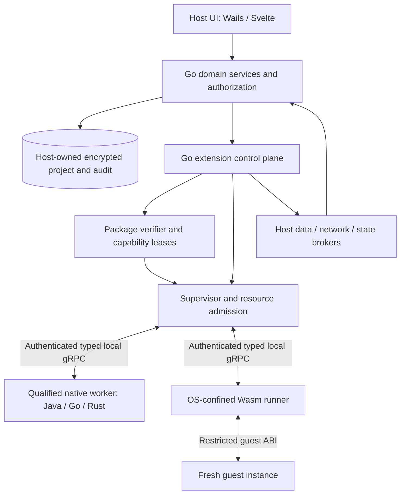

<!--
SPDX-FileCopyrightText: 2026 James L. Burns and The GoPMgr Contributors
SPDX-License-Identifier: GFDL-1.3-or-later
-->

# ADR-015: Capability-Secure, Resource-Bounded, Fault-Isolated Extension Platform

| Field | Value |
|---|---|
| Status | PROPOSED integrated design; no new implementation authorization or qualification |
| Date | 2026-11-13 |
| Decision owner | GoPMgr maintainer |
| Relationship | Supplements ADR-010 v2.2; does not supersede accepted decisions or authorize implementation |
| Evidence baseline | `main@ac20cbe711d9c03479cf937d82c5b7da991454d3`; supplied `5bd3ebe` claims retained in original archive |
| Identifier | ADR-015; source alias ADR-EXT-001; EXT requirement IDs remain stable |

## Integration authority and current evidence

This documentation integration is authorized by the current owner request. It
retains all EXT-Q01–Q10, EXT-D01–D14 and EX0–EX6 target identifiers; it does not
approve their implementation, runtime adoption, SDK or publication. The original
[ADR-EXT-001 source](reporting-extension/sources/ADR-EXT-001-GoPMgr-Secure-Extension-Platform.md)
is unchanged. [Execution sequencing](reporting-extension/implementation-plan.md)
[EXT requirement crosswalk](reporting-extension/extension-requirements.json) and
[acceptance strategy](../testing/reporting-extension-assurance.md) apply.

At the reviewed baseline `internal/interop/deps_pin.go` only retains dependencies
behind a build tag; `spikes/adr010-g0-transport` is feasibility evidence. Neither
establishes a production supervisor, registry, authenticated native worker or
qualified confinement. Existing ordered G1 authorization remains conditional on
its owner records and P04 conditions; new E0/E2 work is not thereby authorized.

The mandatory host-owned **internal capability registry** remains required by
ADR-010 D-02/QI-10. The offline invariant prohibits dependence on an **external**
registry or marketplace; it does not remove that internal component. Core project
operations must remain usable without an installed extension.

Typed mutation commands, revision checks, receipts and crash-safe recovery below
are future target controls. ARC-04 and applicable DEC-FORMAT/DEC-AUDIT/ADR-011
gates precede extension project-write capabilities; arbitrary existing App methods
are not an equivalent safe extension API. Imported facts must remain unmodified;
host-derived values are separately versioned and attributed. KRN-01/KRN-02 limit
claims for affected schedule and EVM calculations.

Use **EXT profile E0–E3** for execution trust, and **RILD evidence E0–E4** for
report qualification. Host-native read-only reporting and its qualification can
proceed without Wasm, MPXJ or an online service. A report export is nevertheless a
filesystem and disclosure effect: authorize destination and audience, publish
atomically, clean up cancellation and keep signing keys in the host. Shared
infrastructure does not merge file-import, report/export, provider or analytics
contracts into one universal schema or state machine.

## 1. Context and decision

GoPMgr requires a secure, offline-capable extension mechanism for native schedule interchange, reports, validation, risk analysis, and future external providers. It must preserve authoritative Go scheduling, encrypted persistence, exact financial calculations, audit continuity and project usability. The accepted ADR-010 already specifies a Go supervisor, typed gRPC over private operating-system IPC, and a bundled Java MPXJ reference worker. It does not approve arbitrary community executables.

**Decision:** retain one Go-controlled extension control plane and consistent semantic rules across separately versioned domain-family contracts. Prefer declarative extensions where sufficient, qualified native workers for capabilities that require them, and isolated WebAssembly for future untrusted executable extensions. Select a single production Wasm engine only after evidence-based qualification; no engine, public SDK or distribution service is adopted by this ADR alone.

Keep Go-native analytics and Arrow-Go as currently implemented. The 2026-11-09 DataFusion no-go and archived feasibility evidence remain binding historical context. Rust is a candidate language for specialized workloads, not a requirement to resurrect DataFusion or a separate privileged control plane. New Rust, Go or Java workers must use the same supervisor and authorization boundary.

### 1.1 Scope and non-goals

In scope: extension admission, contracts, runtime isolation, resource limits, lifecycle, data integrity, package trust, observability, compatibility, and qualification. Out of scope: approving new storage schema or migrations, replacing scheduling or money engines, reopening DataFusion, publishing a marketplace, approving a network integration, granting production code authorization, or altering the existing OS support policy. Full interchange fidelity, 50,000 editable activities and 100,000-activity stress qualification remain intact.

## 2. Normative invariants

The following SHALL requirements are additions; ADR-010 QI-01–QI-15 and D-01–D-19 remain binding. SHALL denotes mandatory target behavior once approved; candidate values and mechanisms explicitly marked provisional require separate evidence and approval.

| ID | Invariant |
|---|---|
| EXT-Q01 | Host alone owns authentication, DEKs, SQLCipher, audit, scheduling, exact money, project revisions and commit authority. |
| EXT-Q02 | A plugin receives only the minimum authorized data and executable capabilities; default deny; no implicit grant from a signature or manifest. |
| EXT-Q03 | Untrusted executable code must be confined by both a qualified guest sandbox and an independently enforced OS process boundary. Native community code is not a v1 capability. |
| EXT-Q04 | Failure, cancellation, revocation or resource exhaustion must not corrupt projects, lose acknowledged edits, or block ordinary host operations. |
| EXT-Q05 | Bound the complete pipeline, including compilation, decoding, buffers, host callbacks, process trees, persistent state and telemetry. |
| EXT-Q06 | All authoritative mutations require typed commands, validation, revision/epoch checks and atomic host persistence; no plugin SQL or direct database access. |
| EXT-Q07 | Preserve existing audit bytes, historical hashes, evidence and recovery semantics; changes append records rather than rewrite history. |
| EXT-Q08 | One production Wasm engine and one supervisor; one selected native transport per platform/release; no runtime or transport fallback that silently weakens security or support. |
| EXT-Q09 | Core works without plugins, cloud services, an external registry, external credentials or online license validation. |
| EXT-Q10 | Security, performance and fidelity claims require reproducible evidence on supported installed platforms; BLOCKED and NOT RUN are not PASS. |

## 3. Architecture and trust boundaries

Only the trusted host may connect to project persistence or credential stores. Native code, runtime engines, guest code, inputs and results are distinct trust surfaces. The runner has a narrow job-scoped credential, no host keys and no general privileged callback. Worker authentication establishes identity and session binding, not correctness or harmlessness. A signed native parser remains a potential compromise point when processing hostile files.

| Profile | Default execution and scope |
|---|---|
| E0 declarative | Host-validated bounded templates, report layouts and configuration; no arbitrary scripts, shell expressions or remote asset loading. |
| E1 bundled native | ADR-010 supervised process; Java MPXJ first; native Go/Rust where evidence justifies. Confinement must be measured; disclose any existing ambient authority and block unsupported security claims. |
| E2 community Wasm | OS-confined runner with restrictive guest imports, fresh instance per job and no ambient WASI permissions. Release only after E2 gates. |
| E3 community native | Deferred; separate ADR and threat review; not enabled by installing a signed package. |

Network access is an orthogonal capability, not a runtime class. No plugin may silently promote itself to a higher trust profile. An E1 worker must not become a general arbitrary native-code loader.

## 4. Runtime and language selection

**EXT-D01:** Go owns registry, policy, admission, supervision and domain validation. Preserve ADR-010 native Protobuf/gRPC contracts and platform transports. Java remains the initial MPXJ implementation; Rust or Go may implement future compute workers. Do not load Go `plugin` shared objects, native dynamic libraries, JNI or arbitrary JavaScript into the privileged host.

**EXT-D02:** Compare wazero (Go, core Wasm) and Wasmtime (Rust, Component Model support) as separately executing runner candidates. Evaluate identical semantics, representative guest workloads, all supported platforms, isolation, cancellation, compilation cost, memory, dependencies, license/security maintenance, signing and packaging. A candidate that cannot satisfy mandatory controls is ineligible regardless of performance. Prefer the simpler eligible candidate when the richer runtime has no demonstrated product benefit. Select Wasmtime/WIT if required typed components and measured capabilities justify it; select wazero with a small versioned core-Wasm ABI if equivalent security, ergonomics and performance are demonstrated. Do not assume the two expose identical APIs or support the same guest binaries. Do not ship both initially.

**EXT-D03:** Keep one reference SDK initially. Rust is a preferred candidate for numerical/complex guest code; Go for native integration and a future guest SDK when compiler/ABI compatibility is proven. Language and runtime selection are separate decisions. No promise of universal language compatibility. No dependency pin or SDK stability commitment before qualification.

## 5. Contracts, data plane and permission broker

**EXT-D04:** Define canonical semantic contracts (types, units, precision, identity, presence, ordering, errors and invariants), with generated Protobuf messages as the native wire contract. If a Component Model runner is selected, expose narrow WIT worlds, with an explicitly versioned mapping and golden conformance tests. Otherwise use a minimal reviewed core-Wasm ABI with bounded typed payloads (candidate: existing Protobuf messages). Do not build a speculative schema compiler or a generic JSON/`Any` gateway. The chosen guest ABI must not expose raw host memory, pointers or privileged services. Generated bindings and compatibility checks are release artifacts.

Separate lifecycle/control messages from business data logically; use the existing authenticated gRPC connection with independently bounded streams, not a second transport. Keep control handling independent of full data queues and enforce outer supervisor cancellation even if HTTP/2 flow control stalls. Host creates endpoint; worker connects; mutual launch proof and peer identity precede work. Preserve G1 single-instance limits, restricted ACLs, remote-client rejection, one-shot bootstrap, fixed selected transport per OS and no automatic TCP/stdio business-data fallback.

**EXT-D05:** Issue opaque, non-delegable, job-scoped handles. Effective authority is the intersection of requested capability, signed operation policy, supported host operation, principal authorization, project/field scope, job lease, current session epoch and runtime policy (plus remote binding and OAuth scope where applicable). Bind leases to account incarnation, project copy, revision/generation, operation ID, artifact digest and expiry. Validate on every broker call and again at commit; deny unknown capability, enum, schema or handle. Revocation invalidates leases and cancels the job; it cannot erase bytes already disclosed. Cache only immutable policy evaluation within the same lease/epoch and invalidate on policy change. No transitive permissions or plugin-to-plugin calls in v1.

No guest receives database paths, DEKs, credentials, arbitrary SQL, raw sockets or raw Wails bindings. Host brokers return bounded, scoped fields and opaque cursors/handles. Plugin settings and any retained state are host-managed, encrypted if sensitive, namespaced by account/project/plugin identity, quota-limited and retention-controlled. No persistent state by default. Extensions cannot alter retention or write audit records directly. External requests, if separately approved, use fixed policy routes, typed queries, destination allowlists, redirect restrictions, TLS verification, byte/rate/time limits and explicit data-transfer consent. OAuth secrets remain host-private. Treat plugin output as untrusted; no automatic HTML, active SVG, executable report or formula injection.

## 6. Isolation and secure execution

**EXT-D06:** For E2, require a restricted Wasm guest plus an OS-confined runner. Start containment before guest compilation, module loading or untrusted input. No inherited environment secrets, arbitrary file descriptors/handles, working directory authority, privileged tokens or general-purpose WASI imports. Allow only required read-only runtime artifacts and authenticated IPC. Disable network, process spawning, shared memory, guest threads, dynamic linking, unsafe runtime features and persistent storage unless separately justified and qualified. Guest imports, compilation inputs, stack depth, memory/table counts and size are bounded. For reproducible compute, deny ambient clock/random imports or supply explicit host-approved inputs; do not expose a general system clock, random or environment API by default. No guest-provided precompiled native code or executable cache. Any required runtime JIT or interpreter configuration must be qualified with OS policies; use a reviewed interpreter if native executable memory is unavailable only as a separately selected and tested configuration, never as an automatic fallback. No debug/core dumps containing project data in production.

| Platform | Candidate controls; must prove installed behavior |
|---|---|
| Linux | Namespaces, no-new-privileges, seccomp, Landlock/other LSM as appropriate, cgroup v2 resource accounting; test actual kernel/ABI and delegation. Landlock alone is not a universal network or descriptor sandbox. |
| macOS | Signed/notarized helper, reviewed App Sandbox entitlements, restricted resources and IPC, explicit testing of JIT/signing compatibility and aggregate limits; signing/hardened runtime alone is not a sandbox. |
| Windows | AppContainer or demonstrated equivalent confinement, restrictive named-pipe ACLs, process-handle identity, Job Objects for tree/resource enforcement; a restricted token or Job Object alone is not sufficient isolation. |

Test inherited handles, symlinks/reparse points, registry/keychain, network including IPv6/UDP/local IPC, process injection/signals/debugging and unauthorized child creation. Detect missing containment prerequisites and deny E2 execution before any project disclosure. Keep core and existing approved E1 functions available subject to their own qualification; no downgrade from E2 to unconfined execution. An OS administrator, compromised host/kernel or already-exfiltrated data is outside the stated plugin isolation guarantee; side channels are bounded by minimizing shared state and secrets, not claimed eliminated.

## 7. Performance, resource control and lifecycle

**EXT-D07:** Reserve resources before accepting work. Enforce global, account, plugin and job budgets for resident memory/commit charge, CPU, wall time, process count, disk, in-flight bytes, records, open descriptors, compilation and log volume. Account for host, runtime, compiler, guest, native allocations, transport buffers and process descendants. Keep explicit capacity for interactive scheduling and persistence. Use fair bounded queues, cancellation-aware workers and typed RESOURCE_EXHAUSTED responses; no unbounded retries or queues. Hard limits require OS enforcement where available and qualified equivalent controls elsewhere; measured RSS alone is not enforcement. Runtime fuel/epoch/deadline controls do not stop blocking host callbacks; broker calls need their own deadlines and outer termination.

**EXT-D08:** Use credit-based bounded batches atop gRPC flow control. Reserve bounded decode/expansion budgets before processing; enforce limits incrementally as decompression and decoding proceed and reject before exceeding allocation limits. Cap per-record expansion, metadata, nesting and concurrent streams. Release credit only after the consumer has processed or safely staged the batch, not merely received it. Enforce maximum message sizes and compression expansion; reject oversized inputs with explicit errors, never silent truncation. Use field projection, stable keyset pagination or bounded snapshots, compact typed records and incremental aggregation. Do not hold SQLCipher write locks across IPC or long-lived read transactions across UI interactions. Revision-bound snapshots must not mix revisions; use approved host snapshot/staging mechanisms or restart on revision change. Avoid whole-project copies and redundant JSON/base64 transformations. Do not introduce shared-memory transport, Arrow IPC or a columnar runtime until profiling demonstrates need and a separate security review proves immutable ownership, bounds and cleanup.

**EXT-D09:** Retain one job per process initially, matching ADR-010. For Wasm, instantiate a fresh store/instance with fresh handles per invocation. Prefer measured optimizations in this order: reduce data volume/copies, batch host calls, reuse verified compile artifacts, then consider process pooling. Compile/validate untrusted modules in bounded confined workers; a host-generated cache may contain executable machine code and must be version-, engine-, configuration-, platform-, CPU-feature- and digest-bound, authenticated or regenerated, size-limited and atomically published. Never deserialize third-party supplied compiled code. No project payload in a shared compile cache. If a candidate needs a privileged cache or an unverified executable loader, reject it. A compiler output may be shared only when it contains no project data and its integrity is maintained against lower-trust processes. Prefer in-memory or disposable compilation when a secure persistent cache is not feasible.

Optional reuse requires separate approval and evidence of safe reset, bounded lifetime, memory high-water recycling, fresh authentication, no stale handles, no pending callbacks, and no cross-account/project/permission-domain residual state. Do not reuse an untrusted runner across different principals or plugin artifacts. Pool only after showing a material p95 benefit; cold-process fallback is permitted only as the already approved isolation-preserving lifecycle, not as a transport/runtime fallback.

**EXT-D10:** Lifecycle: VERIFIED -> ADMITTED -> STARTING -> AUTHENTICATED -> RUNNING -> DRAINING -> REAPED, with FAILED/CANCELLED/QUARANTINED outcomes and explicit commit state. Use the existing ADR-010 lifecycle vocabulary in code; this is a semantic refinement, not a competing state machine. On cancel/revoke: close admission, invalidate lease, cancel callbacks/streams, bounded graceful shutdown, terminate process tree, reap, release resources only after verified cleanup. Never report a process reaped just because a kill signal was sent. A successful commit is not converted into a cancellation; recover the durable receipt. Repeated crashes open a per-artifact circuit breaker; no automatic restart of non-idempotent operations. Failures disable the affected extension, not the core; preserve typed diagnostics and explicit user retry. Host startup reconciles owned job journals and orphaned processes safely without deleting unrelated files or legacy projects.

### 7.1 Proposed qualification budgets (not measured or approved)

Finalize against DEC-HARDWARE and representative installed builds before running acceptance tests. The following are starting hypotheses, not promises; any adjustment needs recorded evidence and owner approval, not retrospective relaxation after failure.

| Metric | Initial engineering target |
|---|---|
| Interactive core under plugin load | p95 core edit/query latency <= 1.20x matched plugin-disabled baseline AND within approved absolute UX budget; no starvation or acknowledged edit loss |
| Plugin-disabled overhead | p95 startup/representative edit latency <= 1.05x baseline; no runner started or loaded solely by opening a project |
| Standard-analysis job envelope | 64 MiB guest linear-memory starting cap, 256 MiB aggregate in-flight decoded data per job upper bound subject to lower host budget, 1 MiB target batch, 4 MiB maximum decoded message; tune from fixture evidence and enforce effective minimum |
| Admission on proposed 8 GiB minimum test host | Start with one active analysis job and a 512 MiB combined incremental host+runner memory reservation; keep >= 2 GiB or 25% of physical RAM, whichever is greater, as system headroom; large jobs require separately measured profiles; do not promise these values fit MPXJ |
| Small pure-compute Wasm invocation | p95 warm-artifact, fresh-instance launch-to-result <= 250 ms for a fixed 100-task reference check; record cold compilation separately |
| Cancellation | p95 host acknowledgement <= 100 ms; target process termination/reap <= 2 s on qualified supported platforms, without overriding existing G1 provisional bounds; unreaped process remains unhealthy |
| Memory and lifecycle stability | 1,000 start/cancel/fail cycles and 8-hour mixed workload; no leaked children/handles or monotonically growing retained state; compare post-cleanup memory trend to controlled baseline |
| Large schedules | 50,000 editable tasks acceptance; 100,000+ stress and million+ timephased points; verify end-to-end correct results, bounded memory and responsive UI; no silent caps |

Record cold/warm, p50/p95/p99, peak private/aggregate memory and CPU, compile/launch, IPC bytes/copies, queue time, validation and commit separately. Use at least 30 independent runs for p95 exploratory comparisons and 100+ for tail characterization; publish sample size, distributions, hardware, OS, fixture and revision. Do not present a noisy p99 as reliable with too few samples; expand runs where needed. Compare equivalent workloads and security settings. Performance cannot override security or numerical correctness.

## 8. Correctness, transactional safety and reproducibility

**EXT-D11:** Plugin results are observations or proposals, never authoritative changes. Host validates type, range, completeness, provenance, IDs, relationships, calendars, exact money and domain invariants; preserve imported observations and original representations; validate or calculate separately identified host-derived schedule/EVM results under the applicable domain contract. Financial values use approved exact representations and explicit rounding; large integers/decimal values crossing Wails use lossless encodings. Reject NaN/Infinity and invalid enum values. A stochastic algorithm records version, seed/PRNG, input revision/digest, parameters and applicable reproducibility tolerance; do not imply bitwise equality across CPUs unless demonstrated. Use independent numerical oracles and representative reference fixtures.

Approve exact canonical proposal digest, operation, affected scope, expected revision, principal, session epoch and expiry. Host rechecks in the atomic commit boundary; stale results remain viewable only with clear stale status and require new validation/approval. Cancellation is honored before commit; after durable commit return/reconcile the committed receipt. Use idempotency keys and unique receipts; do not claim exactly-once external effects. No remote calls within project writer transactions. Import publication, retained evidence, recovery journals, shadow generations and schema migrations remain under ADR-010/011; no replacement of existing records or bypass of DEC-FORMAT/DEC-AUDIT. Audit append and authoritative local state change use the approved atomic transaction/recovery contract. If this contract cannot support the operation, block it.

## 9. Package trust, installation, compatibility and upgrades

**EXT-D12:** Start with release-bundled, digest-pinned artifacts. Public package format (provisional `.gopplugin`) requires separate approval. Use one reviewed canonical manifest encoding and established signature verification library; authenticate the complete artifact inventory, entrypoint, identity, API ranges, runtime profile, permissions, digests, dependencies and publisher key identity. Reject duplicate keys/paths, traversal, symlinks, hardlinks, case/Unicode collisions, archive bombs, undeclared files, excessive sizes and unknown critical metadata. Validate before activation; use private staging, immutable content-addressed storage and atomic activation. Verify the actual bytes opened for execution using protected handles or equivalent race-resistant mechanism; checking a pathname and reopening it is insufficient. Prevent plugin-controlled modifications of its package or trust store. A signature proves provenance under a trust policy, not benign behavior.

Separate trust roots, publisher keys and local grants. New publisher trust and permission expansion require explicit approval. Installation requires no mandatory online account. Signed offline revocation/trust metadata supports disconnected users; do not claim knowledge of revocations not received. Block new installations if freshness policy cannot be met; existing execution follows explicit owner-approved offline policy, with visible trust age and known-revoked artifacts denied. Protect monotonic metadata/version state within the stated local threat model; local administrator rollback cannot be solved by a local counter alone. If an update repository is introduced, evaluate TUF with threshold root trust, delegated roles, expiry and rollback/freeze/mix-and-match protections. TUF is not required for initial bundled packages and does not replace artifact verification or OS signing.

**EXT-D13:** Version manifest, control protocol, capability families, guest ABI and plugin-state schemas independently. Negotiate before disclosure; unknown major versions/critical features fail closed, optional compatible fields must preserve semantics. Never reuse Protobuf field numbers; preserve reservations; apply compatibility checks and golden vectors. Pin active job to exact artifact and contract versions; upgrades drain or cancel running jobs before activation. Keep the previous qualified, non-revoked compatible version for explicit rollback; do not downgrade trust metadata or project writer schema. Plugin state migrations are host-approved, staged, recoverable and separate from project migrations. Removing a plugin disables future jobs but does not erase project records, audit evidence or retained results; state archival/deletion requires explicit reason, authorization and logged retention action.

## 10. Observability, maintenance and assurance

**EXT-D14:** Separate append-only forensic receipts from bounded operational metrics and opt-in diagnostic logs. Record artifact digest, runtime and policy version, principal/project reference, input/output digest, revision, operation ID, authorization and outcome; retain enough encrypted evidence for reproducibility under approved policy. Do not log payloads, tokens, keys, sensitive field values or raw stdout by default. Rate-limit and sanitize worker output; use structured reason codes and local metrics with no mandatory telemetry. Required audit failure blocks material commits; optional diagnostic failure must not disable ordinary work. Quarantine repeat failures and known-vulnerable runtime versions; maintain SBOM, provenance, pinned dependencies, vulnerability handling, reproducible package inventories, licensing review and platform signing. Do not expand the trusted code base without a demonstrated use case.

## 11. Qualification and staged authorization

No stage below authorizes implementation. Obtain separate owner-approved work slices. Existing G1 conditional approval and ADR-010 gates are unchanged; DEC-INTEROP, DEC-FORMAT, DEC-AUDIT, DEC-HARDWARE and DEC-WINDOWS remain independent.

| Gate | Evidence required | Blocking outcome |
|---|---|---|
| EX0 contract and threat review | Inventory existing code; map invariants to ADR-010/011; owner-approved threat model, workload budgets, platform matrix and scope | No new runtime dependency until reviewed |
| EX1 native foundation | Existing G1 ordered slices, real IPC authentication/admission/cancellation and plugin-disabled regressions; MPXJ separately gated | Do not ship unqualified native worker |
| EX2 runtime feasibility | Two isolated candidates or documented evidence eliminating one; comparable guest ABI, hostile inputs, dependencies, licensing, resource and performance evidence | No candidate adoption until all hard requirements pass |
| EX3 confinement and resource tests | Installed Windows/macOS/Linux claims; guest escape, malicious callbacks, process/FS/network restrictions, aggregate limits, host crash and cleanup; offline behavior | E2 unavailable on unqualified targets; no support-policy change without ACR |
| EX4 semantic and persistence tests | Cross-language vectors, stale leases/proposals, concurrency, exact money, import fidelity, atomicity, power-loss/recovery and immutable audit history | No project-write capability until applicable ADR-011/host gates pass |
| EX5 package and SDK | Tamper/replay/rollback/revocation, TOCTOU, archive fuzzing, trust recovery, version compatibility, independently implemented reference plugins | No public installation/update until qualification |
| EX6 product qualification | Representative 50k/100k schedules, tail latency, soak, installed signing, accessibility, independent adversarial review and reproducible evidence | No marketplace/public executable release until explicit approval |

Minimum adversarial corpus: infinite loop, memory/table/stack growth, compile bomb, slow consumer, malformed protobuf/Wasm, decompression bomb, huge single field, resource-limit race, host callback deadlock, stale handle, cross-project access, forged approval, duplicate commit, wrong peer/replay, malicious package signature and artifact swap, unauthorized network/files/child process, abrupt host/worker death, OS suspend/resume and disk exhaustion. Include property/fuzz tests, race tests, deterministic fault injection, process-tree inspection, installed binary tests and independent red-team review. Preserve exact commands, revisions, dependency pins, hardware, outcome and logs; PASS/FAIL/BLOCKED/NOT RUN separately. Tests must not be weakened to qualify a release.

## 12. Alternatives and consequences

| Alternative | Disposition |
|---|---|
| Go-only extensions | Reject language restriction; Go remains primary host and can implement the runner if qualified. |
| Native dynamic loading | Reject privileged process/ABI coupling and weak isolation. |
| In-process Wasm | Reject for untrusted public extensions: smaller deployment cost does not justify single-process blast radius. |
| Mandatory Wasmtime/WIT now | Defer adoption; richer contract tooling may justify it, but must beat requirements and maintenance tradeoffs. |
| Multiple production runtimes or automatic fallback | Reject initially; doubles qualification burden and can hide failures. |
| Native-only worker ecosystem | Retain for bundled use; insufficient default for untrusted public extensions. |
| Containers/VMs | Consider only for separately justified deployments; not mandatory desktop dependency. |

Consequences: independent processes and security verification impose startup, IPC and maintenance cost; typed contracts require disciplined compatibility work. In return, extension failures and updates need not compromise host availability or project integrity. Performance optimization prioritizes data reduction and evidence-backed reuse, not weakening containment. Public SDK/marketplace remains deferred until actual use cases justify a runtime and the release gates pass.

## 13. Open decisions and change control

Owner decisions required: acceptance of the detailed ADR; E2 launch scope and target platforms; runtime/ABI/SDK selection; absolute latency and resource profiles; supported guest operations; offline trust freshness and revocation policy; package signature/trust format; confinement mechanism and any new dependencies; approved state retention; release and support matrix. No implicit approval of Rust, Wasmtime, wazero, WIT, TUF or a public package format. Architecture changes to accepted requirements need an ACR; record alternatives, evidence, tradeoffs and rollback before implementation. Do not rewrite the historical ADR-010 or archived DataFusion evidence.

## 14. Sources and verification status

Repository primary records listed in the supplied draft (historical reference list; the integration baseline is recorded above):

1. [ADR-010 v2.2](https://github.com/draconianneocoder-cpu/GoPMgr/blob/main/docs/design/ADR-010-plugin-architecture.md), especially QI-01–15 and D-01–19.
2. [G1 transport design](https://github.com/draconianneocoder-cpu/GoPMgr/blob/main/docs/design/adr-010-g1-transport-design.md) and [October 28 authorization clarification](https://github.com/draconianneocoder-cpu/GoPMgr/blob/main/docs/review/ADR-010-G1-authorization-clarification-2026-10-28.md).
3. [Current project status](https://github.com/draconianneocoder-cpu/GoPMgr/blob/main/docs/STATUS.md), baseline 5bd3ebe.
4. [Contract and recovery reference](https://github.com/draconianneocoder-cpu/GoPMgr/blob/main/docs/design/CONTRACT-AND-RECOVERY-REFERENCE.md).
5. [ADR-012 DF0-G no-go report](https://github.com/draconianneocoder-cpu/GoPMgr/blob/main/docs/testing/adr-012-df0-g-report.md), 2026-11-09.

Upstream technical references listed in the supplied proposal (not GoPMgr qualification; adoption requires a fresh version-matched review):

6. [Wasmtime security](https://docs.wasmtime.dev/security.html), [configuration](https://docs.wasmtime.dev/api/wasmtime/struct.Config.html), and [resource limiter](https://docs.wasmtime.dev/api/wasmtime/trait.ResourceLimiter.html). Development API docs are capability evidence, not approved release pins.
7. [wazero documentation](https://wazero.io/docs/) and [source](https://github.com/wazero/wazero).
8. [WebAssembly Component Model WIT reference](https://component-model.bytecodealliance.org/design/wit.html).
9. [Linux Landlock](https://docs.kernel.org/userspace-api/landlock.html), [Apple App Sandbox](https://developer.apple.com/documentation/security/app-sandbox), [Microsoft AppContainer isolation](https://learn.microsoft.com/en-us/windows/win32/secauthz/appcontainer-isolation).
10. [The Update Framework specification](https://theupdateframework.github.io/specification/latest/), v1.0.37 (2026-10-08).

This integrated architecture remains proposed. Source and decision reconciliation is recorded in the integration review; documentation changes do not establish runtime benchmarks, penetration tests or installed-platform qualification. No production dependencies, permissions or releases were changed by this integration. Numerical budgets are deliberately provisional, and containment availability and runtime selection are unresolved until measured. All previous accepted GoPMgr requirements remain in force.
