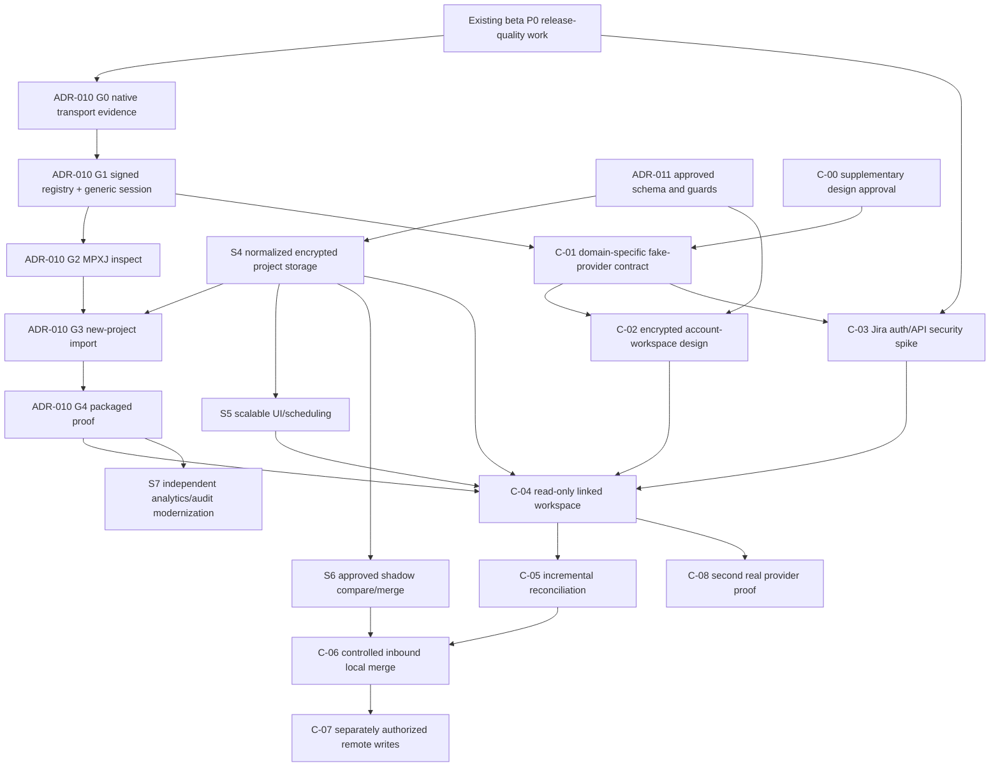

<!--
SPDX-FileCopyrightText: 2026 James L. Burns and The GoPMgr Contributors
SPDX-License-Identifier: GFDL-1.3-or-later
-->
# Proposed GoPMgr roadmap insertion — provider-neutral integrations

**Status:** framework approved **in principle** on 2026-10-28; proposed staged roadmap, not merged into `docs/ROADMAP.md`, no implementation work authorized, delivery dates uncommitted.

**Normative architecture:** `ADR-TBD-provider-neutral-integration-framework.md` and accepted ADR-010/ADR-011 after maintainer approval. This plan does not turn proposed gates into completed ones.

## 1. Roadmap precedence and protection of current delivery

At observed `main@ec7b73ab7d913a2398d333f6dad9ea5734ee8f93` (2026-10-28; confirm at each work-package start), the live roadmap prioritizes protecting stateful editor changes, installer/upgrade validation, signing/notarization trust, and accessibility. `docs/beta-release-backlog.md` explicitly defers net-new features unless security/data-loss/release-blocking. **Do not divert active P0 beta work to Jira.** The live `docs/VISION.md` primarily targets 20–500-task small teams; >10k/50k scheduling and cloud integration are program evolution requiring an explicit maintainer-approved vision/roadmap decision. Do not rewrite vision as if already accepted.

**Recommended allocation:** document contract now; implement shared generic foundations as part of *already justified* ADR-010 and ADR-011 work; develop an isolated Jira feasibility spike only after relevant release protection gates; ship read-only Jira only after storage/transport and privacy/auth evidence; defer all cloud writes until selective-merge authority is proven.

## 2. Dependency graph (logical, not calendar scheduling)

**Note:** ADR-010 G1/G2 must not wait on Jira. The Jira spike may experiment on a feature branch with a fake host; it cannot claim production readiness until G4 and the schema/quality gates. DataFusion/Arrow replacement of DuckDB is a **parallel independent track**, not a cloud integration dependency—only tested stable typed analytical interfaces can be consumed. Iceberg is not a prerequisite and must not become an online project database.

## 3. Proposed work packages, deliverables, and release gates

| ID | When relative to existing roadmap | Deliverables | Must be proven before exit | Must NOT do |
|---|---|---|---|---|
| **C-00** | **Now**, design only, parallel to non-disruptive review | Reconcile accepted-in-principle supplemental ADR with repo ADR hierarchy, domain-family contract, threat model, integration/vision impact, named gate owners and change-control ledger | Maintainer performs explicit normative-ADR acceptance or records blockers; classify implementation as NOT RUN | No feature merge, schema migration, plugin marketplace, beta diversion |
| **C-01** | With ADR-010 **G0/G1**, not ahead of them | One shared registry/supervisor/IPC envelope, domain-specific `external-work` contract and signed provider-operation-policy schema, fake adapter (no cloud) | Native IPC for claimed OS/language, signed manifest/policy, cross-version protobuf tests, future-family extension test, no Jira imports in core | No one-size-fits-all `Any` protocol, Jira-specific core, unverified Windows fallback |
| **C-02** | With ADR-011 **S0–S4** design | **Separate account-encrypted integration workspace**, per-project materialization and account credential vault; bindings, source identities, typed observations, checkpoints, schema/version fences, import saga | Tested cross-store crash/duplicate-ack recovery, independent encrypted backup/restore, cipher/foreign key/integrity, old-project compatibility, multi-process fencing, scoped consent/retention | No assumption of cross-DB atomicity; no new writes against legacy charts; no token in project or `system.db` |
| **C-03** | After beta P0 protection, strictly limited isolated spike | Official auth alternatives, Jira enhanced search, scoped metadata/ADF, sparse inventory, eligible bulkfetch, changelogs, rate quotas, fake/test-tenant fixtures, broker bypass/OS threat validation | Auth topology proof or BLOCKED; per-platform Go native IPC independent of MPXJ Java G0; tenant-scoped signed endpoint rules; measured quota and completeness behavior; no public claim | No API-token collection, no client secret in binaries, no redefinition of P0 |
| **C-04** | **After G4 + S4/S5 and C-03 success**; first eligible cloud release | Project-less linked workspace backed by encrypted account store, manual read-only sync, scoped connected/bound views, encrypted caching, pagination, Job Center, provenance/fidelity report and accessible UI | PI acceptance matrix, complete-or-old snapshot atomicity, auth/privacy/retention, power-loss/restore, packaged OS support, measured 50k class with quota attribution | No implicit project creation, automatic schedule mutation, outbound writes, or claimed global Jira snapshot transaction |
| **C-05** | After actual read-only field reliability | Read-only deltas, overlap and inventory repair, fair tenant/app scheduling, cache invalidation, local-only observability, user-selected sync schedules | crash/power interruption, token rotation, 429/5xx, ambiguous 403/404, no false deletes, multi-process lock and duplicate scan recovery | No webhook-dependent correctness or background service by default |
| **C-06** | Only after **ADR-010 S6 compare/merge**, approved ADR-011 shadow generation and C-05 | Field-level inbound compare/selection, explicit mapping changes, dry-run; local canonical apply with immutable receipts | three-way diff, ownership, atomic active-generation switch, old/new version/backup, fresh-approval checks | No implicit Jira->CPM or source-wins field updates |
| **C-07** | Separate maintainer go/no-go after C-06 and G-C-WRITE | Outbox + typed provider writes, first narrow safe operation, re-read confirmation, conflict UX, kill switch | remote unknown-result and race/permissions evidence, usable undo limitations, read/write scope separation, real Jira permission matrix | No unattended mass edits, generic status PUT, exactly-once guarantee |
| **C-08** | **Before claiming general provider-neutral maturity**; after C-04, can run parallel to C-05 | Implement second materially different provider against same external-work contract, signed policies and account-store lifecycle; add one different-family synthetic adapter to test shared registry | No rewrite of host/canonical schema; capability negotiation, auth/scope/retry differences, format/schema migration, 50k-like fixture, shared broker resource fairness | No public SDK/marketplace or arbitrary downloaded third-party binaries |
| **C-09** | Separately approved future | Optional Forge panel/links inside Jira, or third-party marketplace via new ADR | Atlassian Forge compliance and independently reviewed sandbox/remote authority | No legacy Connect investment, no dependency for GoPMgr offline core |

**Sequencing detail:** C-00 can be reviewed now without waiting for G1; C-01 follows demonstrated G1 transport/protocol, and C-02 requires ADR-011 schema approval before any persistence PR. The C-08 test is independent of any outbound-write release: the read-only framework MUST prove a second real provider before it is advertised as generally extensible. If only Jira is shipped, label it **Jira-only, built on candidate neutral interfaces**, not a proven universal connector platform. No C-04 release is allowed to bypass G4/S4/S5; a scope reduction needs a maintainer ACR with independent evidence.

 `C-00` and *neutral* C-01 contract work can occur early because they preserve future options without feature creep. A Jira Cloud real-data production integration cannot ship until **G4 + S4 + S5 + C-03** are satisfied. C-06 cannot start production code until S6 is actually ready. The merge and controlled write tracks are **not** release promises or license to weaken earlier gates.

## 4. Quality thresholds (proposed until approved hardware/fixtures)

### Mandatory correctness and durability (zero tolerance)

- No partial staged snapshot presented as complete; no unauthorized local project writes; no cloud writes in read-only mode; no access across local accounts/project copies/Jira sites; no plaintext tokens in worker and persistent project/logs.
- Every `COMPLETE` account-workspace snapshot reopens cleanly with correct field/record counts and independently recomputed digests; staged project imports additionally require project-owned evidence and sealed publication; typed audit chain is intact; old `.gopmgr` files remain usable under explicitly tested migrations.
- Every crash injection cut point yields: prior committed revision or fully committed new revision, never mixed/partial; lost remote write response yields `OUTCOME_UNKNOWN` with no automatic unsafe resend.
- Auth expiry/permission loss or partial search never becomes an automatic delete. A user can stop network and continue local project work.

### Target scale classes (consistent with ADR-010, not performance claims)

- `T0`: 100–500 realistic work items; accessibility and user-flow correctness.
- `T1`: 10,000 objects, large custom fields/epics/dependency relationships.
- `T2`: 50,000 work items **target**; demonstrate initial plus incremental sync and interactive access on maintainer-approved minimum hardware and an API rate-limited test environment.
- `T3`: 100,000+ work items/large field histories stress only; failure under resource caps must be safe, bounded and clear.
- No fabricated timing or p95; establish per-OS budgets at C-03 using real sample distributions. Profile whole pipeline: OAuth connect, process startup, requests/quota, network bytes, mapping, SQL writes, DB/WAL/checkpoints, RSS, temporary bytes, first paint, scrolling, shutdown, backup and restored reconnect.

### Cross-cutting compatibility and capacity gates

- **C-GATE-EXT:** a second real provider (C-08) proves the provider interface prior to *provider-neutral production maturity* claims, while an independently simulated analytics/report module proves that shared registry does not force the external-work schema on other families.
- **C-GATE-STORE:** account workspace and project materialization survive 30+ enumerated crash cuts, concurrency/fencing and lost acknowledgment without duplicate projects or cross-account leakage; use verified encrypted restore and unrecoverable-fork/rebind UX.
- **C-GATE-PERF:** budgets measured at minimum and recommended hardware for real fixtures, including max RSS/IPC/in-flight bytes, database page/WAL size, 50k query first paint, quota-limited API wall time, fair scheduling under two connections, cancellations and battery impact. Fail safely on resource caps; do not promise a cloud deadline controlled by Atlassian quotas.
- **C-GATE-PROTO:** two protocol revisions coexist during rolling worker updates, descriptor golden fixtures/reject tests pass, and each signed provider operation-policy can be revoked independently without rebuilding GoPMgr's scheduling kernel.

### Coverage and fidelity

- Define supported Jira project/issue/Agile functionality by API and enterprise configuration, not marketing claim of full fidelity. Each record-group matrix specifies `read`, `write`, `lossless representation`, `editable`, `exportable`, and tested field families.
- Preserve absent/null/unreadable/forbidden distinctions. ADF text, custom-field schemas, user references and links have their own fixtures; demonstrate no invented conversions to CPM, time or money.
- Verify API, auth, webhooks, and Forge behavior from current primary Atlassian docs before each release. “Blocked” or “not run” is never counted as “passed”.

## 5. Repository and PR cadence (small independent approvals)

1. **Design PR** — accepted-in-principle ADR with explicit final approval state, roadmap/test matrix, review findings and ADR hierarchy reconciliation; no code or implicit acceptance of ADR-010/011.
2. **Contract PR** — generated proto/schema descriptors + fake-provider contract tests, generic G1 provenance, no Jira networking.
3. **Persistence PR** — gated ADR-011 **account workspace and project** schema/migrations, vault lifecycle, import saga, crash fencing, format-version and recovery tests, disabled by default.
4. **Broker/security PR** — account vault and network broker, typed endpoint policy, negative security tests, no actual OAuth until G-C-AUTH approved.
5. **Read-only adapter PR** — first-party Jira worker on fake remote and isolated official test tenant, no shipping flag.
6. **Local linked-snapshot PR** — account-encrypted linked workspace, durable reconciliation and UI browsing with optional, *separately authorized* new-project materialization; existing-project merge excluded.
7. **Release integration PR** — signed packaged tests on each advertised OS, simulated failures, supported-provider claims and human test evidence.
8. **Subsequent work** — C-05+ isolated behind separate ADR acceptance and release flags; never fold future write paths into initial read-only PR.

For each PR publish: changed files, user-observable effects, new schema/proto compatibility, security posture, test IDs, baseline evidence, migration rollback limits, version pins/SBOM/licenses, unanswered BLOCKED gates, and explicit maintainer approval where required. Check `AGENTS.md` and current repository status before implementation. Do not stage or commit unrelated work.

## 6. Decisions requested from the maintainer

1. Authorize C-00 as a **proposed** supplemental ADR and roadmap negotiation, not implementation.
2. Confirm priority: finish current beta P0 and ADR-010 G0–G4 / ADR-011 S0–S5 before **shipping** Jira read-only connector. The architecture may be designed sooner.
3. Decide whether to amend the product vision for larger schedules and optional cloud interoperability while maintaining local-first use and a small-team-quality UX.
4. Commission an independent security/privacy/operating-cost analysis of Atlassian-compliant OAuth topology before C-03 exit.
5. Maintain **read-only first**, and explicitly require S6+remote concurrency proof before any remote write claim.
6. Require a second **materially different real provider** conformance implementation plus a synthetic different-family adapter before declaring general extensibility; Jira may ship beforehand only with accurately narrow claims.
7. Explicitly approve or reject the new account-encrypted integration workspace boundary and separately recoverable project-import saga; this closes the v1 storage contradiction.

**No dates are assigned:** ordering is based on proved dependencies, not speculative calendar estimates. A missed technical gate blocks the dependent feature, not the core application or existing release plan.
