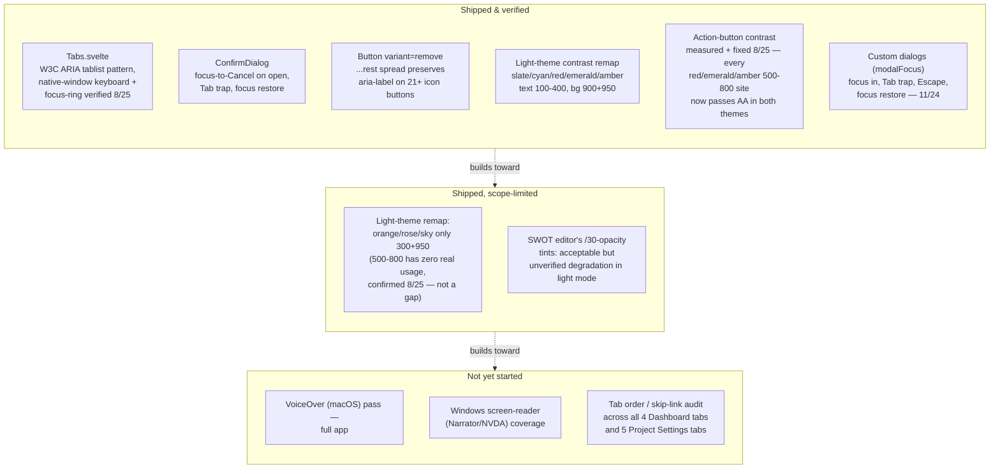

<!--
SPDX-FileCopyrightText: 2026 James L. Burns and The GoPMgr Contributors
SPDX-License-Identifier: GFDL-1.3-or-later
-->

# Accessibility — coverage map and remaining work

**Status:** Planning document, 2026-08-24; updated 2026-09-04 — M1 (native
keyboard-only pass of `Tabs.svelte`'s two consumers) fully closed, in both
the browser-tab and native-window runtimes; action-button contrast (item 5)
fully closed — measured, one bug fixed, and the user's shade-darkening
decision implemented and verified. Maps what accessibility work has
already shipped against what remains, so the two stop being tracked only as
scattered "verification owed" footnotes across `docs/beta-release-backlog.md`
and `session-notes.md`. No implementation in this document — it is the
design/map/plan deliverable ROADMAP.md's "Accessible, keyboard-complete
workflows before broad release" goal has not yet had.

## 1. Why this document exists

Accessibility work has happened incrementally across many unrelated sessions
(light-theme contrast remapping in June, `ConfirmDialog` focus trapping, the
`Tabs.svelte` ARIA tablist built for the Dashboard/Project-Settings IA
restructuring in August). Each was verified and closed in its own backlog
row, but no single place answers "what accessible-interaction coverage does
the app have today, and what's still missing before the ROADMAP's
keyboard-complete/assistive-technology goal is met." This document is that
place. It is a map, not an audit: the rows below are drawn from this
session's grep of `session-notes.md` and `docs/beta-release-backlog.md`, not
from a fresh WCAG pass over the running app.

## 2. Coverage map

## 3. Detail table

| Area | State | Evidence | Gap / next step |
|---|---|---|---|
| Tab navigation (`Tabs.svelte`) | Shipped; fully verified 2026-08-25 | 8 dedicated component tests for keyboard mechanics (`docs/beta-release-backlog.md` Priority #3 R3/R4 row); a 2026-08-25 real-browser pass against the `wails dev` asset server (`http://localhost:34115`, IPC bridge live) confirming trusted OS-level ArrowRight/ArrowLeft/Home/End/Tab keydowns, wraparound both directions, ARIA state, and live `:focus-visible` rendering in both themes; **and, later the same day, a native-window pass through computer-use against the actually-launched `gopmgr.app`** (real macOS window chrome, no browser involved): clicked into each consumer's tablist, then drove ArrowRight through the full cycle plus wraparound in both directions, Home, End, and Tab on both Dashboard's 4 tabs and Project Settings' 5, screenshotting and zooming after each keypress to visually confirm the correct tab activates and a real focus ring renders (the exact `outline: 2px solid` rule from `app.css`), and that Tab exits the tablist into its panel rather than cycling. Zero defects found in either runtime. | None open. Both halves of the plan's original acceptance criterion — "DOM assertions correspond to real focus rings" and "native window chrome doesn't intercept arrow/Tab keys" — are now independently confirmed, in two different runtimes. |
| Confirmation dialogs (`ConfirmDialog`) | Shipped | 12 component tests, fault-seeded initial-focus check | Help text explicitly scopes this guarantee to `ConfirmDialog`-family and Signature Options only — other custom dialogs/menus (chart editors, document editors) are unaudited for the same focus-trap/restore behavior. |
| Other custom dialogs (`modalFocus`) | Shipped 2026-11-24 | Audit of every modal outside `ConfirmDialog` and `SignCertificateModal`: the unsaved-changes prompt (now `UnsavedChangesDialog.svelte`), the sprint, work-item and stakeholder editors, the procurement supplier and item dialogs, and the Sigma 5 Whys drill-down had no focus management (focus stayed in the page behind; Tab left the dialog; nothing restored focus). The stakeholder, procurement and 5 Whys dialogs also had no accessible name, and procurement and 5 Whys no Escape. One shared action, `frontend/src/lib/modal-focus.ts`, now gives all six ConfirmDialog's behaviour; the three missing names come from their visible headings. Tests: `modal-focus.test.ts` owns the behaviour; each dialog has one wiring test, each failing without the action. The fishbone test found the action ignoring SVG openers (diagram nodes), fixed before merge. | `ConfirmDialog` and `SignCertificateModal` keep their own copies of the same logic; moving them onto `modalFocus` is a separate, behaviour-preserving consolidation. No native-window or screen-reader pass of these dialogs has been run. Separate finding: the fishbone's "+ Add Cause" uses `window.prompt()`, which the WebView may not implement (as found for `confirm()` under Wails v2); not checked on Wails v3. Resolved later on 2026-11-24: Wails v3.1.0's macOS delegate does not implement prompt panels, so the button did nothing there; it now opens an in-app dialog, and ESLint `no-alert` blocks the pattern. |
| Icon-only buttons (`Button variant="remove"`) | Shipped | 21 of an unknown larger population of icon buttons migrated with `aria-label` preserved via `...rest` spread. **Correction, 2026-08-25**: this row previously stated `WorkflowEditor`/`ActivityEditor`/`CPMEditor` were "explicitly deferred," carrying forward `beta-release-backlog.md` row 56's 2026-08-18 exclusion reason verbatim into this plan (written 2026-08-24) without re-checking whether it still held. It didn't: those three were actually migrated the very next day (2026-08-19), leaving only their `remove`-variant buttons' *reachability testing* unclosed, not the migration itself — a re-verification failure, not a timing accident, and the same failure mode this correction itself almost repeated before a completeness grep caught it. That reachability gap is now closed across all four `variant="remove"` sites in the trio (`ActivityEditor`'s "Delete edge" and "Remove swimlane," `WorkflowEditor`'s "Delete edge," `CPMEditor`'s "Remove assignment" — `ActivityEditor.test.ts`/`WorkflowEditor.test.ts`/`CPMEditor.test.ts`, 2026-08-25) — and writing the reachable test for "Remove assignment" surfaced a real, independent defect: it had `title` but no `aria-label`, so its computed accessible name came from its bare `✕` text content, not the title, unlike its three siblings. Fixed with a one-line `aria-label` addition, fault-seeded. | None open for this specific trio, confirmed by grep for `variant="remove"` across all three files (not assumed from the original 2-3 sites named). The broader "unknown larger population of icon buttons" beyond the 21 already migrated remains unquantified — a fresh app-wide grep would be needed to know if any remain. |
| Light-theme color contrast | Shipped for core semantic colors; action-button shades measured and fixed 2026-08-25 | `frontend/tailwind.config.js` + `app.css` CSS-variable remap for slate/cyan/red/emerald/amber; **2026-08-25 measurement** (real Tailwind v4.3.3 `npm run build` output, WCAG 2.1 SC 1.4.3 formula, every real `bg-{red,emerald,amber}-[5678]00` call site in `frontend/src`) replaced the "reasoned as sufficient" claim with actual numbers, then every genuinely-failing site was fixed the same day once the user chose "darken the shade" over "restrict to non-text use" — see below for the full ranked table. | orange/rose/sky have **zero real 500-800 usage** (scope correction — the original six-color framing was wrong by half). All real red/emerald/amber sites now pass AA in both themes, both rest and hover. SWOT's transparency tints remain unverified (alpha-compositing math not yet done) — a separate, still-open item. |
| Stats-family canvas theme | Shipped; configuration-tested 2026-09-04 | `StatsChart.svelte` now reads the active slate CSS variables, rebuilds on `data-theme` changes, and applies them to titles, legends, axes, grid lines, pie borders, and default annotation lines. `stats_chart_theme.test.ts` checks light-theme token parsing and the actual Chart.js configuration, including the Pareto cumulative series and 80% annotation sharing the right percentage axis. | No native-window visual pass was run for this correction. Other custom SVG/canvas chart renderers do not use this shared configuration and remain part of a future app-wide visual audit. |
| Theme-token contrast audit (2026-11-25) | Fixed; owner chose both shades the same day (item 6) | Measured in Chromium with the real `app.css` (components mounted under Vite, computed colour against the nearest opaque background, WCAG 2.1 formula), plus a token matrix of every themed text shade against `slate-950`/`900`/`800` in both themes. **Fixed:** (1) the SIPOC, VoC/CTQ, Control Plan and Solution Matrix editors used `var(--bg-secondary)`, `--border-color`, `--text-muted`, `--text-color` and `--color-primary`, which nothing defines, so their light-grey and white fallbacks drew under the dark theme's light text: 25 of 40 SIPOC text elements measured 1.13:1, the other three 1.13–1.23:1. They now use the slate and cyan tokens; every element except the Save button passes in both themes. `theme-tokens.test.ts` rejects any `var(--name)` that `app.css` does not define (fault-seeded against the old Control Plan). (2) light-theme `--cyan-400` (links and accent text) measured 3.0–3.5:1, and `--cyan-200`/`300` 4.35:1 on `slate-800`; all three are now `12 107 133` (4.9–5.8:1). (3) SVG text drawn on theme-dependent backgrounds used dark-theme hex values: Sigma fishbone labels measured 1.36:1 in the light theme and now measure at least 5.54:1. Workflow edge labels, cause-and-effect fishbone labels, stakeholder grid labels, Gantt day numbers, dates and the constraint marker, and the CPM S-curve now use themed `fill-`/`stroke-` classes; their pairs pass in the token matrix. Shapes with a fixed fill and their own text colour (dark node boxes) are unchanged. The Sigma remove and add buttons gained accessible names. | **Owner decisions, implemented:** the primary action (`Button.svelte` `primary` and 83 hand-written lines in 52 files) moves from `cyan-600`/hover `cyan-500` (3.68:1 / 2.4:1 with white text) to `cyan-700`/hover `cyan-800` (5.36:1 / 7.27:1), hover now darkening; `cyan-800` became a theme token. `--slate-500`, the hint-text tier, is now `124 139 161` dark (5.83:1 page, 5.16:1 cards) and `84 98 120` light (5.91:1 page, 5.02:1 grey panels), and the eight `text-slate-600` text uses (2.5–2.7:1) moved to it; the Gantt link-delete button gained an accessible name. Browser re-measurement after both changes: no text element below 4.5:1 in either theme in the four Sigma editors, sign-in, account creation, the project launch wizard or Application Settings. Still below 4.5:1: `slate-500` text on `slate-800` surfaces in the dark theme (4.22:1). Not measured: the other chart editors' canvases in a browser (they need chart data to render), placeholders, and wide-gamut displays. |
| Charts and diagrams, both themes (2026-11-25) | Fixed where measured | Stats charts, the Gantt bars and the workflow, cause-and-effect fishbone, stakeholder grid, CPM, WBS and cause-effect editors were rendered in Chromium from real Go layouts (`charts.Layout`) in both themes; every SVG label was measured against the shape or surface behind it. **Fixed:** stats series now use the dataviz palette validator's checked eight-hue palette, stepped per theme (adjacent CVD ΔE ≥ 9.1 light / 8.4 dark; the old palette failed protan separation at 5.7 and had a grey slot); the dark-only colours the Go stats layouts still send map to the same hue in the active theme; annotation labels use text colour; the value axis now reaches every control limit (an LCL below the data was drawn over the axis title); bars lost their same-colour border and gained a 4px rounded end; pie slices have a 2px surface gap. Gantt bars, milestones and the over-allocation outline use mid-tones with 3:1 on both themes (light sky and cyan were 1.7–2.7:1). Workflow start and decision labels were 3.0 and 4.4:1 (now 4.6 and 6.2:1); node secondary text on critical CPM nodes was 3.9:1 (now 6.75:1). The fishbone layout spaced parallel bones 110 units apart while a cause reached 210 units left of its bone, so labels crossed the neighbouring bone; spacing now derives from the cause width (`TestLayoutFishbone_CauseLabelsClearNeighbouringBones`). Twenty further screens with empty data measured no text below 4.5:1 in either theme. | Light-theme stats palette has four slots below 3:1 against the surface; the legend and tooltips carry identity. Not measured: populated data on most screens, PDF output, the Activity, PERT, Network, RACI, SWOT and risk-matrix editors in a browser. |
| Exported chart PDFs (2026-11-25) | Fixed for stats charts and diagram labels on paper | Every chart kind was rendered through `RenderChartToPDF` exactly as reports do (A4 portrait, 18 mm page-break margin, IBM Plex registered as Helvetica) and rasterised. Charts print on white paper but used the dark-theme inks: pie legend labels 1.1:1, stats legend names 1.5:1, ticks and the chart-kind caption 2.6 and 4.4:1, fishbone categories and causes and workflow branch labels 1.5:1, and the primary series cyan 1.7:1. Stats charts now use the light steps of the validated series palette (former dark-only defaults mapped by hue, as on screen), slate-900/600 ink, recessive gridlines and a white slice edge; diagram labels on paper use slate-600 or cyan-700. A control chart's UCL above every sample was dropped and Pareto's 80% line was positioned on the count axis (so it was dropped too); both now print. Labels are cut by character, not byte, so accented text no longer prints as U+FFFD. Tests read text colours from the content stream (`stats_test.go`). | Light text inside dark node boxes was left as designed. Non-text contrast of diagram shapes on paper and the Gantt PDF were not re-measured. |
| Remaining chart editors, placeholders and badges (2026-11-25) | Fixed where measured | Activity, PERT, Network, Gantt, RACI, SWOT, risk-matrix, generic-matrix and all eight stats editors were rendered in Chromium from real Go layouts in both themes, with placeholders and translucent colours composited before measuring. **Placeholders:** Tailwind's default (half the text colour) was 4.4:1 dark and 3.0:1 light; a base-layer rule now uses the hint-text token (5.0–5.9:1). **Cyan badges and tints:** `cyan-900`/`950` did not invert in the light theme, so `bg-cyan-900 text-cyan-200` badges (RACI, sprint and stakeholder status) were dark-on-dark at 1.5:1; they now invert like red, emerald and amber. **Risk matrix:** cell scores and item chips used fixed white (invisible in the light theme), and `red-950` for the extreme band became the palest red in light; tint strength now follows severity in both themes. **Stats charts in editors drew nothing:** Chart.js writes a listener property into its data arrays, which Svelte `$state` proxies refuse (`state_descriptors_fixed`), and the failed construction then blocked every redraw; `StatsChart` now hands Chart.js a snapshot and clears a chart a failed construction left on the canvas. Bars and stacked areas start the value axis at zero. **Unrequested writes found on the way:** opening a line chart and selecting a CPM task saved the chart (a `bind:checked` on a missing field writes `false`); both now bind one way. The CPM estimate panel showed empty fields on every task because Go wrote `"duration_estimate":{}`; layered nodes now omit it (`omitzero`). | The `StatsChart` snapshot fix is verified in Chromium only: jsdom has no canvas, so Chart.js never reaches the failing write in a unit test. Dark `slate-500` on `slate-800` (4.22:1) remains. |
| Reflow at 640 px, focus on diagram nodes (2026-11-26) | Fixed where measured | 51 screens (every chart editor, the 25 document kinds, settings, admin, sign-up, sprints, dashboard, stakeholder manager, Sigma) were loaded in Chromium at a 640 px viewport, and any element reaching past the window outside a horizontal scroller was reported (WCAG 1.4.10). Two overflowed: the layered editors' toolbar (CPM, WBS, workflow and cause-effect share it) pushed the CPM page to 1041 px, and the stakeholder grid widened its page to 721 px while squeezing the stakeholder list to about 30 px. Both headers now wrap their actions under the title, and the stakeholder plot scrolls inside its pane beside a list that keeps its width; all 51 screens now fit. Keyboard focus on SVG diagram nodes shows a 2 px cyan outline in Chromium, and every SVG `role="button"` node handles keys. | No unit test: jsdom does no layout, so a test could only check class names. The sweep was a Chromium probe run in this session, not a committed gate. WebKit (the macOS and Linux desktop engine) focus outlines on SVG nodes are unverified. |
| Control names, timeline and tollgate marks (2026-11-26) | Fixed | **Names (WCAG 4.1.2):** 34 form controls had no accessible name: every data-grid cell in the bar, line, Pareto, pie, burn-up, burn-down, control-chart and cumulative-flow editors (a column header does not name the input below it), Gantt task rows and the add-link row, swimlane and fishbone category names, the backlog sprint picker, the document status picker, the Sigma belt picker and every Sigma solution-row control, and document string-list rows. Each now has a name from the catalog (`a11y.*` keys), such as "Revenue, Q1" or "Remaining, row 3"; the procurement dialogs' close buttons and the Gantt zoom buttons did too. `control-names.test.ts` rejects a new unnamed control. **Marks (WCAG 1.4.11):** timeline markers used dark-theme hexes on the slate-800 strip and measured 1.5–2.0:1 in the light theme; they now use theme tokens (purple stays fixed at 3.7 / 3.2:1). The tollgate score ring drew a near-black track and a 2:1 amber arc on the light card, and a failing score paired a red arc with amber text. | Names were checked in markup, not with a screen reader: VoiceOver and NVDA wording is unverified. Placeholder- and title-only names were replaced the same day: 31 controls were announced by an example or hint ("#22d3ee", "FS", "e.g., Every hour, Daily", "Optional named resource calendar") and now carry a name with their row or item ("Frequency, row 2", "Owner for Suppliers item 1"); the two signing-path fields point at their visible labels with `aria-labelledby`, and the check no longer accepts a placeholder or title. |
| Chart data edge cases (2026-11-26) | Fixed where found | The stats layouts were run with empty, negative, zero-total, mismatched-length and partly specified data. **Pie:** a negative slice made the percentages run past 100% (10 and -5 read 200% and -100%), while the screen drew the slice as positive and the PDF swept its wedge backwards. **Pareto:** a negative count pushed the cumulative line to 150%, past the fixed 0–100% axis. Negative parts are now left out of both layouts; the stored document keeps them, and the Pie and Pareto editors name the left-out rows and mark the field invalid. **Control chart:** the help text said a field left at 0 is computed, but only all three at 0 were; a chart with only a UCL drew its mean at 0. A Mean of 0 is now the samples' mean, and the two limits are computed together when both are 0 (one limit of 0 stays, as count data often has LCL 0). Shorter series than categories leave gaps, which is accepted. | Slice colours after a left-out slice shift by one palette step. An all-zero pie or a chart with no series now shows "No data to chart yet." (or the pie's own reason) in place of the canvas, as the PDF prints "(no values)" (2026-11-26). |
| Action-button contrast — measured + fixed detail (2026-08-25) | Done — all 12 real failing sites fixed | **Bucket A — light-theme text-flip bug** (ambient text on a fixed-color background that flipped dark only in light theme): `CharterEditor.svelte:265` (amber-800/700), `CharterEditor.svelte:282` and `Dashboard.svelte:564` (emerald-800/700). Fixed by adding explicit `text-white` — 7.13:1–7.71:1 in both themes, both states.  **Bucket B → merged into the shade decision**: `SprintList.svelte:328` (`bg-emerald-700 hover:bg-emerald-600`, ambient, both themes failing at rest) — user chose "darken the shade," so this became `bg-emerald-800 hover:bg-emerald-700 text-white` (7.71:1/5.43:1), the same treatment as Bucket A.  **Bucket C — the shade decision**: user chose to darken every failing shade one tier rather than restrict them to non-text use. Every `emerald-600`/`amber-600`/`red-500` site that failed regardless of text color was shifted up: `bg-emerald-600→800 hover:emerald-500→700` (`SignCertificateModal.svelte:254`, `CharterEditor.svelte:326`, `SigmaProjectView.svelte:265`), `bg-emerald-600 (ambient, no hover-safe pair)→800/700 + text-white` (`SigmaProjectView.svelte:532`), `bg-emerald-600→700` no-hover single value (`SigmaPhaseStepper.svelte:55`'s completed-phase checkmark glyph — `emerald-700`+white measures 5.43:1, comfortably clearing 4.5:1 regardless of whether the `text-lg` glyph counts as WCAG large text; this is a measured fact about this one site, not a "no hover means one tier is enough" general rule), `bg-amber-600→800 hover:amber-500→700` (`SigmaFishbone.svelte:174`), `bg-red-600→700 hover:red-500→600` (`ProjectPicker.svelte:199` — red only needed one tier since `red-600`/`red-700` already both pass individually), and `Button.svelte:78`'s shared `caution` variant (`amber-700→800 hover:amber-600→700`) — cascading the fix to every `variant="caution"` site app-wide (`AppSettings.svelte:383`, `AdminPanel.svelte:338`) without touching those files directly.  **Correction to the original write-up**: `ReportComposer.svelte:226` (`bg-emerald-700 hover:bg-emerald-600 text-white`) was first listed as "passing, no action needed" — that checked only the rest state (5.43:1 PASS) and missed that its hover state (`emerald-600`+white, 3.73:1) fails independently, the same rest-passes/hover-fails shape as the `Button.svelte caution` bug. Caught by a completeness re-grep after the other fixes landed; darkened the same way (`emerald-800/700`).  `Button.test.ts`'s `caution`-variant test asserted `toContain('bg-amber-700')`, which coincidentally still passed after the shade change since `bg-amber-700` is also a substring of the new `hover:bg-amber-700` — a false-negative risk, not caught by the shade change itself. Rewritten to assert `bg-amber-800` and `hover:bg-amber-700` as distinct tokens; fault-seeded by reverting the variant and confirming the rewritten test fails, then restoring.  **Found via adversarial review, fixed the same day**: `SigmaPhaseStepper.svelte:55`'s completed-phase branch sits two lines above its structurally identical `isCurrent` sibling (line 57), `bg-cyan-600 text-white ring-4 ring-cyan-900` — outside the original red/emerald/amber grep scope, since cyan is a theme-remapped color via `--cyan-*` CSS variables rather than a raw Tailwind shade. Measured anyway once flagged: `cyan-600` (`rgb(8,145,178)`, identical in both themes) + white is 3.68:1, a real failure on the *current*-phase indicator — arguably the more important of the two states. Fixed by bumping to `cyan-700` (`rgb(14,116,144)`, the same value already used as the light-theme focus-ring accent), 5.36:1, theme-independent since cyan's CSS-variable values don't differ between `:root` and `:root[data-theme='light']`.  Passing without any change: `red-700`/`red-600`+white (6.52/4.87), `emerald-700`+white rest only (5.43, superseded above), `amber-700`+white rest only (5.05, superseded above), `Button.svelte`'s `danger` variant (unchanged, already passed both states). Excluded, different pattern, still unverified: progress-bar/stepper fills with no text overlay (`BudgetPanel.svelte:100`, `DORADashboard.svelte:119-122`, `SigmaPhaseStepper.svelte:77` — non-text contrast, SC 1.4.11 not SC 1.4.3); `Portfolio.svelte:66,68,70`'s `/20`-opacity badge tints and `ProjectPicker.svelte:222`'s `hover:bg-red-600/80` translucent overlay (need alpha-compositing math). Methodology: ratios use Tailwind v4's sRGB hex fallback, correct for standard-gamut displays; a wide-gamut (P3) display uses Tailwind's `lab(...)` value instead and would compute a different ratio. Verification: `svelte-check --fail-on-warnings` clean (260 files), `vitest run` 361/361 (unchanged count — one assertion rewritten, none added/removed), production build clean. |
| Cross-platform AT coverage | Not started | `docs/beta-release-backlog.md`'s Cost Control and keyboard-coverage rows both explicitly close with "Native Windows, VoiceOver, and keyboard-only coverage remain planned separately" | This is the largest concrete gap against the ROADMAP goal. No VoiceOver, Narrator, or NVDA pass has been run against any version of this app to date, per the available records. |

## 4. Recommended next accessibility work item

In priority order, scoped to be independently completable:

1. ~~**Native keyboard-only pass of `Tabs.svelte`'s two consumers**~~ — **fully
   closed 2026-08-25.** Split earlier the same day into two halves (browser
   focus-ring verification vs. native window-chrome key interception); a
   same-session attempt to close the second half via computer-use was
   initially denied at the access prompt, then explicitly re-granted by the
   user later the same day. With access granted, both consumers were driven
   through the real, launched `gopmgr.app` window — not a browser tab — with
   real hardware keys, screenshotted and zoomed after each keypress to
   visually confirm the rendered focus ring. See the detail table row above
   for the full evidence. No defects found; nothing left open on this item.
2. ~~**Finish the `Button variant="remove"` migration** for the three
   explicitly-deferred editors, each behind its own small test.~~ —
   **closed 2026-08-25**, see the detail table row above; the premise was
   partly stale (migration itself was already done), the real remaining gap
   (reachability tests, plus one genuine accessible-name defect found along
   the way) is now closed.
3. **VoiceOver smoke pass** covering sign-in, project creation, and one
   document/one chart editor — the three flows every user touches first.
4. ~~**Focus-trap/restore audit of the remaining custom dialogs and menus**
   outside the `ConfirmDialog` family, using the same pattern already proven
   there rather than inventing a new one.~~ — **closed 2026-11-24**; six
   dialogs now use the shared `modalFocus` action. See the detail table row
   "Other custom dialogs".
5. ~~**Independent AA contrast measurement of the six action-button shades**
   (500-800 across red/emerald/amber/orange/rose/sky) reasoned-but-not-measured
   in the June remap.~~ — **measured and fixed, 2026-08-25**; see the detail
   table row above. Scope was actually red/emerald/amber only (orange/rose/sky
   have no real usage at these shades). One clear bug (light-theme text-flip
   on ambient text, 3 sites) was fixed immediately. The remaining real,
   both-theme AA failures on `emerald-600`/`amber-600`/`red-500` — including
   the shared `Button.svelte` `caution` variant's hover state, and one site
   (`ReportComposer.svelte:226`) missed in the first pass and caught by a
   completeness re-grep — were a real brand-color decision, referred to the
   user rather than decided unilaterally. **User chose to darken the shade
   one tier** (rather than restrict these colors to non-text use); all 12
   sites fixed the same day, `Button.test.ts`'s coincidentally-still-passing
   assertion corrected and fault-seeded. This item is now fully closed.

6. ~~**Two contrast decisions from the 2026-11-25 theme-token audit**: the
   primary action colour and the `slate-500` hint-text tier.~~ — **closed
   2026-11-25.** The owner chose `cyan-700` with a darker `cyan-800` hover,
   and a `slate-500` lightened in the dark theme and darkened in the light
   one; both implemented and re-measured. See the detail row.

Windows/NVDA coverage is deliberately not item 1 — it requires a Windows
host this environment does not have, and should be scheduled once the
macOS-side gaps above are closed so any shared component-level fix isn't
duplicated across two coverage passes.

## 5. Explicitly out of scope for this document

Per the go-high-assurance workflow's scope discipline, this document plans
and maps only. It does not audit the running app, does not fix any of the
gaps above, and does not run a Penpot accessibility-token or contrast audit
— those are the `penpot-audit-accessibility` skill's job, to be invoked
against a design once one exists to audit, or against this coverage map in a
future session focused specifically on accessibility.
