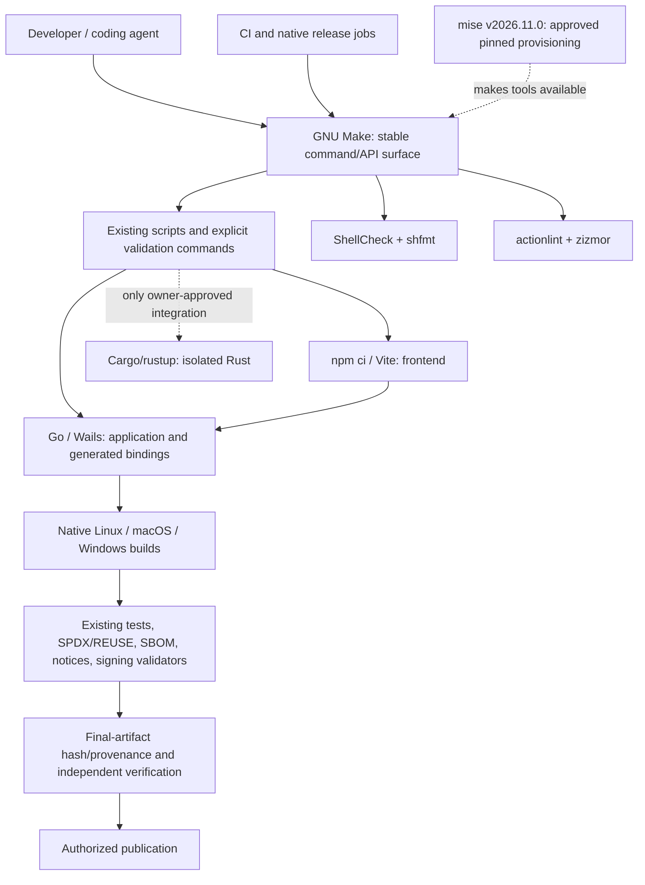

<!--
SPDX-FileCopyrightText: 2026 James L. Burns and The GoPMgr Contributors
SPDX-License-Identifier: GFDL-1.3-or-later
-->

# GoPMgr ADR-013: Maintainer-Approved Phased Engineering Build and Assurance Implementation Plan

**Document version:** v0.3, approved-direction phased implementation plan (official upstream release confirmation incorporated)  
**Date:** November 3, 2026  
**Decision status:** **Overall architecture APPROVED by maintainer; integration of the newest stable mise APPROVED; latest-stable version selection for the added tools APPROVED.**  
**Execution status:** PLAN ONLY. No change to the GoPMgr source repository, CI, runtime dependencies, toolchain, or release procedures is represented as implemented, tested, or merged by this document.  
**Design basis:** `GoPMgr_ADR-013_Engineering_Build_Assurance_Architecture_v0.1.md`, November 3, 2026; inspected GoPMgr repository `draconianneocoder-cpu/GoPMgr` default `main`. The ADR number remains subject to confirming the actual repository ADR numbering scheme.  
**Intended destination:** `docs/design/` or the repository's existing accepted-ADR location, after verifying repository conventions and existing decisions.  
**Primary owner:** GoPMgr maintainer; execution may be delegated to a coding agent under the controls in this plan.

---

## 0. Recorded maintainer approval and boundaries

### 0.1 Explicit authorization received

On November 3, 2026, the maintainer stated:

> “I approve the overall architecture, the use of the newest stable versions of the tools to be used and I approve the integration of the newest stable version of mise. Draft the planned phases with my explicit approval in a downloadable zipped markdown file.”

Accordingly, this document **changes ADR-013 v0.1 in one significant respect**: mise is no longer only a possible pilot subject to an undecided owner choice. **mise integration is an authorized target outcome**, still subject to staged implementation, safety validation, and rollback. The maintainer has also authorized using the newest verified stable releases for the selected tools, rather than selecting old releases for convenience.

**Subsequent release evidence provided by maintainer:** `https://mise.jdx.dev/releases.html` and `https://github.com/jdx/mise/releases/tag/v2026.11.0`. The official GitHub page identifies `v2026.11.0` as **Latest**, published November 3, 2026, with 58 release assets and published SHA-256 metadata for artifacts. This confirms availability at the release-listing level; platform-specific downloaded binaries and their actual checksums still require independent validation during P1. The links confirm the selected stable release; they do **not** authorize use of mise's task runner, skills synchronization, dotfile management, or other new features.

**Approval is for the overall architecture, the specific tool directions and versions policy, and planning the phases. It is not evidence that any phase has already passed its acceptance tests, that a later architecture decision has been superseded, or that an agent may weaken existing safeguards.** Follow repository branch-protection, code-review, release-signing, and accepted-ADR requirements. No unqualified authorization is inferred to push, publish, tag, delete or deploy.

### 0.2 Binding architectural choices

1. **GNU Make is retained as the canonical command surface** for developers, CI, verification, packaging, and release gates. Do not replace it with Task, Just, Mage, or mise's task runner.
2. **mise is adopted for tightly scoped toolchain provisioning and environment validation**, not for task orchestration, project secrets, dotfiles, background services, or automatic uncontrolled upgrades.
3. **ShellCheck, shfmt, actionlint, and zizmor** are added as distinct engineering assurance tools. Each must be independently version-pinned, tested, and integrated by a narrowly scoped change.
4. **Go, Wails, npm, Vite, and Cargo/rustup retain ownership of their compilation/dependency graphs.** Rust workers and DataFusion spikes remain experimental unless an accepted project decision authorizes promotion.
5. **The newest stable release policy applies at each tool's adoption/upgrade decision point:** discover, verify, review, then freeze a concrete version for reproducible execution. Never put `latest`, `main`, floating minor ranges, or mutable action tags into a production/release tool pin.
6. **Preserve all existing assurance semantics:** `make verify`, `make race`, `make check-release`, `make tag-preflight`, REUSE/SPDX, notices, SBOM, encrypted DB, PDF/A, PAdES, native installers, and generated-binding checks. Any required check that is missing or broken must fail closed in its intended mandatory context.
7. **No automatic cleanup or data mutation from read-only checks.** Dependency updates, formatting rewrites, filesystem cleanup, installer downloads, publishing, and signing are explicit operations with separate commands and ownership.
8. **Native execution matters:** validate Linux, macOS, and Windows using supported host environments rather than claiming an OS is covered solely because one cross-compiler works elsewhere.
9. **Do not reintroduce DuckDB or promote ADR-010/ADR-012 Rust/IPC experiments** through build-system restructuring.
10. **All phases have go/no-go gates and independently reversible change sets.** Approving the direction does not waive those gates.

### 0.3 Authority hierarchy

For a specific executable behavior, use: current repository source/tests, actual release/build scripts and CI, accepted owner ADRs, focused policy documents, then explanatory documentation. This plan is a design/implementation specification and must be reconciled with the live repository before each implementation phase. If it conflicts with an accepted architecture decision, stop the conflicting change and report it; do not silently reinterpret either document.

---

## 1. Version selection record, verified November 3, 2026

The following versions were checked against official upstream documentation or official release listings during this draft. A value is **the observed stable candidate as of the drafting date**, not a promise it will still be the newest when its phase is implemented. Before opening each implementation PR, repeat the check for that tool, including prerelease exclusion, release-asset availability, signature/checksum, license, supported operating systems, and known advisories. The PR records the exact accepted version and why it was chosen.

| Tool | Status and role | Stable candidate observed 2026-11-03 | Upstream basis | Implementation rule |
|---|---|---|---|---|
| GNU Make | Existing, canonical CLI | **4.4.1** | GNU FTP archive; GNU Make manual; Homebrew stable formula | Do not forcibly replace system `make`; check `make` vs `gmake` by host, version and behavior. |
| **mise** | **Explicitly approved new provisioning tool** | **v2026.11.0** (official latest release, Nov. 3) | `https://mise.jdx.dev/releases.html` and `https://github.com/jdx/mise/releases/tag/v2026.11.0` | Official signed release/tag and 58 downloadable assets confirmed. At integration, independently verify the actual host artifact and SHA-256; examine breaking changes and select an exact reviewed version. |
| ShellCheck | New shell static analysis | **v0.11.0** | `https://github.com/koalaman/shellcheck/releases` | Pin exact signed/checksummed artifact or verifiable package provenance. |
| shfmt (`mvdan/sh`) | New shell format verification | **v3.14.1** | `https://github.com/mvdan/sh/releases` | Check mode only in CI; formatting rewrites use a separate reviewed change. |
| actionlint | New Actions syntax/semantic analysis | **v1.7.12** | `https://github.com/rhysd/actionlint/releases` | Test actual workflow syntax including custom runners and expression contexts. |
| zizmor | New Actions security analysis | **v1.32.0** | `https://github.com/zizmorcore/zizmor/releases` | Baseline findings before enforcing; do not suppress critical issues globally. |
| govulncheck | Existing vulnerability scanner currently floated in CI | **`golang.org/x/vuln` v1.9.0 was visible on pkg.go.dev**, but its page indicates the package is not in the latest module revision | `https://pkg.go.dev/golang.org/x/vuln/cmd/govulncheck` | Resolve and verify the actual newest stable module release at the time of P6. Do not assume v1.9.0 is latest; record the selected immutable version. |

**Existing product toolchain baseline, not an unreviewed upgrade mandate:** the repository currently declares Go 1.27.3 and Wails v2.17.0; Node.js 26 in CI; Svelte 5 and Vite 8 for the frontend; experimental Rust work uses a separately pinned Rust toolchain. Exact patch versions and supported native SDK/library versions must be inventoried in Phase 0. The approval to use newest stable tools does **not** justify silently modifying Wails or application-language versions in a lint/mise PR. Evaluate latest-stable product toolchains separately against native compatibility, code generation, binary compatibility, signing, CI and security before upgrading those pins.

**Key policy distinction:** *Select newest stable at review time; pin an exact, tested snapshot for builds; update via reviewed, tested PRs.* A production machine or CI runner must not silently upgrade to tomorrow's release. mise releases several times per month, and freshly published versions may be subject to a release-age policy or incomplete platform artifacts. Document the release-time freshness/availability decision rather than bypassing verification.

**Licensing:** stand-alone build tools do not automatically relicense GoPMgr. Record tool licenses accurately, including ShellCheck's GPL licensing and the other upstream licenses, in the development-tool inventory; investigate licensing if embedding/linking code rather than executing independent tooling.

---

## 2. Target architecture and single-owner rules

| Owner | Owns | Must not own |
|---|---|---|
| GNU Make | Stable target names, task ordering, error propagation, developer and CI interfaces | Download/install logic hidden in verification; language-specific caches; secret handling. |
| mise | Verified acquisition and selection of approved developer/CI tools; exact reproducible versions | Task execution, CI definition, automatic signing, secret retrieval, runtime behavior, or unapproved bootstrap scripts. |
| ShellCheck | Shell static warnings, bug finding and syntax/dialect analysis | Formatting, cross-platform execution proof, or runtime test results. |
| shfmt | Shell formatting checks, plus explicit formatting-only operations | Security assessment or script semantics. |
| actionlint | GitHub Actions syntax, expressions, contexts and workflow schema checks | Security risk classification, permissions review, job success. |
| zizmor | Workflow security audit findings | Generic YAML parsing or complete security proof. |
| Go/Wails, Cargo/rustup, npm/Vite | Native compiler/SDK dependencies, language-level build graph, lockfiles, cache, generated bindings | Duplicate global orchestration, mise state, publication trust. |
| Existing first-party release tools | SBOM and notices, content validations, artifact packaging/signing integrity | Substitute for a missing build run, or claim untested platform parity. |
| GitHub Actions | Job scheduling, protected merge/release gates, attestations where authorized | Sole repository source of truth for build semantics. |

**Make-only recovery invariant:** If mise is removed, GNU Make and all canonical targets continue to work with independently installed approved binaries on PATH. Running `make verify` does not trigger `mise install`, `mise use`, `mise upgrade`, `mise exec`, or any other network-dependent operation.

---

## 3. Phase sequencing, dependencies and release gates

### 3.1 Phase map and difference from original v0.1 rollout

The previously proposed optional mise pilot was Phase P4. Because the maintainer **explicitly approved mise integration**, this draft moves it to **P1 immediately after baseline**. Static assurance follows in small stages, preserving the original security intent and rollback boundaries.

| New phase | Original plan mapping | Scope | Blocking on initial adoption? | Can roll back independently? |
|---|---|---|---|---|
| **P0** | P0 | Baseline inventory and executable contracts | Must complete first | Yes, documentation/evidence only |
| **P1** | Old P4, now APPROVED | Integrate newest stable mise for provisioning and lockfile use | No impact on `make verify` initially | Yes |
| **P2** | P1 | ShellCheck read-only static gate | Advisory, then blocking | Yes |
| **P3** | P2 | shfmt format policy/check gate | Advisory, then blocking | Yes |
| **P4** | P3 part A | actionlint workflow validation | Advisory, then blocking | Yes |
| **P5** | P3 part B | zizmor workflow security checks | Advisory, then policy-based blocking | Yes |
| **P6** | P5 | Existing-contract hardening and version-drift remediation | Each fix individually reviewed | Yes, per PR |
| **P7** | P6 | Release artifact evidence, attestations and recovery | Pilot, then blocking only for approved release class | Yes, preserve existing release gates |
| **P8** | P7 | Native-platform, recovery and performance qualification | Must pass before closure | Yes, no runtime architectural dependency |
| **P9** | P8/acceptance | Policy finalization and evidence-based ADR closure | Maintainer acceptance gate | Documentation only |

**Critical path:** P0 -> P1 -> P2/P3/P4/P5 (independent branches with controlled merge order) -> P6 -> P7 -> P8 -> P9. P2 through P5 may be developed separately but require a controlled sequence for baseline review and CI required-check setup. Do **not** parallelize different PRs against shared CI workflows without conflict analysis.

### 3.2 Default work-package rules

Every phase produces: (a) a baseline SHA and worktree inventory, (b) reviewed design/contract deltas, (c) a narrow PR, (d) test and negative-control evidence with host/tool versions, (e) a per-platform exception record, (f) a rollback path, and (g) the maintainer's review decision. Avoid mixing dependency bumps, formatting churn, security fixes and unrelated refactors in one PR. Do not merge a new blocking tool before its baseline findings have been understood and addressed.

### 3.3 Acceptance vocabulary

- **Design approved:** architecture and allowed tools authorized, not implemented.
- **Pilot operational:** tool can be installed and used in a bounded environment, but is not a critical required check.
- **Advisory:** failures are visible and tracked but do not block established release claims.
- **Blocking:** failed/missing tool, invalid input, and policy violation fail the required check and prevent merge/release in that scope.
- **Accepted:** code reviewed, mandatory tests passed, negative controls exercised, rollout evidence documented, and rollback procedure proven.

---

## 4. Detailed phase P0: Freeze and characterize existing build contracts

**Purpose:** Prove the precise baseline before editing anything. No build behavior changes here.

**Inputs:** Current protected `main` revision and working-tree status; root `Makefile`; `AGENTS.md`; existing ADR-010/ADR-012 decisions; `.github/workflows/`; `scripts/`; `tools/config-check/`; `docs/DEPENDENCIES.md`; `docs/TESTING.md`; current release-tool version file; `go.mod`, frontend lockfile, and isolated Rust manifest/toolchain metadata.

**Work plan:**

1. Record `git rev-parse HEAD`, `git status --porcelain=v1`, platform/toolchain versions, repository branch and checkout identity; do not assume the historic Git blob IDs from ADR-013 v0.1 are the current commit.
2. Enumerate every Make target and prerequisite, including scripts calling Make and tools parsing Makefile text. Inventory inputs, outputs, generated assets, persistent state, and destructive effects.
3. Record both the documented Go package set and the actual scope of Go test, race, lint, vulnerability, and release checks; preserve the explicit `-p=1 -count=1` race contract.
4. Inventory CI workflows, their triggers, permissions, pinned action commits, runner labels, dependency caches, artifact outputs, packaging stages, and privileged release boundaries.
5. Run baseline checks on supported hosts when safely available; record actual exit codes, duration/memory, output paths, host packages and a clean-tree delta. **Do not claim a pass for an unavailable host.**
6. Identify exact installation requirements for GNU Make or `gmake` on macOS, GCC vs Clang, Bash/Unix commands on Windows, CGO, Wails WebKit/GTK dependencies on Linux, macOS SDK/notarization, and NSIS/Windows prerequisites.
7. Collect current lint/security findings without enforcing new tools; determine which scripts and workflow files are tracked and first-party.
8. Make a read/write resource matrix before considering any `make -j` optimization. Resolve whether CI's direct `wails build` intentionally differs from `make build`.
9. Create a baseline evidence manifest with dates, source SHA, exact commands, exit codes, known failures, and source links. No sensitive environment variables or secrets.

**Artifacts:** `docs/engineering/adr-013-baseline.md` (or existing repository evidence location), inventory of target-to-caller dependencies, toolchain ownership map, failure/side-effect matrix, pre-merge/CI baseline timings, host-coverage matrix.

**Acceptance tests:** Existing named commands remain runnable and unchanged; prior failures are separately identified; every release-critical target has at least one documented authoritative caller; clean and dirty-worktree behavior is characterized; unsupported hosts are labeled unverified.

**Negative controls:** Use disposable fixtures to confirm that `make verify` fails when an essential pre-existing validator fails and that `make race` cannot be skipped via cached test success. Do not corrupt the production worktree.

**Rollback:** Documentation-only revert if observations inaccurate. **Exit gate:** no implementation P1 until the version sources and Make/CI target contracts are established.

---

## 5. Detailed phase P1: Approved mise integration and controlled provisioning

**Approval:** **EXPLICITLY APPROVED by maintainer** on November 3, 2026, for the newest stable mise. The maintainer additionally supplied the official [v2026.11.0 GitHub release](https://github.com/jdx/mise/releases/tag/v2026.11.0). It is marked **Latest**, its immutable release tag is signed, and its 58 release assets include published SHA-256 values. Target **v2026.11.0** for P1 unless a newer stable version is verified when implementation begins. Published metadata is not equivalent to independently downloading and verifying the selected platform artifact. Do not select a prerelease, mutable tag or fallback without review.

### P1-A. Toolchain ownership and minimum scope

1. Decide which executable versions are authored by existing canonical sources and which auxiliary tools mise directly provisions. Preserve `go.mod` (Go/Wails contract), `frontend/package-lock.json` (npm tree), Rust's `rust-toolchain.toml` for isolated experiments, and existing release tool version records.
2. Begin with **auxiliary engineering tools only**, using a reviewed `mise.toml` with exact versions and a generated, reviewed `mise.lock`. Candidate minimum: ShellCheck, shfmt, actionlint, zizmor. Include only backends confirmed to support the required hosts and integrity policy.
3. Use `mise.toml` as a *provisioning declaration*, not a new single source of truth replacing the version of Go or Wails. A read-only version consistency check must reject drift when a tool is recorded in more than one place.
4. Treat tools that cannot be securely acquired through the selected mise backend as intentionally **out-of-scope**, with an equivalent independently pinned installer. No unverified substitute or dynamic source build.
5. Pin the `mise` executable itself outside `mise.toml` in a reviewed bootstrap/CI configuration; record the exact binary version, architecture, archive digest, release source and verification method.

### P1-B. Trust and installation security

1. Verify the mise release tag, downloadable binaries, SHA-256 files or signatures, installer behavior, and independent hashes where feasible. Verify the *specific* selected host artifact; a signed tag is not a checksum of an arbitrary downloaded binary.
2. Inspect bootstrap scripts before execution; never recommend a bare unattended `curl | sh` in CI without reviewing and pinning the installer. Use a verified artifact-install process or a trusted package source with package integrity validation.
3. Configure lockfile use, exact versions, and release-age decisions deliberately. Never use `mise use tool@latest` as a committed source of truth. The project must not run automatic updates in developer shells or CI on behalf of the repository.
4. Disallow unreviewed mise hooks, project-defined tasks, plugins that execute untrusted code, secrets/fnox integration, dotfile/bootstrap automation, daemons, and external scripts in this phase. Audit the `mise` version for changes to default behavior before enabling it.
5. Confirm that `mise install --locked` (when valid for the selected version/backend) works on the supported environment **and** refuses invalid/missing locks or checksum mismatch. Explicitly test a previously installed malicious/wrong-version executable cannot pass the project version check.
6. Document offline/cache limitations and network failure modes. Do not infer that locked dependencies make SDK or OS system packages hermetic.

### P1-B2. Version-specific acceptance tests for mise v2026.11.0

The upstream release is not a generic drop-in replacement for older mise. P1 must explicitly account for its November 3 breaking changes and new defaults:

1. **Checksummed locked installs:** `mise install --locked` now fails before download when the current platform's lock entry has a URL but no checksum. Generate a genuine lockfile with `mise lock`, inspect its recorded platform-specific checksums, and verify an intentionally missing/wrong checksum fails. **Do not** relax `locked_require_checksum` or use `lockfile_mode = "merge"` merely to bypass this gate.
2. **Safe-mode URL trust:** with `MISE_SAFE=1`, project lockfiles may no longer choose artifact download URLs. Test both ordinary trusted project provisioning and a safe-mode run. Record backend resolution and expected checksum validation without assuming a lockfile URL is always authoritative.
3. **Go version inference changed:** v2026.11.0 no longer selects Go from a *minimum* `go.mod` version. It may read an exact `toolchain goX.Y.Z` directive or an exact `go X.Y.Z` under the documented conditions. The GoPMgr `go.mod` currently specifies `go 1.27.3`, but **mise is not appointed Go version authority in this phase**. Verify that no implicit inference or mise configuration silently replaces the repository's existing Go and Wails toolchain contract. If Go provisioning is later approved, state its version explicitly and add a consistency check against `go.mod` and CI.
4. **Skills and dotfiles remain untouched:** mise v2026.11.0 can write or symlink `.agents/skills` and `.claude/skills` through skills-related commands. GoPMgr already has `.claude/skills`; prohibit `mise skills sync`, `skills.auto_sync`, dotfile/bootstrap operations and automatic hooks under ADR-013. A fixture must confirm running the approved provisioning steps leaves those paths unchanged.
5. **No second scheduler:** the release adds cross-worktree task locks, but that does not change the architectural choice: `make` is canonical. Do not create `[tasks]` entries, invoke `mise run`, or introduce secondary shared lock ownership. Address collisions in existing Make/CI workflows by analyzing artifact and resource ownership.
6. **Release trust is layered:** a signed Git tag and a published SHA-256 string are evidence, not proof that the specific installed executable has been independently validated. Preserve artifact URL, architecture, archive digest, command/output used to verify it, source release tag, and any verified signature/provenance record.

**P1-specific negative controls:** truncated lock entry, checksum mismatch, untrusted-project configuration, mismatched tool version on PATH, attempted auto-generated skills symlink, and missing network/cache. Any required check must fail with a truthful diagnostic. No network access is allowed during `make tools-check` or canonical verification.

### P1-C. Integration contract

- Provisioning may run explicitly in developer setup and an isolated CI setup stage. **No tool installation during `make verify`, `make check-release`, or `make tools-check`.**
- `make tools-check` (proposed, read-only) checks executable version/source consistency, path precedence, required host dependencies and lockfile coherence. It must not change PATH persistently, rewrite `mise.lock`, or fetch anything.
- **Make-only fallback test:** with mise absent but independently installed exact tools on PATH, all existing Make targets and the new read-only tool checks execute as designed.
- Document `mise exec` only as an optional explicit invocation for tool resolution; never redefine authoritative task semantics through `mise run`.
- Keep CI privileged release jobs self-contained; signing credentials must never be accessible to untrusted PR tool installation.

**Artifacts:** verified mise installation record, minimal `mise.toml`, reviewed `mise.lock`, tool-version inventory, optional `scripts/engineering/check-tool-versions.*`, contributor setup guide, CI pilot job, security review.

**Acceptance criteria:** Exact selected versions installed on supported hosts; lockfile and digest verification are demonstrated; no script execution from untrusted config; Make-only operation preserved; no release/test gate skipped; clean verification does not rewrite tracked files; rollback works by removing mise integration alone.

**Negative controls:** Missing mise, invalid checksum, malformed lock, changed tool binary, altered version source, untrusted config, unavailable registry, multiple executable paths with conflicting versions, and read-only CI attempting an install. Record expected failure status for each.

**Rollback:** Remove mise-specific setup/config/lock and keep independent verified tool installation procedure. Do not revert or weaken Make targets. **Exit gate:** maintainer accepts the tested mise provisioning configuration and version-control policy before using it to supply mandatory lint tools.

---

## 6. Detailed phase P2: ShellCheck static analysis

**Selected candidate:** ShellCheck **v0.11.0** as of Nov. 3, 2026; verify newest stable again immediately before PR.

**Scope:** First-party tracked shell files only. Include Bash and POSIX scripts as appropriate, with interpreter/shebang-sensitive analysis; explicitly exclude generated, vendored and copied third-party scripts. Track file selection by `git ls-files -z` or an equivalent safe approach. Avoid unchecked `find .` traversals, path-splitting, and shell command-line length failures.

**Implementation steps:**

1. Capture existing ShellCheck findings, including source line, rule ID, severity, reproducibility and whether code is reachable.
2. Classify defects separately from stylistic suggestions, intentional constructs, and platform portability issues.
3. Fix correctness defects in tightly scoped PRs, prioritizing quoting, path safety, temporary-file management, errexit pitfalls, shell injection and unchecked exit statuses.
4. For justified suppressions, record rule, target, purpose, scope and maintainer approval. No repository-wide `disable=all` or broad high-risk suppressions.
5. Add `make shellcheck` as a read-only wrapper and CI job. Missing tool is an error once the job is required.
6. Introduce initially as advisory until the baseline is adjudicated; convert to blocking only after green, reproducible CI runs and a seeded failure proves the job blocks.

**Acceptance:** No previously required verification changes behavior; no new shell errors are silently ignored; known defects fixed with regression tests; tracked-file scope matches the inventory; static gate fails upon a deliberate unsafe fixture; no mutable outputs.

**Rollback:** Revert the new ShellCheck target/job and rule-specific fixes only if shown to regress behavior; preserve separately valuable bug fixes and existing Make targets.

---

## 7. Detailed phase P3: shfmt read-only formatting discipline

**Selected candidate:** shfmt **v3.14.1** as of Nov. 3, 2026; repeat version check at execution.

**Design:** A nonmutating format-check target plus a separate explicit developer formatting command. Use a documented shell dialect/indentation style matching existing repository practice; do not normalize syntax across Bash and POSIX scripts without understanding semantics.

**Implementation steps:**

1. Inventory tracked shell scripts and their interpreter/dialect. Decide which scripts are eligible for enforced formatting.
2. Run `shfmt` in **diff/check mode**, never `-w` during validation. Agree a versioned formatting style and exclusions.
3. Submit a *format-only* PR where necessary, preserving separate commits or PRs for functional shell changes.
4. Add `make shfmt-check` and an optional explicitly named `make shfmt-write` (only if useful and clearly destructive). Ensure no formatting occurs inside release or read-only CI jobs.
5. Use a seeded style violation to demonstrate CI rejection; test that a valid Bash heredoc/script output remains byte-for-byte behaviorally equivalent where formatting might matter.

**Acceptance:** Zero unreviewed semantic alterations; source and generated scripts correctly excluded; clean-tree check; existing shell regression tests remain green; missing shfmt fails mandatory check.

**Rollback:** Revert formatting-only changes if unsafe and detach new formatting gate without impacting ShellCheck or Make.

---

## 8. Detailed phase P4: actionlint for workflow correctness

**Selected candidate:** actionlint **v1.7.12** as of Nov. 3, 2026.

**Scope:** Every tracked, first-party GitHub Actions workflow and reusable workflow under `.github/workflows`, including release workflows not previously examined in the earlier architecture draft. Account for custom runners and supported action metadata with reviewed configuration as required.

**Implementation steps:**

1. Inventory all workflow triggers, expressions, `needs`, local and external actions, `permissions`, matrices, and required-check names.
2. Run actionlint with pinned executable and record initial findings; separate parser/schema findings from workflow behavior differences.
3. Repair invalid expressions/workflow structures in narrowly scoped PRs. Confirm no change has removed a required job, weakened a token permission boundary, or altered the native release matrix.
4. Add `make workflow-lint`, initially advisory. Require it only after baseline repairs.
5. Provide a disposable fixture with invalid expression, nonexistent `needs` output, malformed YAML, and a custom-runner example; prove failure and correct exclusion behavior.

**Acceptance:** Valid workflow files pass; invalid fixture fails; existing job names and protected branch conditions remain invariant; no alternate workflow silently replaces canonical Make verification.

**Rollback:** Revert the actionlint integration alone; preserve independent workflow correctness fixes.

---

## 9. Detailed phase P5: zizmor for workflow security

**Selected candidate:** zizmor **v1.32.0** as of Nov. 3, 2026.

**Security design:** Static security detection is a complement to least privilege, trusted action pinning, secret isolation, protected environments and human review, not a substitute for them. Respect zizmor's current CLI flags and rule set after version verification; do not mechanically reuse historic suppressions across releases.

**Implementation steps:**

1. Run the new, pinned scanner over all intended first-party workflow files without enabling autofix.
2. Categorize findings: exploitable credential exposure, unsafe PR execution, template injection, unpinned executable actions/images, excessive token permissions, weakened release approvals, suspicious network downloads, and false positives.
3. Remediate critical/high-confidence risks in discrete PRs, with particular attention to untrusted `pull_request_target`, secret-bearing jobs, artifact provenance, CI cache poisoning and indirect shell interpolation.
4. Record any narrow, reviewed exceptions with exact path, rule ID, threat context, compensating mitigation, review date, and reassessment trigger. Never globally silence a security category merely to obtain a green status.
5. Introduce `make workflow-security`; run advisory first, then define an owner-approved blocking policy and test it using an intentionally insecure fixture.
6. Ensure the security-check job itself has no secrets and minimal permissions; its output cannot publish or sign artifacts.

**Acceptance:** All critical/high-confidence findings resolved or explicitly risk-accepted by the maintainer; fixture detects representative workflow injection/permission defect; CI requires the agreed scanner status; no false-green due to skipped tool or incorrectly interpreted output.

**Rollback:** Roll back scanner policy only after preserving independent mitigations for real security defects. A security-critical failure blocks release even if the scanning tool itself needs replacement.

---

## 10. Detailed phase P6: Harden existing build and quality contracts

This phase is deliberately split into separate PRs. Preserve old target aliases wherever possible and prove semantic equivalence before retiring or rewriting any recipe.

| Work package | Observed issue | Planned change | Mandatory evidence |
|---|---|---|---|
| P6-A | Existing `make tidy` runs `go mod tidy` and `npm install` | Preserve explicit mutating `tidy`; document/create nonmutating `deps-check` or `setup-locked` path using Go module downloads and `npm ci` where appropriate. | Clean source unchanged; lock mismatch fails; old target preserved. |
| P6-B | `make license-check` deletes `.DS_Store` | Move cleanup into explicitly named maintenance command; make licensing validation read-only. | Sentinel `.DS_Store` preserved in fixture; `reuse lint` failure still propagates. |
| P6-C | CI uses `govulncheck@latest` | Discover newest stable supported govulncheck module at PR time and pin exact release; document updates. | No `@latest` in required scanner setup; tool version and findings tested. |
| P6-D | `check-release.sh` allows missing/broken REUSE validator in some local paths | Distinguish best-effort developer mode from strict release mode. Release claim must fail if required validator absent or broken. | Failure injection for missing/exiting/nonfunctional REUSE; no misleading success. |
| P6-E | `CC := gcc` and Unix-oriented scripts | Characterize host-specific compiler and Bash policy. Change compiler selection only if native build parity proves safe. | macOS, Linux, Windows native compilation and SDK evidence. |
| P6-F | CI build may invoke `wails build` directly while Make uses wrapper | Document whether output contract intentionally differs, then harmonize only if it strengthens parity. | Binding generation, signing state, flags, file layout and package identity comparison. |
| P6-G | Multiple toolchain version records | Add nonmutating consistency validation without inventing redundant authority. | Fault-seeded drift at each version source must fail. |
| P6-H | Existing Make prerequisites and generated outputs may share files | Explicit resource ownership map and task ordering; avoid blindly adding `-j`. | Shared-output/race stress tests, stable results, preserved `-race -p=1 -count=1`. |
| P6-I | `govulncheck` JSON/SARIF formatting may exit zero even with vulnerabilities | If machine-readable output is used, add a separate reviewed finding-policy evaluator; do not use formatting exit code alone as gate proof. | Fixture with known finding demonstrably blocks the required job. |

**Order inside P6:** P6-A/B/C/G can be relatively independent after baseline; P6-D/E/F/H/I require additional release/platform characterization. Split security fixes from formatting/housekeeping changes. Existing warning-only or optional modes must not be mislabeled as full release compliance.

**Acceptance:** Every modified Make target retains its documented effect and failure semantics; CI config-check and release-scope tests pass; negative controls fail for the right reason; no unrequested dependency or worktree mutation; no hidden test scope reduction.

**Rollback:** Revert each work package independently. If a previously existing defect was repaired, do not remove that repair merely to revert a new integration wrapper.

---

## 11. Detailed phase P7: Release provenance, final-byte identity and reproducibility

**Objective:** Extend existing first-party SBOM, module notices, frontend notices, REUSE, PDF/A, PAdES, encryption, native package checks and signing. Do not create a competing SBOM source of truth.

**Work plan:**

1. Identify every final distributable: native executable, macOS `.app`/`.dmg`/`.pkg`, Windows installer, Linux tarball/deb/rpm, update manifest and any detached signatures. Record exact producer and authoritative file hash *after its last byte-changing step*.
2. Capture source revision, tag validation, Go/Wails/Node/Rust versions as applicable, native SDK/OS environment, lockfile digests, build flags, build timestamp policy and required system libraries.
3. Establish three separate claims: locked dependency resolution, functional clean-build repeatability, and optional bit-for-bit unsigned-stage reproducibility. Do not conflate them.
4. Pilot GitHub artifact attestations or other appropriate verified provenance over actual final artifacts; test artifact digest, subject identity, expected workflow/ref, repository provenance and publish permissions.
5. For macOS, distinguish unsigned binary identity from signed/notarized distribution identity. Do not expect the notarization service to work offline or signed files to hash identically to unsigned outputs.
6. Test that installed-package contents and existing notices/SBOM still describe the actual executable and bundled frontend. Prevent an attestation for an intermediate file from being reported as proving a different published installer.
7. Run an independent verifier with no release secrets and prove substitution, wrong ref, wrong digest, and missing attestation are rejected in an applicable mandatory release context.
8. Define evidence retention, availability during GitHub outage, responsible owner, renewal and revocation procedures for trust roots, and disclosure of unreproducible platform-signing steps.

**Artifacts:** per-platform release provenance format and verifier, artifact identity manifest, updated release-preflight guidance, constrained release workflow change, negative-control fixtures.

**Acceptance:** Existing mandatory release gates remain intact; matching final artifact validates; tampered/swapped/missing provenance is rejected; no privileged signing credential exposed to PR jobs; published checksums match uploaded bytes.

**Rollback:** Preserve the prior release publication path and existing checks while disabling only the new attestation pilot. Never weaken previously required signature/validation controls to make attestation succeed.

---

## 12. Detailed phase P8: Cross-platform, disaster recovery and resilience qualification

**Required matrix:** at least Linux on the supported project baseline, macOS Apple Silicon using the supported SDK, and Windows using the documented Wails/NSIS/CGO native environment. If other architectures are announced as supported, add them. Each report identifies what was truly executed, not merely configured.

**Qualification scenarios:**

1. Clean checkout with independently provisioned reviewed binaries and no mise: Make-only build and checks succeed on the applicable host.
2. Fresh checkout with the approved, exact pinned mise release (initially v2026.11.0) and locked tools: same canonical Make commands succeed; no tracked files unexpectedly modified.
3. Offline recovery from an approved cache/tool archive: document every unavailable dependency; never claim full offline support if platform SDKs/services require a network.
4. Native builds with clean cache and warmed cache: all required checks still execute and produce consistent functional results.
5. Changed source with stale generated bindings: required release validation rejects it.
6. Missing required security/lint/REUSE/PDF validator: blocking job fails and does not report a partial run as full success.
7. Dirty worktree and agent worktrees: tests do not stage, erase, or overwrite unrelated edits; unsafe cleanup operations remain explicit.
8. Tool disappearance: remove mise, then actionlint/zizmor/etc individually and verify expected failure and recovery; valid manually provisioned binaries restore operation.
9. Artifact replacement: attestation verifier rejects other build, wrong commit/tag, different digest, and altered installer.
10. Concurrency stress: analyze CPU/memory oversubscription and collision risks when Go, npm, Cargo, and Make share a host; preserve intentional race-test serialization.
11. Performance: measure both clean/warm wall time and resource use; compare baseline distribution rather than one anecdotal run. Do not weaken tests to hit a speed target.
12. Disaster recovery: reproduce at least one native build from an archived source snapshot and documented install inputs on a clean machine, with explicit limits for external signing/notarization.

**Acceptance:** Every declared supported host has independent proof or is transparently excluded; no quality-gate regression; version and checksum policy works both with and without mise; recovery procedure can be followed by a maintainer unfamiliar with prior local setup; all exceptions and unverified scenarios documented.

**Rollback:** Any adopted tool that demonstrably compromises reliability is reverted by its independent PR. Production release remains blocked if essential independent validation is unavailable.

---

## 13. Detailed phase P9: Finalize policy and record decision evidence

1. Collect approved PR references, tool versions, exact installation provenance, tests, failure-injection evidence, benchmark outputs, platform matrix and signed release-evidence samples.
2. Confirm no unauthorized changes to Wails runtime, Go module, frontend lockfile, native SDK policy, ADR-010/ADR-012 worker boundaries, DuckDB retirement, encryption, signing, or release scopes.
3. Update `AGENTS.md` and relevant developer/release docs **after** implementation is verified. Record exact target names and warning vs mandatory gate status.
4. Reconcile the ADR number/status with the repository's accepted architecture process; set implementation status to *accepted and implemented* only for proven completed phases, not by copying this draft.
5. Define the ownership and update review interval for every new tool. Changes to latest-stable candidate releases follow version-control PRs; no automatic unreviewed changes to CI/release toolchains.
6. Conduct a final Make-only recovery check, policy review, negative-control suite and maintainer acceptance review.

**Exit:** All mandatory tests and review requirements are demonstrated, remaining optional/deferred capabilities are named, and all unresolved risks are assigned follow-up owners rather than hidden by a blanket acceptance statement.

---

## 14. Concrete target/interface policy

The following target names are **PROPOSED**. They are intentionally additive and must be checked against the current Makefile before implementation.

| Command | Effect | Mutates tracked source? | Downloads dependencies? | Initial enforcement |
|---|---|---|---|---|
| `make tools-check` | Validate installed versions, executable identity and canonical pin consistency | No | No | Advisory pilot, then blocking |
| `make shellcheck` | Run pinned ShellCheck on approved tracked scripts | No | No | Advisory -> blocking |
| `make shfmt-check` | Check agreed shell formatting, without rewriting | No | No | Advisory -> blocking |
| `make workflow-lint` | Run actionlint | No | No | Advisory -> blocking |
| `make workflow-security` | Run zizmor with reviewed policy | No | No | Advisory -> risk-based blocking |
| `make engineering-static` | Aggregate validated static checks; missing required tool fails | No | No | Independent required CI job after baseline |
| `make verify` | Existing complete pre-merge verification | Existing expected outputs only | Must not install new tools | Keep current contract |
| `make check-release` | Existing release validation (strengthened only through separate reviewed PRs) | Documented build outputs only | No implicit untrusted installers | Preserve and strengthen |
| `make tag-preflight` | Existing release-tag contract | Documented outputs only | Only approved setup | Preserve |
| `make deps-setup-locked` | OPTIONAL explicitly named deterministic dependency setup | Can create ignored outputs | Yes, explicitly | Not part of read-only checks |
| `make shfmt-write` | OPTIONAL explicit source reformatting | **Yes** | No | Never CI verification |
| `make attest-verify` | Verify required final artifact provenance | No | May need trusted metadata access, explicit | Release only after pilot |

If a new target name conflicts with existing targets, do not override it. Choose a new explicitly documented name or reuse the existing behavior only after parity inspection.

**No extra task-runner manifest:** `Taskfile.yml`, `justfile`, `magefile.go`, `moon.yml`, Bazel files, or a custom task engine must not be added as an architectural substitute during this work. Introducing a narrowly justified tool later requires a new decision and measured evidence.

---

## 15. CI security and execution model

**Separation of duties:**

- **Untrusted PR jobs:** minimal read-only token, no release keys, deterministic tools and outputs; run normal tests and new static checks.
- **Protected branch checks:** require named independent verification, security and platform jobs rather than a self-reported summary in the same script.
- **Release approval:** confirm signed/authorized tag and required check identities; only a protected release job receives signing/notarization permissions.
- **Native build jobs:** run on actual host OS/SDK, include version evidence and independent checks of generated assets; release job must not accept arbitrary PR-created artifacts without validated source and digest.
- **Provenance:** attest and verify final artifacts, archive evidence; track what verification does and does not prove.

**Status migration rule:** Do not rename existing required CI job IDs casually: branch protection and `tools/config-check` may depend on exact names and exact commands. When introducing an independently required static job, update branch protection only after the job exists and runs on representative PRs. Confirm any GitHub workflow or config validation helper that checks exact steps before changing existing CI workflow layouts.

**Security risk classification:** release and signing boundaries are high impact; dependency/version pinning and shell invocation are medium/high depending on context; formatter style is low risk. Scope the testing depth accordingly.

---

## 16. Quality gates, negative-control suite and measurement

### 16.1 Mandatory generic gate for **each** PR

- Source SHA, branch, dirty-worktree inventory and exact changed files documented.
- No unrelated change or new runtime dependency; no unreviewed installer or network step.
- Existing Make target names and expected exit codes preserved unless change explicitly authorized and tested.
- Existing tests/CI checks run where relevant; incomplete tests shown as incomplete, not green.
- Tool invocation/installed version recorded, including OS and architecture.
- At least one representative **intentional failure** demonstrates the new check fails closed.
- No `|| true`, swallowed exit status, blanket suppression or partial-scan success falsely claimed as complete.
- Proper SPDX/REUSE annotation of new tracked source and doc files.
- Rollback command documented and tested in a disposable checkout or sandbox when feasible.

### 16.2 Recommended observation metrics (no invented baselines)

| Metric | Why | Collection approach |
|---|---|---|
| Pre-merge median and p90 duration | Catch material CI delays | Compare repeated equivalent pipeline runs, record runner type and cache state |
| Clean / warm build time | Distinguish compiler cache effects | Native host repeated measurements with exact toolchains |
| Toolchain setup failure rate | Validate mise benefit | Fresh machines, controlled missing-network scenarios |
| False-green negative control count | Prove failure propagation | Intentional invalid fixture suite |
| Blocking finding and suppression trends | Prevent tool adoption from becoming ignore-list growth | Per tool/rule, reviewed exception register |
| Dependency drift incidents | Measure lockfile/pin value | Version audit exceptions, build mismatches |
| Release artifact identity failures | Detect provenance breakdown | Final SHA and attestation verifier outcomes |
| Make-only recovery success | Prevent tool vendor lock-in | Scheduled disaster recovery dry runs |

Do not impose a made-up quantitative pass threshold without an observed baseline. Investigate any meaningful performance regression, but do not drop protection merely to satisfy a target duration.

---

## 17. Risk register and countermeasures

| Risk | Consequence | Mitigation | Blocking trigger |
|---|---|---|---|
| Unreviewed newest-stable version introduces regression | Breaks builds/CI | Version check, immutable artifact pin, canary, regression tests, rollback | Release/verification incompatibility |
| mise installer or backend compromised | Supply-chain compromise | Independently verified binary, locked checksum, reviewed backend, no hooks | Cannot independently validate artifact or installed executable |
| Two executables with different versions on PATH | Misleading reproducibility | Path/version validator; one installation method per host where practical | `tools-check` detects ambiguity/mismatch |
| Make/mise duplicated ownership | Hidden installation or cache effects | Explicit no-task-runner scope, Make-only fallback | Required check installs or invokes mise automatically |
| Linter warnings suppressed wholesale | False green | Narrow exceptions and negative-control tests | A planted defect passes unexpectedly |
| CI workflow refactor removes security boundary | Secret exposure | actionlint/zizmor, permissions review, protected job parity | Elevated untrusted PR or unverified artifact publication |
| New scanner emits machine-readable success despite findings | Release false negative | Parse reports under explicit policy; seeded vulnerable fixture | Finding does not fail required gate |
| Cross-platform tool unavailable | Unsupported claims | Independent native host validation / verified fallback | Target host cannot run required tool without approved equivalent |
| Rust spike accidentally packaged | Architecture violation | Explicit exclusions and owner decisions | Worker included in default release without approval |
| Race and cache tests silently skipped | Quality regression | Preserve uncached race test; verify generated bindings and outputs | Any baseline required test no longer executes |
| Signed/notarized bytes differ from recorded digest | Artifact integrity failure | Hash final artifact and verify exact identity | Published artifact differs from release evidence |
| Tool update outage | Development interruption | Archived installers, Make-only fallback, rollback | Recovery cannot rebuild validated artifacts |

---

## 18. Agent execution instructions (binding for implementation)

An engineering agent assigned a phase must:

1. Read this approved-direction plan, `AGENTS.md`, current accepted ADRs, repository licensing policy, and the **actual** current Make/CI files before editing.
2. State phase ID, current repository SHA, target environment, tool release being selected, reason it is the newest stable release at review time, and change boundaries.
3. Preserve established Make targets and all test/release semantics. Do not delete or narrow checks because a new tool reports errors or executes slowly.
4. Create the **smallest complete scoped PR**. Do not perform bulk formatting and functional security fixes together.
5. Keep mise exclusively as provisioning; do not create new mise tasks, hooks, fnox secrets, dotfile automation or autoupdate policy.
6. Do not substitute experimental Rust production build changes or DuckDB dependencies. The plan contains no approval for changing ADR-010/ADR-012 production boundaries.
7. Use read-only scans first; obtain separate explicit approval before changing release credentials, protected checks, irreversible cleanup, or publication processes.
8. Run appropriate existing tests plus new negative controls. Preserve exact failure output and report unresolved blockers.
9. Never claim a suite passed if it did not execute successfully, including host-specific suites not available on the agent's environment.
10. Submit evidence, risks and rollback separately with each PR. **Do not unilaterally mark the entire ADR implemented.**

**Instruction conflict rule:** If implementation conflicts with a documented accepted owner decision, do not weaken that decision. Stop the affected slice and request a narrowly scoped design decision while leaving unaffected phases intact.

---

## 19. Maintainer acceptance / sign-off record

| Item | State |
|---|---|
| Overall Make-centered architecture | **APPROVED**, per maintainer request dated Nov. 3, 2026 |
| Add the orthogonal assurance tools listed in this plan | **APPROVED IN PRINCIPLE** as part of the overall architecture |
| Newest stable versions of selected tools at adoption time | **APPROVED**, with exact version pins and verification |
| Integration of newest stable mise | **EXPLICITLY APPROVED**; this is a target integration, not an optional owner decision |
| Make remains canonical and production behavior preserved | **RETAINED DESIGN CONSTRAINT** |
| Individual phase completion, tests, merges, deployments | **NOT YET PERFORMED OR APPROVED AS COMPLETED** |
| Existing runtime toolchain upgrades | **NOT AUTOMATICALLY PERFORMED**; separate compatibility review and project policy required |
| Attestations and stricter release checks | **APPROVED DESIGN DIRECTION**, staged rollout and release privilege review required |
| Release publication, credentials, signing changes | **NOT AUTHORIZED BY THIS DOCUMENT ALONE** |

**Proposed ADR status label after repository numbering is checked:** `Accepted (maintainer-approved direction); implementation staged; no phases yet merged.` This wording deliberately distinguishes approval from verification.

---

## 20. Sources, evidence and verification limitations

### Design basis

- `GoPMgr_ADR-013_Engineering_Build_Assurance_Architecture_v0.1.md` (Nov. 3, 2026), the immediately preceding design draft. Phase numbering has been changed deliberately to place the now-approved mise integration first after baseline.
- Project repository: [GoPMgr Makefile](https://github.com/draconianneocoder-cpu/GoPMgr/blob/main/Makefile), [AGENTS.md](https://github.com/draconianneocoder-cpu/GoPMgr/blob/main/AGENTS.md), [CI workflow](https://github.com/draconianneocoder-cpu/GoPMgr/blob/main/.github/workflows/ci.yml), [release gate](https://github.com/draconianneocoder-cpu/GoPMgr/blob/main/scripts/check-release.sh), [dependencies policy](https://github.com/draconianneocoder-cpu/GoPMgr/blob/main/docs/DEPENDENCIES.md), [DuckDB-retirement owner decision](https://github.com/draconianneocoder-cpu/GoPMgr/blob/main/docs/review/ADR-012-DUCKDB-RETIREMENT-OWNER-DECISION.md).

### Primary vendor/upstream version and practice sources (accessed Nov. 3, 2026)

- GNU Make release archive: https://ftp.gnu.org/gnu/make/ ; GNU manual: https://www.gnu.org/software/make/manual/make.html ; current Homebrew stable formula: https://formulae.brew.sh/formula/make
- mise official release timeline (**v2026.11.0, Nov. 3**): https://mise.jdx.dev/releases.html ; official signed GitHub tag, assets, release notes and breaking changes: https://github.com/jdx/mise/releases/tag/v2026.11.0 ; install instructions: https://mise.jdx.dev/installing-mise.html ; lockfile: https://mise.jdx.dev/dev-tools/mise-lock.html ; security/trust: https://mise.jdx.dev/cli/trust.html
- ShellCheck stable releases (**v0.11.0**): https://github.com/koalaman/shellcheck/releases
- shfmt releases (**v3.14.1**): https://github.com/mvdan/sh/releases
- actionlint releases (**v1.7.12**): https://github.com/rhysd/actionlint/releases
- zizmor releases (**v1.32.0**): https://github.com/zizmorcore/zizmor/releases
- govulncheck module and CLI behavior: https://pkg.go.dev/golang.org/x/vuln/cmd/govulncheck
- Cargo locked build: https://doc.rust-lang.org/cargo/commands/cargo-build.html
- GitHub artifact attestations: https://docs.github.com/en/actions/how-tos/secure-your-work/use-artifact-attestations

### Limitations and audit trail

This is a detailed, **prospective implementation plan**, not a completed repo audit or acceptance test report. As of document authoring, current versions were researched from public release listings; no downloaded tool binary was installed or checksum-verified in the user's build environment, no live CI job was run, and no GoPMgr repository file was modified. The supplied official GitHub release now confirms `v2026.11.0` as **Latest** on November 3, 2026, and the release page lists 58 assets with published SHA-256 digests. **No actual artifact download, local hash comparison, signature verification, or GoPMgr CI execution is claimed.** P1 requires independent downloaded-artifact verification before installation. Every other version also requires fresh current-stable verification when its implementation phase begins.

### v0.3 corrections following maintainer-provided mise release link

- Confirmed mise **v2026.11.0** from its official GitHub release page, signed tag, released assets and published hashes. Independent binary verification remains an implementation gate.
- Added release-specific tests for checksum-required `--locked` installs, `MISE_SAFE`, `go.mod` version detection changes, `.agents/skills` / `.claude/skills` mutation risks and refusal to use mise as a task runner.
- Updated zizmor's observed latest stable candidate from **v1.30.1 to v1.32.0** following official latest-release confirmation.
- Preserved the owner's prior approval; no new permissions for repository mutations or release operations are inferred from providing the two mise URLs.

**End of approved-direction phased plan.**
