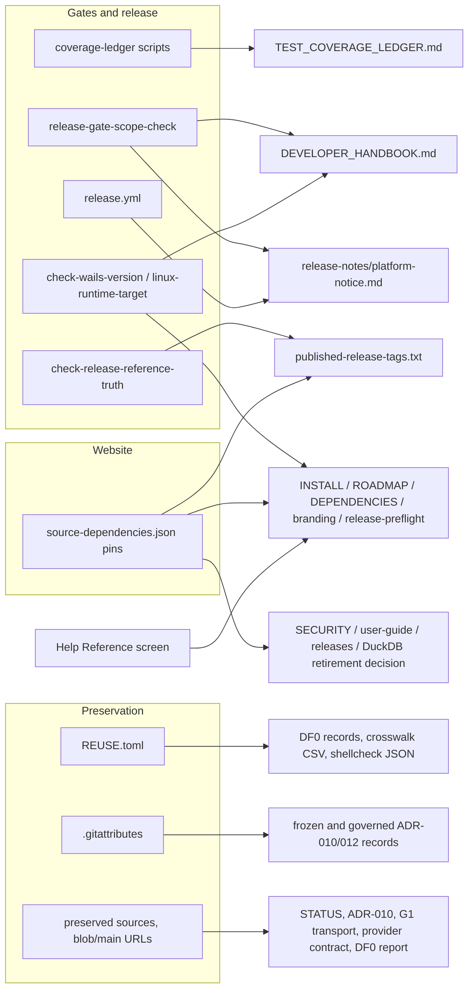

<!--
SPDX-FileCopyrightText: 2026 James L. Burns and The GoPMgr Contributors
SPDX-License-Identifier: GFDL-1.3-or-later
-->

# Documentation structure: reorganization and consolidation plan

**Direction:** On 2026-11-17 the owner asked for an analysis, a plan and a
design for the structure of `docs/`. They then asked that documents be
combined where that is logical, easier to review and reasonable.
**Baseline:** `main` at `9ab5d91` (PR 226).
**Status:** Proposed. Nothing has moved or been merged. Each phase needs the
owner decisions in [section 7](#7-owner-decisions) first.
**Inventory:** every file under `docs/` is listed, with its kind, status,
references and proposed action, in
[docs-reorganization-inventory.md](docs-reorganization-inventory.md).

## 1. Summary

`docs/` links work, but the folder has no map and no checkable inventory.
Some of its files are pieces of one subject split for no reader's benefit.

- **Links:** 6 of the 928 relative Markdown links are broken, all inside one
  frozen snapshot.
- **Navigation:** there is no `docs/README.md`, and no register of ADRs,
  decisions or evidence. `docs/testing/` holds 66 Markdown files in one flat
  folder.
  - Four hand-kept indexes overlap, and one of them is stale (section 2.4).
- **Status:** fewer than half of the 193 Markdown files that are not frozen
  state a status (about 85, depending on how a status line is detected), each
  in its own words.
- **Naming:** two imported proposal sets have upper-case generic names. Two
  review records are named alike, and neither name says what it reviews.
- **Fragments:** several subjects are split across files. For example, one
  save contract is recorded in four files, one per editor.

The design is **index first, then consolidate**:
- Every folder gets a README listing every file.
- A documentation ledger, which a tool checks, makes "every file is
  inventoried" a tested fact. It gives each document a permanent ID and keeps
  its path history, so references can always be traced.
- 21 fragment files with a shared subject and status combine into 7 new files.
- 1 superseded note becomes a labelled appendix of the document that
  replaced it.
- 3 records are renamed or moved.

Merging joins records without rewriting them. Section 5.2 defines exactly
what a merge may change, and a check proves nothing else changed.

## 2. Analysis

### 2.1 Contents

| Folder | Files | Content | Holds |
| --- | ---: | ---: | --- |
| `docs/` (root) | 20 | 1.0 MB | Entry-point references, user guides, status, roadmap, release data, one dated security review |
| `agent/` | 4 | 36 KB | Instructions for ADR-010 and ADR-012 agent work |
| `design/` | 70 | 2.6 MB | 15 numbered ADRs and 2 unnumbered; designs and plans; frozen ADR-010, ADR-012 and ADR-013 snapshots; the reporting-extension set |
| `engineering/` | 27 | 282 KB | ADR-013 slice records, advisory and tooling records |
| `interoperability/` | 4 | 46 KB | Dependency reviews and the transport matrix |
| `release-notes/` | 1 | 1 KB | Text fed into `gh release create` |
| `releases/` | 1 | 8 KB | Evidence for a published release |
| `review/` | 25 | 334 KB | Owner decisions, reviews, triage |
| `testing/` | 127 | 2.9 MB | 66 Markdown records (strategies, evidence, qualification, the DataFusion "DF0" spike), 60 DF0 data files, 1 CSV |
| **Total** | **279** | | 212 Markdown, 54 JSON, 9 JSONL, 2 DOCX, 1 CSV, 1 TXT |

Content is the sum of file sizes, not disk usage.

### 2.2 Wiring

These consumers read, check, show or pin `docs/` paths. Moving or renaming a
file they name breaks a gate, a release, the website, a user-visible string
or a test message, unless the same commit updates the consumer.

| Consumer | Files |
| --- | --- |
| `scripts/check-coverage-ledger-current.sh` and `-drift.sh` | `TEST_COVERAGE_LEDGER.md` |
| `scripts/release-gate-scope-check.sh` | `DEVELOPER_HANDBOOK.md` (required text), `release-notes/platform-notice.md` |
| `.github/workflows/release.yml` | `release-notes/platform-notice.md` |
| `scripts/check-release-reference-truth.sh` | `published-release-tags.txt`, `release-notes/*-rc*.md` (glob) |
| `scripts/check-linux-runtime-target.sh` | `ROADMAP.md`, `INSTALL.md`, `release-preflight.md` |
| `scripts/check-wails-version.sh` | `INSTALL.md`, `DEVELOPER_HANDBOOK.md`, `DEPENDENCIES.md`, `branding.md` |
| `website/quality/source-dependencies.json` (sha256 pins) | `INSTALL.md`, `ROADMAP.md`, `SECURITY.md`, `branding.md`, `user-guide.md`, `published-release-tags.txt`, `releases/v1.1.0-alpha.2.md`, `review/ADR-012-DUCKDB-RETIREMENT-OWNER-DECISION.md`; outside `docs/`, root `README.md` and `LICENSE.md`. Editing any pinned file means re-pinning it and re-reviewing its pages under `website/README.md` |
| `website/tools/test_site.py` | `SECURITY.md` |
| `REUSE.toml` | `engineering/adr-013-shellcheck-findings.json`, `testing/adr-010-case-crosswalk.csv`, `testing/adr-012-df0-records/**`, `design/reporting-extension/{sources/*,*.json,*.docx}` |
| `.gitattributes` (`-whitespace`, text kept as received) | ADR-010 v1, v2.0 and v2 addendum; the ADR-010 v2.2 acceptance record; the five working ADR-012 copies; `design/adr-012/**` |
| Frontend, user-visible: `help/HelpReference.svelte` | `INSTALL.md` (path shown to users) |
| Frontend, other (11 files: comments, tests, i18n) | Mostly `DEVELOPER_HANDBOOK.md`, `TEST_COVERAGE_LEDGER.md`, `design/typography-ibm-plex.md` |
| Test failure message: `internal/kernel/overallocation_differential_test.go:38` | `testing/resource-overallocation-contract.md` |
| Tool and script messages: `tools/engine-advisories`, `tools/sbom`, `scripts/check-release.sh`, `fetch-fonts.sh`, `check-required-font-assets.sh`, `verify-module-notices.sh`; `Makefile` help text | `engineering/engine-advisories.md`, `SBOM.md`, `design/typography-ibm-plex.md`, `review/ADR-012-DUCKDB-RETIREMENT-OWNER-DECISION.md` |
| Go comments (24 files) and `code-map/recent-decisions.md` | Mostly ADRs, design contracts and evidence records |
| `AGENTS.md` | 26 lines naming `docs/` paths, mostly ADR-010, ADR-012 and ADR-013 governance and resource resilience |
| Preserved sources, by `blob/main` URL: `reporting-extension/sources/ADR-EXT-001…` | `STATUS.md`, `design/ADR-010-plugin-architecture.md`, `design/adr-010-g1-transport-design.md`, `design/CONTRACT-AND-RECOVERY-REFERENCE.md`, `review/ADR-010-G1-authorization-clarification-2026-10-28.md`, `testing/adr-012-df0-g-report.md` |



### 2.3 Link health

- **Relative Markdown links:** 928 across the repository. 6 are broken, all in
  the frozen `design/adr-010/v2.1/` snapshot, which was copied without the
  files beside it.
- **Plain-text `docs/…` paths:** 146 distinct paths. 10 point at nothing:
  - **3 planned:** `interoperability/mpxj-*.md`, promised by the governed
    `design/adr-010-implementation-plan.md` for G1.
  - **1 abandoned:** `interoperability/adr-012-format-parity-matrix.md`. The
    DataFusion spike ended without adoption on 2026-11-09.
  - **1 renamed after it was cited:** the DF0 report is now
    `testing/adr-012-df0-g-report.md`, but
    `review/adr-012-df0-decision-report.md` is still cited by the governed
    working copy `testing/adr-012-datafusion-feasibility-spike.md` and by the
    frozen copies.
  - **1 ignored private path:** `docs/superpowers/plans/`.
  - **4 false matches:** website content paths that only look like `docs/`
    paths.
- **Licensing:** all 212 Markdown files carry an inline SPDX header except
  `reporting-extension/sources/ADR-EXT-001…`, which is kept as received and
  covered by `REUSE.toml`. `make license-check` passes.

### 2.4 Navigation

| Index | Covers | Problem |
| --- | --- | --- |
| `README.md` "Documentation" | 11 files | A good entry point. It is website-pinned, so this plan leaves it alone |
| `DEVELOPER_HANDBOOK.md` §22.3 | ADRs | Lists ADR-001 to 004 as "Current ADRs", but 15 numbered and 2 unnumbered ADRs exist |
| `DEVELOPER_HANDBOOK.md` Appendix F | Root references | Overlaps the README and covers no subfolder |
| `code-map/recent-decisions.md` | Durable decisions | Useful, but hand-kept and not linked from `docs/` |

Nothing lists the review records, the 66 testing records or the engineering
records.

### 2.5 Naming

- **Security-keys proposal (v4).** Five `design/` files:
  - `ADR-TBD-TIERED-…`, `ROADMAP-TIERED-…`, `TEST-TIERED-…`;
  - `POLICY-AND-ENROLLMENT-STATE-MACHINE.md`;
  - `CRYPTO-AND-STORAGE-CONTRACT.md`.

  Its review is `review/CRITICAL-REVIEW-AND-DECISION-DELTA.md`.
- **Provider-integrations proposal (v2).** Four `design/` files:
  - `ADR-TBD-provider-…`, `ROADMAP-provider-…`, `TEST-provider-…`;
  - `CONTRACT-AND-RECOVERY-REFERENCE.md`.

  Its review is `review/CRITICAL-REVIEW-and-DECISIONS.md`.
- The two review names differ only in letter case and a suffix, and neither
  names its subject.
- The root holds one dated record, `cornucopia-elicitation-2026-09-01.md`.
- `release-notes/` (text that goes into a release) and `releases/` (evidence
  for a published release) have similar names but different jobs. Both are
  wired, so they keep their paths and get READMEs that say which is which.

### 2.6 Unreferenced files

Nothing in the repository names these files, by path or by name. Folder
READMEs will list them:

- the three `design/adr-012` READMEs;
- `design/reporting-extension/GoPMgr_Reporting_Extension_System_Design.docx`;
- `design/wbs-capability-parity-plan.md`;
- `engineering/website-production-ci.md`;
- `testing/release-race-package-policy.md`;
- `testing/reliability-2026-10-12.md`;
- `testing/sqlcipher-wal-reset.md`.

The DF0 data files and the frozen snapshots are cited by directory, which is
enough.

## 3. Constraints

1. **Frozen records stay exact, and so does every path they cite.** These
   are:
   - the ADR-010 source plans and the ADR-010 v2.2 acceptance record, kept
     byte-for-byte as received (`.gitattributes`);
   - the as-submitted snapshots in `design/adr-010/v2.1/`,
     `design/adr-012/v0.*/` and `design/adr-013/v0.3-as-submitted/`;
   - the preserved sources in `design/reporting-extension/sources/`, which its
     implementation plan says to keep unchanged. They cite six paths by
     `blob/main` URL (section 2.2).
2. **Governed records keep their paths.** This covers:
   - ADR-010 and ADR-011 (the preservation prompt);
   - ADR-012: the five working copies keep their body as received, and only
     their status lines are maintained;
   - the ADR-013 records cited from `AGENTS.md`.

   The manifest records each one's status exactly as stated. It never
   reclassifies accepted material, as `docs/agent/ADR-010-architecture-preservation-agent-prompt.md`
   requires.
3. **Pinned and wired files keep their paths** (section 2.2). Where an edit to
   a pinned file is unavoidable, the phase includes re-pinning it and
   re-reviewing its pages.
4. **Records are not rewritten.** `STATUS.md` already rules that design
   records, ADRs and evidence stand as written.
   - A merge may only join records and change their headings and links
     (section 5.2).
   - Updating a link path inside a non-frozen record is path maintenance,
     not rewriting.
   - Status for old records lives in the manifest, not in edits to them.
5. **ADRs stay in `docs/design/`**, as Handbook §22.3 prescribes, and stay one
   file each. An ADR is never merged with another document.
6. **No new dependencies.** The checker is a stdlib Go tool under `tools/`,
   like `tools/code-map`.

## 4. Target structure

```text
docs/
  README.md                 NEW  map: start here, by reader and task
  ledger.json               NEW  the documentation ledger (REUSE.toml: CC0-1.0)
  LEDGER.md                 NEW  generated, readable view of the ledger
  (root references)         unchanged
  agent/README.md           NEW
  design/
    README.md               NEW  ADR register, then designs by subject
    security-keys-v4-design.md          MERGED from 4 files
    provider-integrations-v2-plan.md    MERGED from 2 files
    governed-presentation-only-fx.md    absorbs the superseded FX options note
    ADR-TBD-*.md, CONTRACT-AND-RECOVERY-REFERENCE.md   unchanged (see 5.1)
  engineering/README.md     NEW  ADR-013 slices in phase order, then records
  interoperability/README.md   NEW
  release-notes/README.md      NEW
  releases/README.md           NEW
  review/
    README.md               NEW  decision register, newest first
    security-keys-v4-critical-review.md          RENAMED
    provider-integrations-v2-critical-review.md  RENAMED
    cornucopia-elicitation-2026-09-01.md         MOVED from docs/
  testing/
    README.md               NEW  strategies; evidence by subject; qualification by date; DF0
    editor-save-atomicity.md          MERGED from 4 files
    editor-guard-errors.md            MERGED from 3 files
    editor-timestamp-boundary.md      MERGED from 2 files
    sqlcipher-cleanup-corrections.md  MERGED from 3 files
    wbs-foundation-evidence-2026-10.md   MERGED from 3 files
```

## 5. Consolidation

### 5.1 Merges

Each group covers one subject that a reviewer would read as a whole. There
are two kinds:

- **Combined files.** Every source has the same status, so the new file can
  carry it: `historical` for the testing groups, `proposed` for the two
  proposal groups.
- **Appendix.** One superseded note is added to the document that replaced
  it, under a heading that marks it "Superseded record, not maintained". The
  receiving file keeps its own status. Only `superseded` or `historical`
  records may become appendices; an accepted record never does.

| New or receiving file | Sources | Why it is one subject |
| --- | --- | --- |
| `testing/editor-save-atomicity.md` | `resource-calendar-`, `sprint-`, `stakeholder-`, `work-item-save-atomicity.md` | One contract, proven for four editors. A reviewer compares them side by side |
| `testing/editor-guard-errors.md` | `sprint-`, `stakeholder-`, `work-item-guard-errors.md` | One exit-guard error contract, three editors |
| `testing/editor-timestamp-boundary.md` | `sprint-`, `work-item-timestamp-boundary.md` | One timestamp-boundary contract, two editors |
| `testing/sqlcipher-cleanup-corrections.md` | `sqlcipher-commit-cleanup.md`, `-rollback-cleanup.md`, `-wal-reset.md` | Three corrections to SQLCipher connection cleanup after failed transactions. Nothing names the WAL-reset record today |
| `testing/wbs-foundation-evidence-2026-10.md` | `wbs-model-validation-2026-10-13.md`, `wbs-ordering-2026-10-13.md`, `wbs-storage-boundary-2026-10-14.md` | Consecutive evidence for one WBS foundation, recorded over two days |
| `design/security-keys-v4-design.md` | `POLICY-AND-ENROLLMENT-STATE-MACHINE.md`, `CRYPTO-AND-STORAGE-CONTRACT.md`, `ROADMAP-TIERED-SECURITY-KEYS.md`, `TEST-TIERED-SECURITY-KEYS.md` | One proposal's state machine, crypto contract, roadmap and test plan (304 lines). Its ADR stays separate |
| `design/provider-integrations-v2-plan.md` | `ROADMAP-provider-integrations.md`, `TEST-provider-integrations.md` | One proposal's roadmap and test plan. Its ADR stays separate. Its contract stays because a preserved source cites it by URL |
| `design/governed-presentation-only-fx.md` (note) | `portfolio-fx-governance-options.md` | A 17-line superseded options paper, which already points to its replacement |

Considered and not merged:

| Candidates | Reason |
| --- | --- |
| ADR-012 DF0 records (17 files) | Frozen and governed records cite them |
| `account-race-assurance.md` and `account-race-oracle.md` | One is a maintained strategy (`current`), the other a dated record (`historical`). Combined, it would be unclear which part may still change |
| `adr-013-shfmt-plan.md` and `adr-013-zizmor-plan.md`, into their results | Approved contracts still in force (`accepted`, 2026-11-05). Their result records cite them as the approved contract (`adr-013-shfmt.md:9`, `adr-013-zizmor.md:8`); an appendix would mark them not maintained |
| `adr-013-checkout-guard-plan.md` and `adr-013-release-license-plan.md` | `AGENTS.md` cites both by path, and their P6 work is not all done |
| `review/independent-evaluation-2026-11-10.md` and its response plan | Two kinds of record by different authors: an external evaluation and the owner's decision on it |
| The 8 dated macOS qualification records | Separate scenarios and runs, each cited on its own; an index by date serves better |
| The ADR-010 G1 decision records | Governed by ADR-010 |
| The professional-scheduling set | Spans design, decision and test records; the decisions are accepted owner records |
| `release-notes/` and `releases/` | Different jobs, both wired |
| Root references (STYLE, ERROR_HANDLING, Handbook and others) | Wired or pinned; each already stands alone |

### 5.2 Merge rules

**The path table.** P2 records one table that maps each old path to its new
path, or to its new file plus a section anchor. It covers every merge and
rename in sections 5.1 and 5.3. Together with re-basing (next paragraph), it
is the only source of path changes anywhere in P2.

**Re-basing.** When a file or section moves to another folder, its relative
links to targets that did not move are rewritten so they still reach the
same target, for example `../internal/…` becoming `../../internal/…` in the
cornucopia record. The check reverses this by resolving each link against
the old location and the new one, and requiring the same target.

**A combined file** is exactly these parts, in this order:
1. One SPDX header. All 22 sources carry the same holder and
   GFDL-1.3-or-later.
2. A title, and a "What this file holds" list with one line per source: its
   former path, its date and the commit it came from (`9ab5d91`). Nothing
   else.
3. One section per source, in date order (editor order within a contract).
   The section heading is the source's own title, which is unique within the
   group. Below it, the source body follows unchanged except for:
   - every heading moving down one level;
   - link targets and plain-text paths or names changed exactly as the path
     table says.

   Link text, wording, statuses and duplicated text stay as they were.

**An appendix** is one heading, "Superseded record, not maintained: \<former
title\>", one line naming the former path, date and commit, and then the
source body under the same rules. The receiving file's existing text must
stay unchanged.

**The preservation check (P2).** It fails unless all of these hold:
- each combined file splits into exactly the parts above, with no other
  text;
- each section, with the path table applied in reverse and its headings
  moved back up, equals `git show 9ab5d91:<former path>` without its SPDX
  header;
- the receiving file, minus its appendix, equals its `9ab5d91` text, apart
  from path-table changes;
- every other file P2 touches, including the 14 referrers and the 3 renamed
  or moved files, differs from its `9ab5d91` text only by path-table
  substitutions and re-basing.

Exempt, because their own checks cover them:
- `ledger.json`: covered by the ledger check;
- `LEDGER.md` and the generated README sections: must match the ledger;
- P2b's website files (`source-dependencies.json`, `reviewed-inputs.json`
  and page front matter such as `last_reviewed`): covered by
  `canonical_check()` and `make website-tests`.

**Known substitutions.** These plain-text mentions need the path table:
- `ROADMAP-provider-integrations.md:68` names
  `docs/review/CRITICAL-REVIEW-and-DECISIONS.md`;
- `ADR-TBD-TIERED-SECURITY-KEY-POLICY-v4.md` names its four companions on
  line 10, and `CRYPTO-AND-STORAGE-CONTRACT.md` again on line 86;
- `ADR-TBD-provider-neutral-integration-framework.md:18` names three of its
  companions.

**Anchors.** Sources share subheadings: "Regression evidence" appears in more
than one save-atomicity record, and "Lessons" in more than one SQLCipher
record. GitHub tells repeated headings apart by adding `-1`, `-2` to their
anchors, so those anchors depend on section order. No link into those
subsections exists today. New links should target the unique section
headings.

### 5.3 Renames and moves

| From | To |
| --- | --- |
| `review/CRITICAL-REVIEW-AND-DECISION-DELTA.md` | `review/security-keys-v4-critical-review.md` |
| `review/CRITICAL-REVIEW-and-DECISIONS.md` | `review/provider-integrations-v2-critical-review.md` |
| `cornucopia-elicitation-2026-09-01.md` | `review/cornucopia-elicitation-2026-09-01.md` |

- Content stays byte-for-byte the same, except for path-table substitutions
  and re-basing (5.2).
- `git mv` keeps the history.

### 5.4 Files to update

The inventory's appendix lists, for every merge and rename, each other file
that names a source: 14 files in all. Mentions inside the sources and
receiving files themselves are rewritten as part of the merge.
`docs/ROADMAP.md` is the only pinned one, and four changes touch it:

- the security-keys merge;
- the provider-integrations merge;
- the two review renames.

No frozen or governed record names any source (checked against section 3's
lists, including `blob/main` URLs).

## 6. Documentation ledger

The ledger answers four questions for every file under `docs/`: what it is,
whether it can be trusted today, where it went and who still points at it.
It follows the pattern of `TEST_COVERAGE_LEDGER.md`: a ledger that a script
checks on every change.

### 6.1 Files

- **`docs/ledger.json`** is the source of truth. Tools read it, and its diffs
  are easy to review. `REUSE.toml` annotates it as CC0-1.0, like
  `code-map/*.json`.
- **`docs/LEDGER.md`** is generated from it: one table per folder, for people
  to read. It is never edited by hand.
- **Folder READMEs** keep a hand-written introduction. Their file lists sit
  between `<!-- ledger:begin -->` and `<!-- ledger:end -->` and are generated
  from the ledger.

### 6.2 Entry format

There is one entry per file, or one per evidence-data directory such as
`testing/adr-012-df0-records/df0-a/**`. The values in this example are
illustrative; in a real ledger `next_id` is one more than the highest ID
assigned.

```json
{
  "next_id": 281,
  "entries": [
    {
      "id": "DOC-0142",
      "path": "docs/testing/editor-save-atomicity.md",
      "kind": "evidence",
      "status": "historical",
      "status_evidence": "9ab5d91",
      "stated_status": null,
      "summary": "Save atomicity for the four editors: one contract, proven per editor.",
      "frozen_sha256": null,
      "previous_paths": [
        {"path": "docs/testing/sprint-save-atomicity.md", "until": "PR <P2a number>"}
      ]
    },
    {
      "id": "DOC-0097",
      "path": "docs/design/portfolio-fx-governance-options.md",
      "kind": "design",
      "status": "removed",
      "status_evidence": "PR <P2a number>",
      "summary": "Superseded FX options paper; now an appendix of governed-presentation-only-fx.md.",
      "content_now_in": "DOC-0096"
    }
  ],
  "planned": [
    {"path": "docs/interoperability/mpxj-field-mapping.md",
     "promised_by": "docs/design/adr-010-implementation-plan.md"}
  ],
  "recorded_dangling": [
    {"source": "docs/testing/adr-012-datafusion-feasibility-spike.md",
     "target": "docs/review/adr-012-df0-decision-report.md",
     "reason": "renamed; the report is docs/testing/adr-012-df0-g-report.md"}
  ]
}
```

| Field | Meaning |
| --- | --- |
| `id` | A permanent identifier, `DOC-` plus four digits. Assigned once from `next_id`, never changed and never reused, even after the file is removed |
| `path` | Where the file is now |
| `kind`, `status` | From the vocabularies below |
| `status_evidence` | What justifies the status: a tracked file (a decision record or evidence file), a pull request number (`PR 228`), or a commit already on `main`. A change cannot name its own commit, so a change records its PR number instead. This is the rule `STATUS.md` already follows for its rows |
| `stated_status` | The file's own status line, quoted exactly. Used for ADRs, designs, plans and test plans, so the ledger never reclassifies accepted material |
| `summary` | One line of at most 120 characters, starting with the subject rather than "This document". READMEs show it, so it is the copy readers scan |
| `frozen_sha256` | Set only when `status` is `frozen` |
| `previous_paths` | Every earlier path, with the PR that stopped using it |
| `content_now_in` | Set only when `status` is `removed`: the ID of the document that holds the content now, or `null` if the content was dropped, which the evidence must explain |

**Kinds:**

| Kind | Meaning |
| --- | --- |
| `guide` | How-to for users or maintainers |
| `reference` | Kept-current facts or rules |
| `status` | `STATUS.md` |
| `roadmap` | `ROADMAP.md` |
| `adr` | An architecture decision record |
| `design` | A design or contract |
| `plan` | A plan or backlog |
| `decision` | An owner decision record |
| `review` | A review, evaluation or audit |
| `strategy` | A test strategy or test contract |
| `evidence` | Test or qualification evidence |
| `evidence-data` | Machine-readable evidence |
| `release` | Release inputs and records |
| `agent` | Instructions for AI agents |
| `index` | A folder README, `ledger.json` or `LEDGER.md` |

**Statuses:**

| Status | Meaning |
| --- | --- |
| `current` | Kept true as the code changes |
| `proposed` | Not yet approved |
| `accepted` | Approved and in force |
| `superseded` | Replaced; the entry names the replacement |
| `historical` | A true record of its own date, never updated |
| `frozen` | Must stay byte-identical (`frozen_sha256`) |
| `removed` | The file no longer exists; the entry stays so that its ID and history still resolve |

These statuses describe the document, not the feature, so they don't collide
with the words `STATUS.md` uses.

### 6.3 Ledger rules

| Goal | Rule | Enforced by |
| --- | --- | --- |
| Organized | Every file under `docs/` has exactly one entry before it merges | Check |
| Organized | A file's folder must suit its kind (table below). The root holds only entry points | Check |
| Organized | A **new** file's name is lowercase letters, digits and hyphens, and starts with its subject. Any date in the name is a suffix, `-YYYY-MM` or `-YYYY-MM-DD`. Generic prefixes (`ROADMAP-`, `TEST-`, `CRITICAL-REVIEW-`, `ADR-TBD-`) are refused. Exceptions: `README.md`, `LEDGER.md`, and ADRs named `ADR-NNN-title.md` as Handbook §22.3 prescribes. Existing names are kept unless this plan renames them | Check, for files added after P1. Whether a record should carry a date is left to reviewers |
| Easily maintained | A move, rename or merge updates its referrers and the ledger in the same commit | Check (link resolution) |
| Easily maintained | Indexes and `LEDGER.md` are generated, never hand-edited | Check |
| Auditable | Every status names its evidence, and changing a status changes its evidence | Check that the field is present and names an existing commit or file; reviewers judge whether it supports the status |
| Auditable | Frozen records are hash-pinned; governed records are listed | Check |
| Auditable | Nothing disappears silently. A deleted file's entry stays as `removed`, with the commit that removed it and where its content went | Check |
| Reliably referenced | IDs are unique, permanent and never reused; `next_id` only grows | Check: every ID from `DOC-0001` to `next_id` − 1 has exactly one entry, so a deleted entry shows as a gap. Renumbering is caught by the history check |
| Reliably referenced | Every former path stays in `previous_paths`, so an old link can be traced to the current file | History check |
| Reliably referenced | Links point to a path or heading anchor that exists | Check |

**Where each kind may live:**

| Kind | Allowed folders |
| --- | --- |
| `adr`, `design` | `design/` |
| `plan` | `design/`, `engineering/`, `testing/`, root (release plans and the backlog) |
| `strategy` | `testing/`, `design/` |
| `evidence`, `evidence-data` | `testing/`, `engineering/` |
| `decision` | `review/` |
| `review` | `review/`, `interoperability/`, `engineering/` |
| `reference` | root, `design/`, `engineering/` |
| `guide`, `status`, `roadmap` | root |
| `release` | `release-notes/`, `releases/`, root (`published-release-tags.txt`) |
| `agent` | `agent/` |
| `index` | Any folder |

These are the folders each kind already uses. The one file outside them, a
review in the root, moves in P2a. Frozen records are exempt.

**Citing a document.** Link to its path, as today. Where a citation must
survive future moves, such as in a decision record, an evidence file or a
commit message, add its ID, for example "(DOC-0142)". `make docs-ledger
find=DOC-0142` prints the current path and the path history.

### 6.4 Checker: `tools/docs-ledger`

`make docs-ledger` regenerates `LEDGER.md` and the README lists.
`make docs-ledger-check` checks everything below.

**Scope:**
- Every tracked file under `docs/`.
- For links: tracked Markdown under `docs/` that is not frozen, plus
  `AGENTS.md`, root `README.md` and `code-map/recent-decisions.md`.
- `website/` is out of scope: its Hugo-relative links have their own checks.

**Contracts.** The check fails unless all of these hold:
1. Every file in scope has exactly one entry that is not `removed`, and every
   such entry names a file or directory that exists. `planned` paths are
   exempt, and must not exist yet. `removed` entries must name no existing
   file.
2. Every `kind` and `status` comes from the vocabulary; every `summary` is
   non-empty and at most 120 characters; every `status_evidence` is a tracked
   file, a `PR N` reference or a commit hash in the expected form. Only the
   form is checked offline, not whether a PR or commit exists.
3. Every `frozen` entry matches its `frozen_sha256`.
4. Every relative link and plain-text `docs/…` path in scope resolves, or is
   a `planned` path, or appears in `recorded_dangling`. A dangling entry is
   allowed only when its source is frozen, governed or `historical`; current
   files must be fixed instead.
5. `LEDGER.md` and every generated README section match the ledger.
6. IDs are unique and well formed; every ID from `DOC-0001` to `next_id` − 1
   has exactly one entry.
7. Every entry's folder suits its kind (6.3), and every file added after P1
   follows the naming rule.

**History check.** `make docs-ledger-history BASE=origin/main` compares the
ledger with the one at the merge base of `BASE` and `HEAD`:
- no ID changes its path without the old path joining `previous_paths`;
- no entry's ID changes;
- `next_id` never decreases.

It needs history. If the merge base cannot be found, as in a shallow clone,
it fails and says to fetch more history; it never passes by skipping. When
the merge base has no `ledger.json` and `HEAD` adds one (P1 itself), it
reports "bootstrap: no base ledger" and passes only if every other contract
passes. It is
run before opening or updating a PR, beside the coverage-ledger checks that
`AGENTS.md` already requires. CI's Verify job checks out a single commit, so
running it in CI needs a workflow change, which is decision D8.

**Limit:** an edit to a frozen file passes if the same change also updates
its hash in the ledger. Review of ledger hash changes is the guard. A second
tool would not stop this either.

The tool's tests join `make verify` from P1 onwards, through `./tools/...`.
Running the check itself as a gate is decision D3.

### 6.5 Navigation

- **`docs/README.md`** is the one map, organised by reader:
  - **Using GoPMgr:** install, user guide, security.
  - **Deciding:** status, roadmap, vision, the decision register.
  - **Building:** architecture, handbook, style, errors, testing, coverage,
    dependencies.
  - **Releasing:** preflight, release plan, release notes, SBOM.
  - **Records:** design, review, testing, engineering.
- **Handbook §22.3:** the stale ADR list is replaced by a link to the register
  in `design/README.md`; the convention text stays.
- **Handbook Appendix F** points to `docs/README.md`.
- The Handbook strings that `check-wails-version.sh` and
  `release-gate-scope-check.sh` require stay unchanged.
- **The root `README.md` is not edited:** it is website-pinned, and the
  Handbook and `docs/` already lead to the map.
- **`code-map/recent-decisions.md`** stays as the short summary of decisions.
  `docs/README.md` links to it.

## 7. Owner decisions

| ID | Decision | Recommendation |
| --- | --- | --- |
| D1 | Index first, plus the merges and renames here; index only; or a full re-tree into guides, reference and records | Index first, with merges and renames. A full re-tree breaks frozen, governed and pinned references, and would touch most of the 1,112 places where one tracked file names another document. Index only leaves the fragments and misleading names in place. |
| D2 | The documentation ledger and its rules (section 6), with permanent document IDs, checked by a Go tool | Yes. It is the only way the folder stays organized, auditable and reliably referenced without manual audits. Without IDs, a path is a document's only identity, and paths are what reorganizing changes |
| D3 | Add `docs-ledger-check` to `make verify`, which CI's Verify job runs | Yes, after P2 has landed and the tree passes |
| D4 | Rename the two `CRITICAL-REVIEW-*` records | Yes. Today their names don't say what they review |
| D5 | ADRs stay in `docs/design/`, one file each | Yes. Moving them is churn, and the register gives the overview |
| D6 | The merges in section 5.1. Each group can be accepted or declined on its own | Accept all eight. Each joins records of one subject and status without changing their text |
| D7 | Edit the pinned `ROADMAP.md` in P2b, then re-pin it and re-review its pages | Yes. Otherwise the security-keys and provider merges and both renames must be dropped |
| D8 | Run the history check in CI. This needs `fetch-depth: 0` on the Verify job in `.github/workflows/ci.yml`, a workflow change under the ADR-013 actionlint and zizmor gates | Not yet. Run it locally before each PR first; decide after P3 whether CI should also run it |

## 8. Phases

Each phase is one reviewable PR with Gate A and Gate B reviews, and keeps the
coverage-ledger rule in `AGENTS.md`. Every phase merges with a merge commit,
so the commits that ledger entries and history checks refer to stay in
`main`'s history.

| Phase | Scope | Pinned files edited |
| --- | --- | --- |
| **P1** Ledger and indexes | `ledger.json` covering every file with IDs and status evidence, its REUSE annotation and the generated `LEDGER.md`; `tools/docs-ledger` and its tests; folder READMEs and `docs/README.md`; the Handbook §22.3 and Appendix F edits; opt-in Make targets; a coverage-ledger heading for the new tool | None |
| **P2a** Unpinned consolidation | The five `testing/` merges, the FX appendix, the cornucopia move; their referrers; the merge-preservation check (5.2) | None |
| **P2b** Pinned consolidation | The security-keys and provider merges and both review renames; their referrers, including `ROADMAP.md`; the re-pin and page re-review | `docs/ROADMAP.md` |
| **P3** Enforcement | `docs-ledger-check` joins `make verify` (D3) | None |

### 8.1 Verification

| Phase | Checks |
| --- | --- |
| **P1** | The tool's tests (8.2); `make docs-ledger-check` and `make docs-ledger-history` on the real tree; `make license-check`, `make verify`, `make coverage-ledger-current` and `make coverage-ledger-drift`; `make release-scope` (the Handbook changes); `git diff --check` |
| **P2a** | The P1 checks, plus the merge-preservation check (5.2); a link scan showing no new broken links; `git log --follow` on one renamed file |
| **P2b** | The P2a checks, plus `make website-tests` and the website `canonical_check()` after re-pinning; the hosted website job's build and output checks run on the PR |
| **P3** | `make verify` fails with one seeded unlisted file, and passes once that file is listed |

### 8.2 Test strategy for the checker

P1 must add one table-driven owner test for the contracts in section 6.4,
following the testing rules in `AGENTS.md`:
- Each case builds a small temporary repository, and its expected outcome is
  written out by hand.
- Each case must be shown to fail with its check disabled before the phase
  is accepted.

| Case | Regression caught |
| --- | --- |
| An unlisted file | A new document skips the inventory |
| A listed file that is missing | A move leaves a stale entry |
| A `planned` path that now exists | A planned file lands without a real entry |
| Two entries for one file | Ambiguous status |
| An unknown `kind` or `status` | Vocabulary drift |
| One changed byte in a frozen file | An accepted record silently edited |
| A broken link in a current file | A move forgets a referrer |
| The same broken link in a historical file, with a `recorded_dangling` entry and without one | The exception must not hide real breaks |
| A `recorded_dangling` entry whose source is `current` | The exception is misused for fixable files |
| A stale README section or `LEDGER.md` | An index no longer matches the ledger |
| A `status_evidence` that is missing, malformed, or names an untracked file | A status changed with nothing to point at |
| A deleted file whose entry is also deleted, not marked `removed` | A document silently disappears |
| A gap in the IDs below `next_id`; two entries with one ID | References by ID become unreliable |
| History check: a path changed without `previous_paths`; an ID renumbered; `next_id` lowered | Old links and IDs can no longer be traced |
| History check in a shallow clone with no merge base | The check must fail with its message, never pass by skipping |
| History check with no base ledger: once with a valid new ledger, once with an invalid one | The first ledger is accepted only on its own merits |
| A path change without `previous_paths` updated | An old link can no longer be traced |
| An evidence file under `design/`; a new file named `TEST-x.md`; a new `ADR-016-title.md` and `README.md` accepted | Placement and naming drift, without refusing the allowed names |

There are no snapshot tests of README text or counts. The check that runs on
the real tree is the integration test.

## 9. Risks

- **Broken bookmarks.** External bookmarks to the 22 merged and 3 renamed
  files break. Only GitHub blob links to `main` are affected; website links
  use pinned commits. `previous_paths` and the "What this file holds" lists
  let readers find the new location; so does `make docs-ledger find=<ID>`.
- **Merge conflicts in generated README sections.** Resolve them by
  regenerating with `make docs-ledger`.
- **Classification errors in the first ledger.** The P1 Gate A review checks
  a sample from every folder against each file's own text.
- **Status drift.** A document's own text can change status without its ledger
  entry changing. The checker cannot detect this, so reviewers own it, as they own
  `STATUS.md` today.
