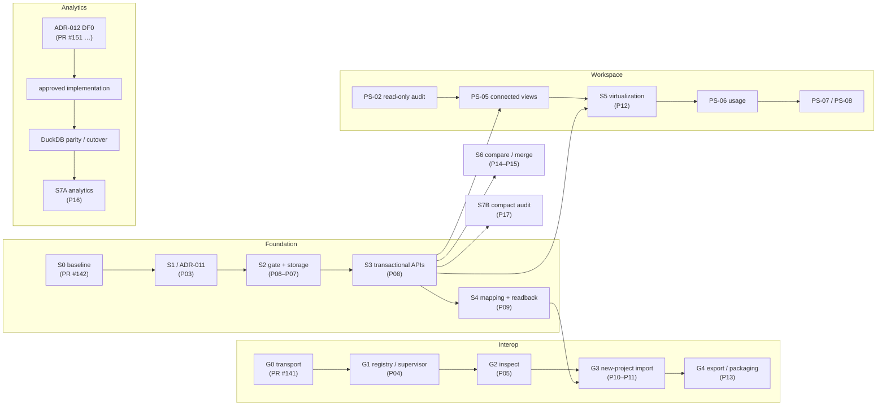

<!--
SPDX-FileCopyrightText: 2026 James L. Burns and The GoPMgr Contributors
SPDX-License-Identifier: GFDL-1.3-or-later
-->

# Professional scheduling and project controls modernization plan

**Status:** APPROVED strategic direction and priority order
([maintainer decision, 2026-10-26](../review/PS-professional-scheduling-ACCEPTED-OWNER-DECISION.md)).
It changes no accepted ADR. Where it differs from ADR-010, ADR-011's reserved
decisions or ADR-012, an Architecture Change Request (ACR) decides.

**Companions:**
- [capability matrix](../review/PS-capability-matrix.md);
- [domain model and open ADR-011 decisions](professional-scheduling-domain-model.md);
- [PS-02 schedule-quality audit specification](../testing/PS-02-schedule-quality-audit-spec.md).

## 1. Goal

GoPMgr is to become a professional, local-first project-management
application that exceeds ProjectLibre Desktop in:

- scheduling correctness;
- project controls and interoperability;
- usability, security, documentation and analysis.

It is to be **one connected experience** over independently governed
scheduling, scope, resource, financial and audit records. Correctness and
fidelity come before feature count (AP-04), and nothing proposed is described
as implemented.

## 2. Architectural principles

| ID | Principle | How it is held |
|---|---|---|
| AP-01 | Connected information, separate authorities. Stable typed IDs connect domains; names, row numbers, outline codes and positions are never identities | Domain ownership table in the [domain model](professional-scheduling-domain-model.md). **Open:** the received decision text lists no domain owners (see the decision record's "Gaps"); the table there is a proposal for confirmation |
| AP-02 | Keep the architecture: Go host and scheduling kernel, SQLCipher, Wails/Svelte, native gRPC local IPC for workers, MPXJ for external formats, DataFusion/Arrow as the analytics direction (ADR-012 gates) | ADR-010, ADR-011 (reserved), ADR-012. Workers never hold project keys, databases, approvals or audit authority |
| AP-03 | One calculation authority per result. Derived views name their source revision and calculation version; imported and calculated values stay distinguishable | The Go kernel stays the only schedule calculator. DataFusion is not a scheduling authority (PS-09) |
| AP-04 | Reliability and fidelity before feature count | Every work-package exit gate below includes tests, recovery and documentation |
| AP-05 | Local-first | No mandatory service. Optional features stay optional |

## 3. Work packages

Status uses the capability matrix's words.

| WP | Priority | Maps to | Depends on | Status today | First slice |
|---|---|---|---|---|---|
| **PS-00** Verified baseline | Immediate | ADR-010 P02/S0 (PR #142); capability matrix; ADR-012 DF0-A (PR #151) | — | **Partial.** S0 measurements, fixtures and hardware-profile proposals exist. The capability matrix exists. Owner-approved hardware and numeric budgets (OWN-10) are still open | Owner selects hardware profiles and budgets from S0 §7 |
| **PS-01** Normalized connected model | Critical, foundational | ADR-011 (reserved) = ADR-010 S1 (P03) → S2 gate and storage (P06, P07) → S3 APIs (P08) → S4 mapping (P09) | PS-00 | **Proposed.** The [domain model](professional-scheduling-domain-model.md) lists the open ADR-011 decisions | ADR-011 draft (P03) |
| **PS-02** Schedule-quality audit | High, early parallel | Read-only use of `internal/kernel`. Later history needs S3 | None for the snapshot version | **Proposed**: [specification](../testing/PS-02-schedule-quality-audit-spec.md) | `internal/schedaudit`, read-only, over a bounded chart snapshot (§6) |
| **PS-03** File inspection and interoperability | Critical | ADR-010 G1 (P04) → G2 inspect (P05) → G3 import (P10, P11) → G4 export (P13) | G0 evidence; G1; S4 for full import | **Partial.** MSPDI Quick Chart Import and export are on `main` but drop major fields (matrix §5). G0 and G1 are on branches | Continue G1 slices (G1-2 contract is paused) |
| **PS-04** Large-schedule storage, audit, Gantt | Critical | ADR-010 S3 (P08), S5 (P12), S7B (P17). S0 F1–F3 are the baseline | PS-01 (S2/S3) | **Blocked by architecture** (S0 F1–F3) | After S3: scoped `ApplyTaskPatch`. **Possible before S3:** the F3 overallocation rescan fix (see §6) |
| **PS-05** Connected scheduling workspace | High | ADR-010 S5 (P12) and appendix A components | PS-01 S3 query APIs | **Proposed** | Read-only linked outline and Gantt over S3 queries |
| **PS-06** Task and Resource Usage | High | Extends `kernel.ResourceUsage` and capacity plans. Needs S1/S3 assignments and timephased segments | PS-01, PS-05 | **Proposed**; the kernel computes usage | Read-only usage views |
| **PS-07** Resource and financial planning | High, after PS-01/PS-06 | Cost-control domain (`internal/budget`); ADR-009 currency rules | PS-01, PS-06 | **Partial** (hourly rate to committed cost) | Rate-table contract and checked-money tests |
| **PS-08** Advanced scheduling | Medium | Kernel extensions; independent scheduling reference corpus | PS-01; reference corpus | **Partial** (5 of 8 constraint types, splitting in leveling) | Independent scheduling reference corpus (QG-01) |
| **PS-09** Analysis, comparison, reporting | High, parallel | ADR-012 (DF0 → cutover), ADR-010 S6 (P14, P15), S7A (P16), S7B (P17) | ADR-012 gates; S3 | **Partial.** Rich exports exist; analytics engine replacement is in DF0 | Continue ADR-012 DF0 |
| **PS-10** Advanced local-first capabilities | Later, separate approval | Its own ADRs | Identity and locking across encrypted files | **Proposed** | None until approved |

## 4. Delivery streams

No stream may add a second schema, plugin framework, scheduling engine or
audit authority to go faster (decision §4).

## 5. Quality gates

| Gate | Existing mechanism | What the plan adds |
|---|---|---|
| QG-01 Scheduling correctness | `internal/kernel` tests | An independent scheduling reference corpus: hand-computed CPM, float, constraints, lags, calendars and leveling |
| QG-02 Identity consistency | WBS v2 revision checks | Stale-handle, reparent and import-remap tests per view |
| QG-03 Import fidelity | ADR-010 D-09 field ledger | A per-format, per-version fixture matrix |
| QG-04 Scalability T0–T3 | S0 harness | Owner-approved budgets (OWN-10). No invented thresholds |
| QG-05 Security and audit | Existing audit chain and SQLCipher tests | Abnormal-termination and legacy-file cases per work package |
| QG-06 UX and accessibility | Component tests, `make frontend-smoke` | A hands-on comparison against a documented ProjectLibre Desktop version |
| QG-07 Legal and distribution | Notices gates (PRs #144–#149), TPC exclusion gate (#146) | SBOM (open item from #146) |
| QG-08 Adversarial completion review | Repository practice | A required section in every work-package report |

## 6. The next implementation slice

**Recommendation: PS-02 slice 1**, a read-only schedule-quality audit over
today's chart schedules.

- It needs no schema change, no new dependency and no change to any calculation.
- It works on today's `kernel.Task` values.
- It gives users visible value: logic gaps, cycles, open ends, constraint
  effects and overallocations, each naming the affected task and rule.
- The [specification](../testing/PS-02-schedule-quality-audit-spec.md)
  holds the rules, independent oracles, defective fixtures, test IDs, risks
  and PR breakdown.
- It needs its own implementation authorization (decision §8: "proposing ...
  as a separately reviewable, read-only implementation slice").

**Runner-up: the S0 F3 fix.** `DetectOverallocations` rescans every task for
each overallocated resource-day. It can be made linear without changing
results, proven by differential testing against the current implementation
(the rule in PS-04). It is also read-only in effect. It is smaller than PS-02
but less visible to users, and it changes a production hot path, so it needs
the same authorization.

## 7. Open items

1. The domain-owner list for AP-01 and the §6 risk table are missing from the
   received decision text.
2. Hardware profiles and numeric budgets (OWN-10, PS-00).
3. ADR-011 drafting (P03), and the open decisions in the domain model.
4. The ProjectLibre hands-on comparison needs a documented ProjectLibre
   version and representative workflows (QG-06).
5. Authorization for PS-02 slice 1, or for the F3 fix.
