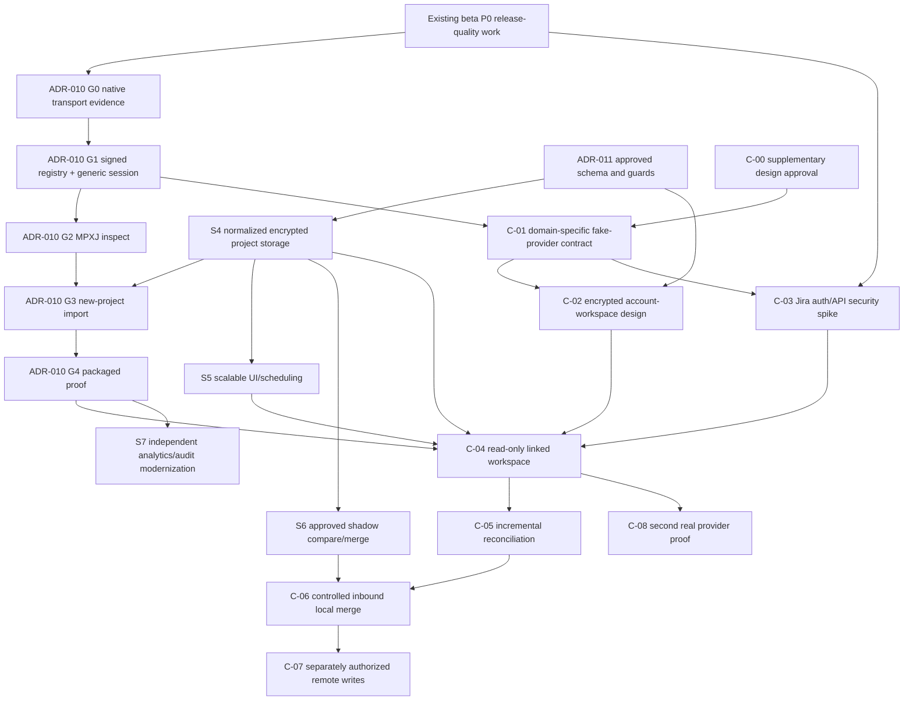

<!--
SPDX-FileCopyrightText: 2026 James L. Burns and The GoPMgr Contributors
SPDX-License-Identifier: GFDL-1.3-or-later
-->

# Provider-neutral integrations (v2): roadmap and test plan

The proposal's roadmap insertion and its test plan; its ADR and contract reference stay separate.

Each section below is a record kept as written, with its headings one
level lower and its links updated; nothing else changed.

## What this file holds

- [Proposed GoPMgr roadmap insertion — provider-neutral integrations](#proposed-gopmgr-roadmap-insertion--provider-neutral-integrations): formerly `docs/design/ROADMAP-provider-integrations.md`, 2026-10-28, from commit `9ab5d91`.
- [Provider integration assurance, adversarial validation and acceptance](#provider-integration-assurance-adversarial-validation-and-acceptance): formerly `docs/design/TEST-provider-integrations.md`, undated, from commit `9ab5d91`.

## Proposed GoPMgr roadmap insertion — provider-neutral integrations

**Status:** framework approved **in principle** on 2026-10-28. A short summary is now in `docs/ROADMAP.md`. The C-00 through C-09 table was not copied into that summary. No implementation work is authorized, and delivery dates are uncommitted.

**Normative architecture:** `ADR-TBD-provider-neutral-integration-framework.md` and accepted ADR-010/ADR-011 after maintainer approval. This plan does not turn proposed gates into completed ones.

### 1. Roadmap precedence and protection of current delivery

At observed `main@ec7b73ab7d913a2398d333f6dad9ea5734ee8f93` (2026-10-28; confirm at each work-package start), the live roadmap prioritizes protecting stateful editor changes, installer/upgrade validation, signing/notarization trust, and accessibility. `docs/beta-release-backlog.md` explicitly defers net-new features unless security/data-loss/release-blocking. **Do not divert active P0 beta work to Jira.** The live `docs/VISION.md` primarily targets 20–500-task small teams; >10k/50k scheduling and cloud integration are program evolution requiring an explicit maintainer-approved vision/roadmap decision. Do not rewrite vision as if already accepted.

**Recommended allocation:** document contract now; implement shared generic foundations as part of *already justified* ADR-010 and ADR-011 work; develop an isolated Jira feasibility spike only after relevant release protection gates; ship read-only Jira only after storage/transport and privacy/auth evidence; defer all cloud writes until selective-merge authority is proven.

### 2. Dependency graph (logical, not calendar scheduling)

**Note:** ADR-010 G1/G2 must not wait on Jira. The Jira spike may experiment on a feature branch with a fake host; it cannot claim production readiness until G4 and the schema/quality gates. DataFusion/Arrow replacement of DuckDB is a **parallel independent track**, not a cloud integration dependency—only tested stable typed analytical interfaces can be consumed. Iceberg is not a prerequisite and must not become an online project database.

### 3. Proposed work packages, deliverables, and release gates

| ID | When relative to existing roadmap | Deliverables | Must be proven before exit | Must NOT do |
|---|---|---|---|---|
| **C-00** | **Now**, design only, parallel to non-disruptive review | Reconcile accepted-in-principle supplemental ADR with repo ADR hierarchy, domain-family contract, threat model, integration/vision impact, named gate owners and change-control ledger | Maintainer performs explicit normative-ADR acceptance or records blockers; classify implementation as NOT RUN | No feature merge, schema migration, plugin marketplace, beta diversion |
| **C-01** | With ADR-010 **G0/G1**, not ahead of them | One shared registry/supervisor/IPC envelope, domain-specific `external-work` contract and signed provider-operation-policy schema, fake adapter (no cloud) | Native IPC for claimed OS/language, signed manifest/policy, cross-version protobuf tests, future-family extension test, no Jira imports in core | No one-size-fits-all `Any` protocol, Jira-specific core, unverified Windows fallback |
| **C-02** | With ADR-011 **S0–S4** design | **Separate account-encrypted integration workspace**, per-project materialization and account credential vault; bindings, source identities, typed observations, checkpoints, schema/version fences, import saga | Tested cross-store crash/duplicate-ack recovery, independent encrypted backup/restore, cipher/foreign key/integrity, old-project compatibility, multi-process fencing, scoped consent/retention | No assumption of cross-DB atomicity; no new writes against legacy charts; no token in project or `system.db` |
| **C-03** | After beta P0 protection, strictly limited isolated spike | Official auth alternatives, Jira enhanced search, scoped metadata/ADF, sparse inventory, eligible bulkfetch, changelogs, rate quotas, fake/test-tenant fixtures, broker bypass/OS threat validation | Auth topology proof or BLOCKED; per-platform Go native IPC independent of MPXJ Java G0; tenant-scoped signed endpoint rules; measured quota and completeness behavior; no public claim | No API-token collection, no client secret in binaries, no redefinition of P0 |
| **C-04** | **After G4 + S4/S5 and C-03 success**; first eligible cloud release | Project-less linked workspace backed by encrypted account store, manual read-only sync, scoped connected/bound views, encrypted caching, pagination, Job Center, provenance/fidelity report and accessible UI | PI acceptance matrix, complete-or-old snapshot atomicity, auth/privacy/retention, power-loss/restore, packaged OS support, measured 50k class with quota attribution | No implicit project creation, automatic schedule mutation, outbound writes, or claimed global Jira snapshot transaction |
| **C-05** | After actual read-only field reliability | Read-only deltas, overlap and inventory repair, fair tenant/app scheduling, cache invalidation, local-only observability, user-selected sync schedules | crash/power interruption, token rotation, 429/5xx, ambiguous 403/404, no false deletes, multi-process lock and duplicate scan recovery | No webhook-dependent correctness or background service by default |
| **C-06** | Only after **ADR-010 S6 compare/merge**, approved ADR-011 shadow generation and C-05 | Field-level inbound compare/selection, explicit mapping changes, dry-run; local canonical apply with immutable receipts | three-way diff, ownership, atomic active-generation switch, old/new version/backup, fresh-approval checks | No implicit Jira->CPM or source-wins field updates |
| **C-07** | Separate maintainer go/no-go after C-06 and G-C-WRITE | Outbox + typed provider writes, first narrow safe operation, re-read confirmation, conflict UX, kill switch | remote unknown-result and race/permissions evidence, usable undo limitations, read/write scope separation, real Jira permission matrix | No unattended mass edits, generic status PUT, exactly-once guarantee |
| **C-08** | **Before claiming general provider-neutral maturity**; after C-04, can run parallel to C-05 | Implement second materially different provider against same external-work contract, signed policies and account-store lifecycle; add one different-family synthetic adapter to test shared registry | No rewrite of host/canonical schema; capability negotiation, auth/scope/retry differences, format/schema migration, 50k-like fixture, shared broker resource fairness | No public SDK/marketplace or arbitrary downloaded third-party binaries |
| **C-09** | Separately approved future | Optional Forge panel/links inside Jira, or third-party marketplace via new ADR | Atlassian Forge compliance and independently reviewed sandbox/remote authority | No legacy Connect investment, no dependency for GoPMgr offline core |

**Sequencing detail:** C-00 can be reviewed now without waiting for G1; C-01 follows demonstrated G1 transport/protocol, and C-02 requires ADR-011 schema approval before any persistence PR. The C-08 test is independent of any outbound-write release: the read-only framework MUST prove a second real provider before it is advertised as generally extensible. If only Jira is shipped, label it **Jira-only, built on candidate neutral interfaces**, not a proven universal connector platform. No C-04 release is allowed to bypass G4/S4/S5; a scope reduction needs a maintainer ACR with independent evidence.

`C-00` stays design review. C-01 onward stays unauthorized, matching `docs/ROADMAP.md` and `docs/review/provider-integrations-v2-critical-review.md`. A Jira Cloud real-data production integration cannot ship until **G4 + S4 + S5 + C-03** are satisfied. C-06 cannot start production code until S6 is actually ready. The merge and controlled write tracks are **not** release promises or license to weaken earlier gates.

### 4. Quality thresholds (proposed until approved hardware/fixtures)

#### Mandatory correctness and durability (zero tolerance)

- No partial staged snapshot presented as complete; no unauthorized local project writes; no cloud writes in read-only mode; no access across local accounts/project copies/Jira sites; no plaintext tokens in worker and persistent project/logs.
- Every `COMPLETE` account-workspace snapshot reopens cleanly with correct field/record counts and independently recomputed digests; staged project imports additionally require project-owned evidence and sealed publication; typed audit chain is intact; old `.gopmgr` files remain usable under explicitly tested migrations.
- Every crash injection cut point yields: prior committed revision or fully committed new revision, never mixed/partial; lost remote write response yields `OUTCOME_UNKNOWN` with no automatic unsafe resend.
- Auth expiry/permission loss or partial search never becomes an automatic delete. A user can stop network and continue local project work.

#### Target scale classes (consistent with ADR-010, not performance claims)

- `T0`: 100–500 realistic work items; accessibility and user-flow correctness.
- `T1`: 10,000 objects, large custom fields/epics/dependency relationships.
- `T2`: 50,000 work items **target**; demonstrate initial plus incremental sync and interactive access on maintainer-approved minimum hardware and an API rate-limited test environment.
- `T3`: 100,000+ work items/large field histories stress only; failure under resource caps must be safe, bounded and clear.
- No fabricated timing or p95; establish per-OS budgets at C-03 using real sample distributions. Profile whole pipeline: OAuth connect, process startup, requests/quota, network bytes, mapping, SQL writes, DB/WAL/checkpoints, RSS, temporary bytes, first paint, scrolling, shutdown, backup and restored reconnect.

#### Cross-cutting compatibility and capacity gates

- **C-GATE-EXT:** a second real provider (C-08) proves the provider interface prior to *provider-neutral production maturity* claims, while an independently simulated analytics/report module proves that shared registry does not force the external-work schema on other families.
- **C-GATE-STORE:** account workspace and project materialization survive 30+ enumerated crash cuts, concurrency/fencing and lost acknowledgment without duplicate projects or cross-account leakage; use verified encrypted restore and unrecoverable-fork/rebind UX.
- **C-GATE-PERF:** budgets measured at minimum and recommended hardware for real fixtures, including max RSS/IPC/in-flight bytes, database page/WAL size, 50k query first paint, quota-limited API wall time, fair scheduling under two connections, cancellations and battery impact. Fail safely on resource caps; do not promise a cloud deadline controlled by Atlassian quotas.
- **C-GATE-PROTO:** two protocol revisions coexist during rolling worker updates, descriptor golden fixtures/reject tests pass, and each signed provider operation-policy can be revoked independently without rebuilding GoPMgr's scheduling kernel.

#### Coverage and fidelity

- Define supported Jira project/issue/Agile functionality by API and enterprise configuration, not marketing claim of full fidelity. Each record-group matrix specifies `read`, `write`, `lossless representation`, `editable`, `exportable`, and tested field families.
- Preserve absent/null/unreadable/forbidden distinctions. ADF text, custom-field schemas, user references and links have their own fixtures; demonstrate no invented conversions to CPM, time or money.
- Verify API, auth, webhooks, and Forge behavior from current primary Atlassian docs before each release. “Blocked” or “not run” is never counted as “passed”.

### 5. Repository and PR cadence (small independent approvals)

1. **Design PR** — accepted-in-principle ADR with explicit final approval state, roadmap/test matrix, review findings and ADR hierarchy reconciliation; no code or implicit acceptance of ADR-010/011.
2. **Contract PR** — generated proto/schema descriptors + fake-provider contract tests, generic G1 provenance, no Jira networking.
3. **Persistence PR** — gated ADR-011 **account workspace and project** schema/migrations, vault lifecycle, import saga, crash fencing, format-version and recovery tests, disabled by default.
4. **Broker/security PR** — account vault and network broker, typed endpoint policy, negative security tests, no actual OAuth until G-C-AUTH approved.
5. **Read-only adapter PR** — first-party Jira worker on fake remote and isolated official test tenant, no shipping flag.
6. **Local linked-snapshot PR** — account-encrypted linked workspace, durable reconciliation and UI browsing with optional, *separately authorized* new-project materialization; existing-project merge excluded.
7. **Release integration PR** — signed packaged tests on each advertised OS, simulated failures, supported-provider claims and human test evidence.
8. **Subsequent work** — C-05+ isolated behind separate ADR acceptance and release flags; never fold future write paths into initial read-only PR.

For each PR publish: changed files, user-observable effects, new schema/proto compatibility, security posture, test IDs, baseline evidence, migration rollback limits, version pins/SBOM/licenses, unanswered BLOCKED gates, and explicit maintainer approval where required. Check `AGENTS.md` and current repository status before implementation. Do not stage or commit unrelated work.

### 6. Decisions requested from the maintainer

1. Authorize C-00 as a **proposed** supplemental ADR and roadmap negotiation, not implementation.
2. Confirm priority: finish current beta P0 and ADR-010 G0–G4 / ADR-011 S0–S5 before **shipping** Jira read-only connector. The architecture may be designed sooner.
3. Decide whether to amend the product vision for larger schedules and optional cloud interoperability while maintaining local-first use and a small-team-quality UX.
4. Commission an independent security/privacy/operating-cost analysis of Atlassian-compliant OAuth topology before C-03 exit.
5. Maintain **read-only first**, and explicitly require S6+remote concurrency proof before any remote write claim.
6. Require a second **materially different real provider** conformance implementation plus a synthetic different-family adapter before declaring general extensibility; Jira may ship beforehand only with accurately narrow claims.
7. Explicitly approve or reject the new account-encrypted integration workspace boundary and separately recoverable project-import saga; this closes the v1 storage contradiction.

**No dates are assigned:** ordering is based on proved dependencies, not speculative calendar estimates. A missed technical gate blocks the dependent feature, not the core application or existing release plan.

## Provider integration assurance, adversarial validation and acceptance

**Status:** framework approved in principle; this is a proposed test plan only and **all 48 PI tests are NOT RUN** until separately executed and evidenced. Zero test passes claimed. **Normative sources:** `ADR-TBD-provider-neutral-integration-framework.md` and the accepted ADR-010/ADR-011 contracts if/when approved.

### 1. Test governance

- Every acceptance claim requires an independent test/oracle, bounded result, dated platform/configuration, tested code SHA, fixture source/license, reproducible seed, toolchain and executable/manifest hash. Use raw evidence and counts; do not mask initial failures with test retries or mark unavailable tests PASS.
- Named environments: Linux x86-64, macOS arm64 and x86-64 where supported, Windows amd64/arm64 where advertised. Per-platform local IPC is a **real packaged** test, not a simulated Linux test. Java MPXJ Windows gate is distinct from Go Jira Windows gate.
- Real test Jira tenant and documented user roles are required; synthetic HTTP fixtures are necessary for adversarial faults but insufficient for public API fidelity, OAuth, quotas or permission guarantees.
- Verify old release/open/backup/restore and current beta regression suites; schema upgrades must be reversible or honestly documented as forward-only with backups. A feature flag off means zero background connector operation.
- Include `go test`, race/fuzz/property tests, frontend accessibility/keyboard tests, service lifecycle tests, SQLCipher fault-injection/hard-kill tests, packaged codesigning/notarization tests, and `make verify`/`make check-release` from repository's authoritative process.

### 2. IDs and independent proof

| Test ID | Failure / invariant | Independent proof and mandatory result |
|---|---|---|
| PI-001 | Connector absent/disabled | Offline core works; no network/auth prompts; previous projects, scheduling, exports unchanged |
| PI-002 | No Jira coupling | Static import and dependency checks forbid `jira` imports in core/host domain; unrelated fake provider passes contracts unchanged |
| PI-003 | Manifest substitution | Modified/symlink-swapped/unsigned worker refused before start; signed release hash matched in each package |
| PI-004 | IPC spoof/replay | Unauthorized/wrong-tenant/wrong-worker/old nonce clients rejected; restricted UDS/npipe permissions/cleanup proven |
| PI-005 | Platform fidelity | Real gRPC HTTP2 over native UDS/npipe with streams, deadlines/cancellation; no TCP/stdio fallback and no unproven Windows claim |
| PI-006 | Same-user risk honesty | Worker has no DB/key/token API; adversarial process has no privileged broker actions; OS confinement claims verified separately |
| PI-007 | Broker route restrictions | SSRF to localhost/private DNS/metadata, redirects, alternate domains, crafted headers, cross-cloudId and unknown verbs rejected |
| PI-008 | Secret boundary | Instrument worker IPC, host logs, backup, crash report, env and project: zero tokens/client secrets; vault encrypted and login-gated |
| PI-009 | OAuth security | Correct state/redirect binding, callback forgery/CSRF prevention, scopes and tenant selection; approved confidential client secret topology proven |
| PI-010 | Refresh failure | Concurrent refresh, token rotation, expired/revoked grant and lost response leave correct persisted state; reauth rather than credential guess |
| PI-011 | Account isolation | A user/account/project copy cannot import/activate another user's site, vault grant or snapshot |
| PI-012 | No direct worker mutation | Inject hostile `canonical update` messages; host rejects; project/audit hashes unchanged |
| PI-013 | Big-data streaming | 10k/50k source data with bounded per-page memory/IPC/storage; inspect no truncation claimed as complete |
| PI-014 | Duplicate/order/resume | Reordered pages, duplicate remote issues, changed page tokens, process kill; stable record IDs/count/digests after retry |
| PI-015 | Snapshot atomicity | Kill process at every durable transition, restart/reopen: either previous complete or next complete revision; never mixed |
| PI-016 | Audit identity | New events and old audit chain independently verify; no history rehash; exact numeric serialization and privacy-safe references |
| PI-017 | Remote eventual consistency | Inject delayed search visibility and changed issue during paging: show uncertainty, reconcile overlap, no invented instant snapshot |
| PI-018 | Deletion vs permission | 403, 404, JQL scope loss, archive/move, revoked grant, true delete tested separately; no blind local deletion |
| PI-019 | Rate-limit/reliability | 429 Retry-After, points quotas, DNS failure, TLS error, 5xx, timeout, offline power loss; last good snapshot persists |
| PI-020 | Field accuracy | Jira custom field schema drift, ADF rich text, parent hierarchy, issue key rename, user IDs, locale/timezone/decimal tests |
| PI-021 | Domain semantic safety | Story points not converted to hours, due date not hard constraint, `blocks` not CPM dependency unless explicit preview approval |
| PI-022 | Copy/backup/restore | Encrypted source evidence and mappings survive, vault tokens do not transfer, restored project cannot dispatch remote writes until rebound |
| PI-023 | Privacy/retention | Data minimization, consent withdrawal, provider retention/purge, encrypted cache, no immutable personal payload in audit |
| PI-024 | UI safety/accessibility | Nontechnical user can connect, inspect coverage, preview, stop, disconnect, purge; keyboard/screen-reader and offline modes pass |
| PI-025 | Outbox crash/replay | Kill before, during and after remote send, lose response: `OUTCOME_UNKNOWN`, no unsafe blind retry, readback adjudication |
| PI-026 | Real racing writer | Two distinct Jira users change same field around approval; automatic remote updates blocked if no provider CAS equivalent |
| PI-027 | Jira workflow | Status transitions use available transition APIs/permissions; no arbitrary status PUT; failed transition does not fake success |
| PI-028 | Security supply chain | Pinned SBOM/licenses, dependency audit, signing/notarization, vuln fix policy, no unsigned replacement masquerading as bundled |
| PI-029 | Field sync granularity | Remote/local/derived/manual_shared ownership enforced per field; three-way compare rejects out-of-date revisions |
| PI-030 | Second provider conformance | Entire fake-other-provider (followed by required real second provider before general maturity claim) operates without core model, supervisor, audit or DB API changes |

`PI-025`–`PI-027` and outbound parts of `PI-029` are **later-release** gates; not required to make a **read-only** release pass. `PI-009` is BLOCKING for real-distributed Jira authentication. `PI-005` must be passed on every **advertised** platform; missing support must be explicitly marked BLOCKED, never silently rerouted.

### 3. Detailed crash and transaction matrix

For both local initial sync and ongoing refresh, inject hard termination/power interruption at each relevant persisted transition:

| Cut point | Expected recovery |
|---|---|
| Prior to first remote request | No new snapshot; no leaked credential; pending attempt expires |
| During a paginated response | Received but unacknowledged data ignored; last complete revision remains active |
| After page staged, before checkpoint | Replay/dedup page; no active partial snapshot |
| After durable checkpoint, before next page | Continue using checked page digest/token or restart bounded window safely |
| After final page, before completeness verification | Staged incomplete; no activation |
| After verification, before revision commit | Old snapshot active; stage recoverable/quarantined |
| During atomic snapshot/audit commit | Either full new revision+audit or old revision, verified on reopen |
| After commit, before success UI | Reopen idempotency receipt; show complete once, no duplicate |
| After credential revocation, before next poll | New lease fails; cached view treatment follows consent/visibility policy |
| After outbound intent commit, before dispatch | Pending intent requires fresh authorization; no remote request |
| During outbound remote HTTP request | Outcome unknown, halt unsafe retry, inspect provider result |
| After Jira commit, before local confirmation | Re-read remote and verify semantic postcondition; may remain unresolved |
| After confirmation, before local receipt | Repeat safe verification; do not send write again |

Use real SQLCipher reopen, backup and independent audit verification; unit-mocking transactions cannot establish power-loss durability. Confirm journal/WAL behavior on minimum supported filesystem and platform; state limits of simulated sudden power cut versus real controlled power-loss testing. Do not claim absolute stability across arbitrary storage hardware failures.

### 3a. New high-severity contract, isolation, consistency and recovery cases (v2 review)

| ID | Mandatory independent test | Required outcome |
|---|---|---|
| PI-031 | Account linked workspace exists with **no** project and local encrypted state is reopened offline | No implicit project creation, no plaintext cache, explicit stale status |
| PI-032 | Crash after sealed project publication but **before** account workspace acknowledgment | Locate receipt by operation ID and reconcile once, no duplicate published project |
| PI-033 | Delete/revoke account workspace and restore independent project backup | Project keeps its own provenance/evidence and works offline; link requires rebind |
| PI-034 | Two app processes/profiles attempt same binding at once; kill lease owner and skew wall clock | File/OS lock plus durable generation fences stale writer; only one promoted revision |
| PI-035 | Swap/tamper signed provider operation policy, manifest, worker or endpoint template | Reject policy/digest mismatch; no arbitrary URL, JQL, header or network escalation |
| PI-036 | Compromised same-user bundled worker directly opens a socket or reads another local file | Report actual OS enforcement or record trusted-process residual access; never claim broker enforced egress if it did not |
| PI-037 | Register a second real work provider with different rate, auth, tenancy and field model | No core schema/scheduling API changes, compatibility tests pass; no Jira-only assumptions |
| PI-038 | Register fake analytical/report plugin family using shared registry/supervisor | No reuse of work-provider protobuf for unrelated business data, host authority retained |
| PI-039 | Mixed minor/major protobuf versions and unknown enum/field; retire policy digest | Backward-compatible negotiated capability or fail closed; no silent writes |
| PI-040 | Multiple Jira issues have identical updated timestamps, change membership mid-page, cursor expires | Re-scan/dedup; no false snapshot completeness or missed record silently reported |
| PI-041 | 50k sparse inventory with selective ADF/custom field hydration and rate limits | Bounded memory/disk, truthful field fidelity, cost/quota accounting, performant local paging |
| PI-042 | Two connectors consume shared API quota, CPU and disk under backpressure | Fair bounded work; no starvation or resource runaway; offline UI remains responsive |
| PI-043 | Receive 429 for global points, burst and per-issue writes; Retry-After and quota reset | Appropriate per-budget cooldown, typed reason codes, bounded retries |
| PI-044 | Remote write returned ambiguous result, identical field value posted by another actor | No false causal confirmation; `POSTCONDITION_OBSERVED` distinct from correlated commit |
| PI-045 | Project and account workspace migrated to incompatible next-version schemas | Correct independent writer fences; encrypted backup; safe read-only/upgrade path |
| PI-046 | Revocation/erasure during staged import and old-snapshot retention | Enforce policy while preserving user-owned schedule, protected audit continuity and proper redaction |
| PI-047 | Key recovery, password rotation, admin/escrow cases for account vault/workspace | No plaintext tokens, no orphaned decryption state; paths consistent with existing ADRs |
| PI-048 | Signed app upgrade invalidates provider policy and connector API changes | Feature disabled safely; previous offline snapshot still browsable and repairable |

### 3b. Test evidence contract

For each PI test record fixture ID and raw digest, test seed, source/baseline commit and schema version, OS/arch/installer, adapter and policy hashes, actual execution commands, observed assertions, p50/p95 sample size when applicable, outcome (`PASS/FAIL/BLOCKED/NOT RUN`) and reviewer. A mock OAuth/HTTP server proves shape, *not* compliance with official Atlassian production OAuth or real tenant quota. Failure injection needs post-crash independent verification from a clean process; rerunning to green is not sufficient. A partial integration roll-out cannot inherit proof from ADR-010 MPXJ tests without evidence of the distinct Go worker and cloud API paths.

### 4. Performance evidence format (predeclared, no invented numbers)

For each `T0/T1/T2/T3` case record: OS, CPU, RAM, drive, bandwidth/latency, Jira tenant entitlements, user scopes, field population, work hierarchy depth, relationships, ADF/custom field payload, real/synthetic ratio, records changed per run, number of API requests, 429 count, bytes exchanged, full process RSS peak, CPU and wall duration distribution, local SQL DB/WAL/temp size, authenticated worker startup/cancel latency, consistency-pass duration, row-paging first paint and scroll latency, accessibility regression status.

Before a release, approve explicit budgets for: memory per live connector, max staging growth, max retry/time, 10k/50k sync completion and interactive first paint. Publish p50/p95 only with adequate measured samples and methodology; distinguish cold/warm cache, provider rate-limit effects, and total wall time. Stress may exceed target within **safe bounded failure** limits; label it correctly.

### 5. Adversarial review checklist and forced negative tests

- Security reviewer attempts credential exfiltration, fake worker registration, user account switch race, provider-cloudId spoofing, SSRF, HTTP redirect and log injection.
- Data reviewer attempts implicit semantic conversions, duplicate cloud identities, regenerated Jira issue keys, overwritten user-edited fields, broken source lineage and audit rewrites.
- Reliability reviewer injects disconnect/retry, process kill, token expiry, malformed ADF/custom fields, 429 under partial resume, staging collision, disk full, crypto integrity failure and bad filesystem permission.
- UX/accessibility reviewer tests paused, offline, not authorized, partially scoped, conflict and quarantine states without relying on color-only status or inaccessible virtualized views.
- Maintenance reviewer tests a second fake provider and protobuf previous-major/minor compatibility, protocol downgrade rejection, reproducible signed packaging, no unreviewed license changes, and code/doc/test drift.

**Stop rule:** any security, identity, data-loss, token, cross-project, false completion, or audit-integrity failure blocks the affected release. A failed Windows transport test blocks that connector on that target rather than inviting an agent to silently replace gRPC with TCP or stdio. An incomplete dataset is not success. A single green rerun without investigated original failure does not clear a gate.
