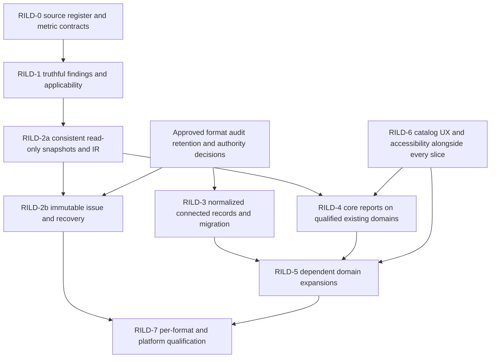

<!--
SPDX-FileCopyrightText: 2026 James L. Burns and The GoPMgr Contributors
SPDX-License-Identifier: GFDL-1.3-or-later
-->

# Reporting and extension implementation sequence

**Status:** Integrated planning baseline, 2026-11-13, source `ac20cbe711d9c03479cf937d82c5b7da991454d3`.
The owner requested this documentation integration. The RILD source records approval
of workstream establishment; detailed ADRs and new implementation slices remain
proposed. No runtime, schema, dependency, financial-policy or release authorization
is created by this plan. Existing conditional G1 authorizations retain their scope.

Main synchronization reviewed against `22b7df1` (PR #213): KRN-02 is fixed;
KRN-01 and remaining findings UI work stay open. The archived inputs and companion
DOCX retain their stated original review baseline, not current implementation status.

## Read and decide before coding

1. Read live `AGENTS.md`, `docs/STATUS.md`, `docs/ROADMAP.md`, the applicable accepted
   ADR and owner records. Record HEAD, working changes and drift from this baseline.
2. Read [ADR-014](../ADR-014-reporting-integrity-and-lifecycle.md),
   [ADR-015](../ADR-015-secure-extension-platform.md), the relevant rows in
   [requirements.json](requirements.json), and the
   [verification strategy](../../testing/reporting-extension-assurance.md).
3. Select one bounded slice and its exact requirement IDs. Assign an implementer
   and independent reviewer; identify governing decisions, authoritative facts,
   schema ownership, target formats and platforms, prohibited effects and test IDs.
4. Record authorization separately from design acceptance and evidence. A draft
   table, existing source path, shared generated calculation or passing build is
   not qualification. Obtain missing product, format, audit, retention, financial,
   trust, confinement and support decisions before dependent code.
5. Review the plan independently, implement the smallest complete slice, execute
   independent positive/negative oracles, challenge the finished work, update the
   register and current status with exact evidence. Do not weaken assertions to
   declare a slice complete. Preserve all existing report capabilities and inputs.

## Reporting dependency graph

This is a dependency graph, not a blanket serial waterfall. Host-native reports
whose authoritative inputs already exist may qualify without normalized writes,
MPXJ, Wasm, an SDK or an external registry. A report that needs missing connected
records must wait for those domain gates. Each slice explicitly lists which
RILD-3 dependencies apply; it may not infer missing data or silently narrow scope.

| Slice | Required outcome and prerequisites | Exit evidence and prohibited shortcuts |
| --- | --- | --- |
| RILD-0 | Rebase the 120 explicit requirements, eight expanded families and 17 architecture contracts; maintain metric definitions and 16 fixture specifications. | Every original ID and source row retained; owner and applicability assigned; decisions and qualification gaps explicit. Documentation integration is not runtime gate passage. |
| RILD-1 | Surface read-only PS-02 findings and truthful missing/unsupported/stale states; name cutoff, baseline and calculation version. KRN-01 remediation requires separately authorized kernel work; retain the KRN-02 regressions fixed in PR #213 (`22b7df1`). | Q1/Q2 oracles reject unsupported semantics, false green status, unavailable-to-zero conversion and partial reads. Never alter scheduling results inside reporting/audit work. |
| RILD-2a | Capture consistent existing records in one project read transaction or verified immutable revision set; use a per-project vector for a portfolio. Compile and render the same typed IR. | Q1–Q4 as applicable; T-X01 and concurrency cases prove findings, calculations and outputs use identical revisions. No fictitious global transaction or unbounded read lock. |
| RILD-2b | Design and implement immutable issue packages, exact approvals, retained bytes and recovery only after approved storage/retention/authority contracts. Coordinate DEC-FORMAT and DEC-AUDIT. | Q3/Q5, T-D01/T-X01: crashes at every durable boundary; incomplete staging never issued; repeat requests/receipts cannot double issue. A PDF-only export remains distinct from a committed issue. |
| RILD-3 | Connected schedule/WBS/assignments/baselines through ADR-011 and ARC-01–08, PS-01/04/05, with format, audit and hardware decisions. | Migration/recovery, older-writer protection, source loss inventory and exact reconciliation. No incidental schema change to make a report easier. |
| RILD-4 | Status, progress, schedule, EVM, risk and document reports on qualified domain inputs, with reviewable RAG and narrative. | Applicable Q1–Q6, independent T-S/T-F fixtures and per-format semantic/visual parity. Report definitions cannot recalculate source facts in a renderer. |
| RILD-5 | Full remaining catalog: lifecycle records, time/usage PS-06, financial/commercial PS-07 and Cost Control Phase 2, Agile/quality, portfolio/program, specialized and assurance reports. | Every retained requirement and each distinct expanded capability receives a bounded contract and oracle. Do not claim an entire family complete from one template. Domain and privacy gates precede dependent claims. |
| RILD-6 | Report Center, saved definitions, filters, audience variants, help, review/issue flows and accessibility with each delivered family. | Q4/Q6 representative installed tasks, draft preservation, keyboard/screen reader/zoom, exact preview/issued output; no last-phase-only UX. |
| RILD-7 | Independently qualify each claimed format, platform, workload and report profile. | Q1–Q8 applicability and evidence, exact revisions/builds/data hashes, 50k editable/100k stress where applicable, installed supported platforms and publication/signing proof. No date-based release. |

## Extension paths and reporting integration

| Gate | Dependency and permitted planning outcome | What remains blocked |
| --- | --- | --- |
| EX0 | Map EXT-Q01–10/D01–14 to accepted ADR-010/011 and domain-family contracts; threat review and budget/support decisions. | New runtime dependencies or production execution without a separately approved slice. |
| EX1 | Reuse the existing ordered G1 foundation and its current conditional owner authorization, including P04-D1–D8. Keep native interchange and domain work separately gated. | Production qualification is not established by dependency pins or G0 spikes; no MPXJ import or arbitrary native loader implied. |
| EX2 | Separately authorized isolated comparison of candidate Wasm runners, or documented disqualification of one; equivalent required semantics and host budget tests. | No engine/ABI/SDK selected by prose, no dual production runtime or automatic fallback. |
| EX3 | Qualify restricted guest and independently enforced OS runner confinement before untrusted loading/compilation; bound the whole pipeline. | EXT profile E2 unavailable on unqualified targets; no support-policy downgrade or unconfined fallback. |
| EX4 | Qualify applicable read-only and mutating extension results against cross-language semantic vectors, exact arithmetic, provenance, scope, snapshot consistency and stale/revoked leases. Project mutations additionally require approved host command/revision/receipt/recovery contracts and applicable ARC-04/DEC-FORMAT/DEC-AUDIT gates. | No plugin SQL, direct project writes or reuse of arbitrary App methods as a public command API. Read-only reporting does not inherit these write privileges. |
| EX5 | Qualified package verification, trust/revocation/offline freshness, TOCTOU-safe loading, state migration and compatibility. | No public installation/update, package format or trusted signer selection without approval and evidence. |
| EX6 | Representative workloads, tail latency/soak, signing/licensing/SBOM, accessibility and independent adversarial review on installed targets. | No public executable ecosystem, marketplace or SDK stability promise until explicitly approved. |

EXT profile E0 declarative layouts still require bounded schema validation, safe
assets/escaping and resource contracts; existing templates are not automatically a
public extension API. EXT profile E1 bundled native work uses ADR-010. EXT profile E2
community Wasm requires the independent runner and guest controls. EXT profile E3
community native remains deferred. None is a RILD evidence level.

A report may consume an extension observation only when both its domain report
contract and the applicable execution profile are qualified. Keep imported facts,
host-derived results, stochastic estimates and management commitments distinct.
Signing and permission to execute are separate; no signature grants data authority.

## Decisions and change control

| Decision | Required before dependent work |
| --- | --- |
| DEC-FORMAT / DEC-AUDIT | Persistent revision/issue schemas, host write commands, migration and audit-bridge choices; retain historical bytes and readers. |
| DEC-HARDWARE / OWN-10 | Actual workload/host profiles and approved numeric resource/latency budgets. Candidate EXT numbers are not product limits. |
| DEC-INTEROP / DEC-WINDOWS | Applicable import fidelity, installed transport/platform qualification and support policy. |
| RILD policy decisions | Revision/approval roles, separation of duties, retention/disposition/legal holds, restatement, finance recognition/FX/reserves, shared resource identity and portfolio coverage. |
| EXT policy decisions | Runtime/ABI/reference SDK, package/trust format and signer roots, offline age/revocation recovery, containment mechanisms, state retention and public launch scope. |

Architectural changes require an ACR against the accepted target. Keep original
proposals and historical owner decisions unchanged; amend current canonical plans
with rationale and evidence. A later source change reopens affected qualification;
a past report retains its original evidence and issued bytes.
