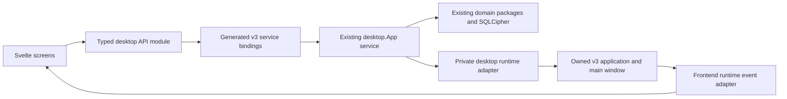

<!--
SPDX-FileCopyrightText: 2026 James L. Burns and The GoPMgr Contributors
SPDX-License-Identifier: GFDL-1.3-or-later
-->

# Wails v3 migration design

Status: **Approved for implementation on 2026-11-03; release approval remains separate.** Inspected
2026-11-03 at `e193e993c1dd6972ed9b72a4c1758d06580f1a3c` on
`fix/import-mixed-integer-precision`. That commit is an independent import
precision fix; preserve it and reconcile its merge status before branching.
The working tree was clean before these planning documents were written.

## Goal and decision

Migrate GoPMgr from Wails v2.17.0 to **v3.1.0**, the latest stable release
reported by GitHub's live releases API on 2026-11-03 (published 2026-11-01,
not a draft or prerelease). The matching npm `@wailsio/runtime` 3.1.0 exists.
Pin the Go library, CLI and frontend runtime together. Refresh release and
advisory metadata before execution; a newer target requires a reviewed plan
update, not an unrecorded `@latest` substitution.

Recommend staged implementation on one migration branch, with one final
cutover PR after local verification. This is a desktop-runtime migration,
not a product redesign. The owner has directed implementation of this migration. Necessary isolated
local tooling and dependency changes follow the approved work; publication,
hosted CI and release remain separately controlled.

| Approach | Tradeoff | Disposition |
| --- | --- | --- |
| Direct dependency bump and mechanical API replacement | Fast initial compilation; misses native lifecycle, wire and packaging contracts | Reject |
| Qualified shell, service/bindings transition, then packaging and cutover | Tests the highest-risk boundary first; one final release candidate | Recommend |
| Retain or fall back to v2/GTK 3 | Does not meet the forward migration direction | Rejected by the maintainer on 2026-11-03 |

## Current architecture and migration surface

- Root `main.go` embeds `frontend/dist` and calls `desktop.Main(assets)`.
  `internal/desktop/app.go` dispatches CLI/headless operations before GUI
  setup; then creates the store and starts Wails. Preserve this separation.
- `internal/desktop.App` exposes **209 methods**, enumerated in
  `code-map/app-api.json`. Preserve method names, arguments, result/error
  meaning and JSON field names. A JavaScript transport change is expected;
  it must not silently change the application's API semantics.
- A source scan found `window.go` in 66 frontend source/test/declaration
  files, including three test files. This is an inventory snapshot, not a
  count of required edits. `frontend/src/wails-window.d.ts` duplicates the
  injected bridge types. Runtime access also occurs in the root component.
- Go runtime imports occur in app setup, charts, projects, foundation,
  fonts, export destinations and recovery-code file handling. The last two
  have injected dialog seams typed with v2 options; migrate those seams too.
- Lockfile versions are Svelte 5.57.3, Vite 8.3.5 and TypeScript 6.0.3.
  Retain them initially. Add only the pinned Wails frontend runtime needed
  for this migration; inspect resulting transitive dependency changes.
- Build, installer, notice and version gates assume v2 CLI commands,
  `wails.json`, production tags and `build/bin`. These are contracts to
  migrate, not files to overwrite with an upstream template.

## Proposed target boundaries

1. Keep root asset embedding and the `internal/desktop` package. Register
   the existing App as a v3 service; do not split 209 methods into domain
   services during this change. Keep lifecycle plumbing private or outside
   the bound method set so it does not expand the callable API accidentally.
2. Introduce a small private Go runtime adapter for the operations actually
   used: dialogs, events, quit and window/menu actions. Own the main window
   explicitly; do not select an arbitrary current window for a file export.
   Domain methods continue using the existing locking and admission rules.
3. Keep a lifetime-owned cancellation context. A per-call context may bound
   that call but must not replace the App's lifetime context. Assign one
   owner for session-key cleanup, database closure and startup-failure
   cleanup; prove ordering against outstanding calls, not only normal quit.
4. Replace global `window.go.desktop.App` use with a typed module namespace
   in `frontend/src/lib/desktop-api.ts` backed by generated bindings. Prefer
   a namespace re-export over hundreds of forwarding functions. Discover
   the actual generated path with the pinned generator. Do not invent it,
   assign a fake compatibility object to `window`, or use `any` casts.
5. Put v3 event subscriptions and envelope conversion in
   `frontend/src/lib/desktop-runtime.ts`; preserve event names and payload
   contracts and return the real unsubscribe function. Use `event.data`
   deliberately. Do not replace save/discard state or autosave as part of
   adapting the transport.
6. Retain one window, 1280x800 initial and 800x600 minimum dimensions,
   menus, keyboard shortcuts, typography, themes, fonts and branding.
   Multi-window, tray features, mobile/server modes, experimental purego,
   experimental YAML builds and adoption of Wails' updater are out of scope.
   Preserve GoPMgr's existing signed update-manifest mechanism.

## Native-close and shutdown contract

This is the first qualification gate. Current v2 `beforeClose` returns true
when closing must be prevented. v3 `ShouldQuit` returns true to allow quit:
copying the old callback directly would invert the safety decision.
The tagged v3 source also has a distinct `WindowClosing` hook and explicit
window destruction; do not infer every trigger takes the same path.

Trace close button, Cmd+Q, application-menu Quit, frontend completion,
Linux quit/menu/window paths, `QuitToInstallUpdate`, SIGINT/SIGTERM and
startup failure separately.
Use a single close coordinator. Require non-blocking hooks, listener-before-
guard readiness, request deduplication, Save/Discard/Cancel, failed-save draft
preservation, and safe retry. Define authorization consumption only after
tracing both hooks: two callbacks must not consume the same one-shot permit
twice, and a cleanup-driven window close must not restart the prompt.
No unconditional raw runtime quit may bypass this contract. Uncatchable process
termination cannot promise draft recovery; document that boundary explicitly.

The proposed state model is shared by every close entry point:

| State | Request/outcome | Required transition/effect |
| --- | --- | --- |
| Bootstrapping | Close before listener readiness | Allow termination; clean up anything already acquired; never trap a failed launch |
| Ready | Any user/update close request | Awaiting decision; veto native destruction and notify the frontend once |
| Awaiting decision | Duplicate request / Cancel | Deduplicate / return to Ready with a usable window and intact draft |
| Awaiting decision | Save / Discard | Saving / Approved, using the existing editor's successful-discard contract |
| Saving | Save fails / succeeds | Awaiting decision with error and draft retained / Approved |
| Approved | Matching quit/window callbacks | One coordinated exit, no second prompt or double consumption; do not authorize unrelated future requests |
| Shutting down | Terminal exit begins | Stop admission, resolve active work, then clear keys and close stores exactly once |

A failure before terminal shutdown must revoke pending authorization and leave
safe recovery available. If the runtime cannot satisfy these transitions,
record the counterexample and stop. Shell tests must prove no windowless live
process remains after approved quit, and no successful installer handoff can
bypass save/discard/cancel through `QuitToInstallUpdate`. Do not change the
existing download/launch-before-explicit-quit update sequence in this migration.

`NewApp()` currently acquires the system store before Wails starts. An
idempotent lifecycle owner must therefore also cover successful construction
followed by failed application/window/service startup; service shutdown alone
is not a sufficient cleanup strategy. The v3 service contract guarantees
shutdown notification after startup notification, not before it. Test every
acquisition/failure boundary with real disposable stores.

Keep OS/window calls outside database/session locks when callbacks could
re-enter. Establish cancellation, in-flight dispatch draining and key/database
cleanup order from the pinned source and native tests. Do not assume v2's
comment that dispatch stops before shutdown still describes v3.

## Build and platform design

Keep Make targets as the maintainer interface. Use explicit, reviewed v3
Taskfiles and `build/config.yml` underneath; retain existing GoPMgr packaging
wrappers. The general migration page's configuration example is insufficient:
the build guide and v3.1.0 templates use Taskfiles, and v2 build flags are not
interchangeable with v3 flags. Map v3 output explicitly back to `build/bin`
or update every consumer atomically; prefer preserving that path.

Retain Go 1.27.3 and CGO. v3.1.0 declares Go 1.26.0/toolchain 1.26.10;
this is not a reason to lower GoPMgr's requirement. Retain macOS 13 minimum
and Apple Silicon priority; override upstream template macOS 12 deployment
settings in owned tasks and verify the resulting Mach-O/bundle metadata.

The maintainer directed on 2026-11-03 that this plan include the **GTK 4
upgrade**. Linux therefore targets Wails v3.1.0's standard CGO backend:
`gtk4` and `webkitgtk-6.0` pkg-config modules, verified in the tagged
`linux_cgo.go`. Do not select the legacy `gtk3` backend or assume v2's
`webkit2_41` tag applies. Update build, binding-generation, test and package
configuration together; a failed GTK 4 gate does not authorize a GTK 3 fallback.

On Debian/Ubuntu, qualify `libgtk-4-dev` and `libwebkitgtk-6.0-dev` for building,
and `libgtk-4-1` and `libwebkitgtk-6.0-4` for installed runtime dependencies.
Verify target-repository versions and the built ELF's dependency requirements;
these names alone do not establish compatible minimum versions. Derive RPM
requirements from the target distro's providers and built artifact, rather
than copying Debian package names. Inspect transitive WebKit/JavaScriptCore
requirements and update package manifests, installation docs and local/CI
provisioning recipes. Local migration tooling stays isolated; hosted-CI
execution and runner changes require their own authority.

The core shell gate covers rendered frontend, native close/quit, dialog
cancellation, Save/Discard/Cancel/retry and resource lifecycle on available
macOS and Ubuntu hosts. Remaining production UI, accepted file selection,
Wayland where advertised, HiDPI, keyboard focus/shortcuts, clipboard, input
methods, accessibility and packaging checks remain mandatory at cutover.
Minimum-OS execution remains mandatory before release. Test the declared
minimum Linux target on a clean environment; Ubuntu 26.04 execution alone
does not qualify Ubuntu 24.04.
If required packages or runtime behavior fail on an advertised distro, stop
for a release-matrix decision rather than silently raising the OS floor.

Upgrade an installed v2/GTK 3 package to v3/GTK 4 with disposable existing
accounts/projects. Verify dependency resolution, encrypted-data preservation,
launch and removal; do not remove shared GTK 3 libraries used by other apps.
Do not downgrade the runtime as a recovery strategy. Qualify restoration of
verified backups into the new runtime using disposable copies; retain shared
system libraries without selecting the legacy backend.

Windows is lower priority, not silently removed from the advertised package
or release-gate matrix. Require native Windows WebView2 startup, close/quit,
dialogs, installer lifecycle and encrypted-project reopen for an advertised
Windows candidate. Missing evidence blocks that platform pending an explicit
release-matrix decision.

Preserve application identifiers, user data paths, version/linker metadata,
icons, GPL text, notices, PDF fonts/ICC assets, installer data-preservation and
moved-app rules. Adapt signing/xattr handling only after examining v3 output.
Do not change existing trust claims or enable new entitlements by default.

## Verification and stop gates

| Risk | Required acceptance evidence |
| --- | --- |
| Lost edits or trapped close | Real macOS Save/Discard/Cancel and save-failure/retry for close button and Cmd+Q/menu; repeated quit and startup-not-ready cases; analogous Linux evidence |
| Binding/DTO drift | Reproducible clean-checkout generation and full 209-method name/signature inventory plus representative real round trips for exact money, timestamps, nulls, arrays/maps, bytes and returned errors; explicit review for every difference |
| Event mismatch | Actual backend-to-frontend delivery and unsubscribe/reload checks; no duplicate menus or close listeners |
| Cleanup races | Race tests plus native in-flight-call, shutdown and startup-failure evidence; no premature store close or session use after key clearing |
| Blank production window | Packaged native first render, assets/fonts, generated binding invocation and disconnected/offline launch |
| Trust-boundary regression | Packaged allowed-origin/asset boundary, path confinement, external-navigation policy and error/diagnostic redaction; no added public server or remote bridge |
| Linux GTK 4 regression | Clean minimum-target GTK 4/WebKitGTK 6.0 installation and actual dependency inspection; X11/Wayland where advertised, dialogs, focus/IME/clipboard/accessibility and native close; v2-to-v3 package upgrade and backup restoration into v3/GTK 4 |
| Packaging or recovery loss | Native install/upgrade/remove evidence with disposable existing data; unchanged identifiers and paths; backup recovery on copies with v2-created encrypted projects/account metadata, v3 save/reopen and interrupted-write recovery; no new storage migration |
| Release-compliance drift | Fresh module/frontend notices and SBOM, vulnerability review, REUSE and package content gates; no assumed clearance from a successful build |

Implementation was approved on 2026-11-03. Qualification failures must be
fixed forward; do not select a v2/GTK 3 fallback. The shell gate must
pass before broad binding conversion. Stop on unknown close/cleanup behavior,
wire incompatibility, missing native target evidence or a platform-policy
change. No storage/schema changes are planned. If one becomes necessary,
stop for a separate migration/recovery design and approval.

## Rollout and evidence limits

Use reviewed local commits, one migration integration branch and one final
PR after local macOS and local Ubuntu qualification, plus native Windows qualification if
Windows remains in the cutover release matrix. Preserve verified backups for data recovery; do not plan a runtime downgrade. Do not execute v2 and v3 against the same live account or
project files simultaneously; native probes use disposable homes/copies.
Hosted CI, publication and release remain separately authorized operations.
Capture timings/memory for comparison without promising an unmeasured speedup;
set any new acceptance budget before using it as a gate.

The isolated shell's implementation results are recorded in the
[migration evidence](../testing/wails-v3-migration-evidence.md). Production
conversion is implemented on the migration branch. Native bridge/dialog checks
pass on available hosts; local package evidence is recorded separately. Final
independent integration review, comparative benchmarks and release/platform
qualification remain open.
The owner approved deferring macOS 13 and Ubuntu 24.04 execution to the
mandatory release gate because no such test hosts are currently available.
Development may continue on the available hosts without claiming compatibility
with untested versions. Prior v2 results do not qualify v3.

## Sources

- [Stable release v3.1.0](https://github.com/wailsapp/wails/releases/tag/v3.1.0),
  checked with the live `/releases/latest` API; npm registry metadata checked
  for `@wailsio/runtime` 3.1.0.
- [Official migration guide](https://wails.io/migration/v2-to-v3/): application,
  services, bindings and event transition overview; its examples use v3.0.0.
- [Build system](https://wails.io/concepts/build-system/): Taskfile/configuration
  and CLI differences; check the tag for executable details.
- [Lifecycle](https://wails.io/concepts/lifecycle/),
  [window events](https://wails.io/features/windows/events/) and
  [runtime events](https://wails.io/reference/frontend-runtime/).
- [Tagged application code](https://github.com/wailsapp/wails/blob/v3.1.0/v3/pkg/application/application.go),
  [options](https://github.com/wailsapp/wails/blob/v3.1.0/v3/pkg/application/application_options.go),
  [service lifecycle](https://github.com/wailsapp/wails/blob/v3.1.0/v3/pkg/application/services.go),
  [window implementation](https://github.com/wailsapp/wails/blob/v3.1.0/v3/pkg/application/webview_window.go),
  [GTK 4 CGO boundary](https://github.com/wailsapp/wails/blob/v3.1.0/v3/pkg/application/linux_cgo.go)
  and [platform build templates](https://github.com/wailsapp/wails/tree/v3.1.0/v3/internal/commands/build_assets).

- [Linux installation](https://wails.io/quick-start/installation/) and
  [Linux packaging](https://wails.io/guides/build/linux/): GTK 4/WebKitGTK 6.0
  development and runtime dependency guidance; native qualification remains required.

## Delivery sequence

1. Freeze the current contracts and isolated qualification environment.
2. Prove the native shell's close and cleanup behavior on macOS and Linux.
3. Migrate the existing Go service and generated bridge with a minimal local
   build/run path available immediately.
4. Move frontend callers/events with unchanged screens and save recovery.
5. Complete packaging, pin/provenance gates and required generated metadata.
6. Finish source/documentation cleanup, commit and freeze the candidate, then
   qualify that exact tree and review it before one final cutover PR. Any
   later shipped-file change requires a new candidate and affected checks.

The detailed maintainer execution checklist is local-only at
`docs/superpowers/plans/2026-11-03-wails-v3-migration.md`, following this
repository's ignore policy. It is intentionally not a link a normal clone
would be expected to resolve. The sequence above is the portable public plan.

## Implementation findings and owner decision (2026-11-04)

The production host drains complete runtime HTTP responses before native quit,
with the UI loop still running. Native `OnShutdown` performs cleanup without
joining UI-dependent response handlers. Native About dialog ownership follows
dismissal, because `Show` is asynchronous. The owner approved separate OK and
Cancel buttons so Return and Escape both work through the pinned public API;
the App and Help menu entries share that owned dialog. These findings refine
the lifecycle design without changing the 209-method domain API or data formats.
